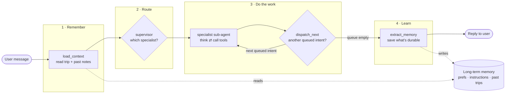
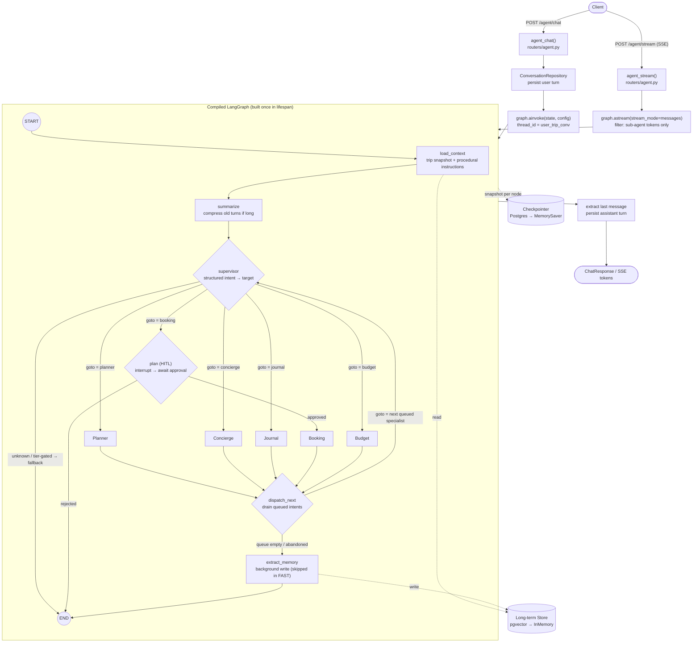
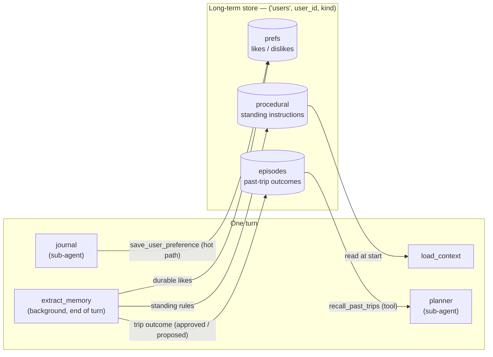
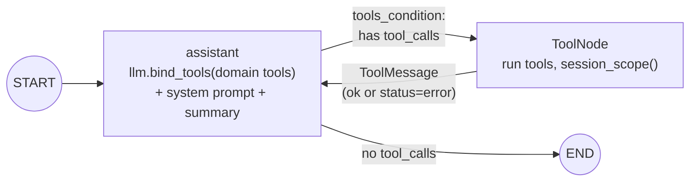
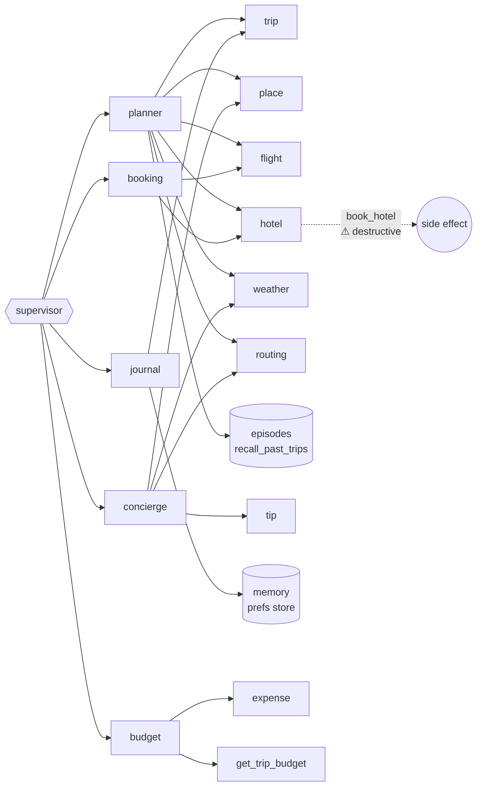

# Travel Agent — Chatbot Flow Diagram

Backend agent flow. Companion to `WORKFLOW.md`, which is the authoritative text.
Render with any Mermaid-aware viewer (GitHub, VS Code Mermaid preview, mermaid.live).
Last verified: 2026-07-01; the reflection node was removed from these diagrams in #112.

> Known drift, pre-dating #112: `extract_memory` is drawn as an in-graph node with a
> "skipped in FAST" note. It is neither — it runs as a background task after the
> response (`memory/extraction_runner.py`), and modes were removed in MIN-43. Trust
> `WORKFLOW.md` where the two disagree.

---

## 1. The big picture (simple view)

One user message travels through the graph left-to-right. It **reads** long-term
memory on the way in, **does the work** in the middle, and **saves** new memory on
the way out.

**In words:**

1. **Remember** — `load_context` pulls the active trip snapshot and the user's
   standing instructions from the store, so the agent starts with context.
2. **Route** — `supervisor` reads the message and picks one specialist
   (planner / concierge / journal / booking / budget).
3. **Do the work** — the specialist runs a *think ⇄ use-tools* loop until it has an
   answer; `dispatch_next` then runs any further intent the supervisor queued for
   this turn before the turn ends.
4. **Learn** — `extract_memory` runs in the background after the turn and saves any
   durable preferences, standing instructions, and trip outcomes for next time.

---

## 2. End-to-end flow (full detail)

---

## 3. Memory lifecycle (read + write)

Long-term memory lives in one store, namespaced per user as
`("users", <user_id>, <kind>)`. Three kinds, each read and written at a different
point in the turn.

- **prefs** — durable likes/dislikes. Written explicitly by the journal tool
  `save_user_preference`, and in the background by `extract_memory`.
- **procedural** — standing instructions ("always book aisle seats"). Read by
  `load_context` into the system prompt; written by `extract_memory`.
- **episodes** — per-trip outcomes. Recalled by the planner via `recall_past_trips`
  so it adapts instead of planning from scratch; written by `extract_memory` with
  `outcome="approved"` when the plan passed the HITL gate, else `"proposed"`.

> `extract_memory` is **best-effort and gated**: it is skipped entirely in FAST mode
> (`allow_memory_write=False`), and any write error is swallowed so a failed
> extraction never breaks the reply.

---

## 4. Sub-agent ReAct loop (each specialist)

## 5. Sub-agent → tool-domain map

## 6. Tool inventory by domain

| Domain | Tools |
|---|---|
| trip | `get_trip_summary`, `get_trip_budget`, `list_trip_places`, `add_place_to_trip`*, `add_itinerary_item`* |
| place | `search_places`, `nearby_places`, `resolve_place`, `parse_nl_query`, `list_place_categories` |
| flight | `search_flights` |
| hotel | `search_hotels`, `book_hotel`† |
| weather | `get_weather`, `get_packing`, `get_air_quality` |
| routing | `get_route`, `get_city_route` |
| tip | destination tips lookup |
| expense | `add_expense`*, `list_expenses`, `expense_summary` |
| memory | `save_user_preference`*, `get_user_preferences` |
| episodes | `recall_past_trips` |

`*` write · `†` destructive
