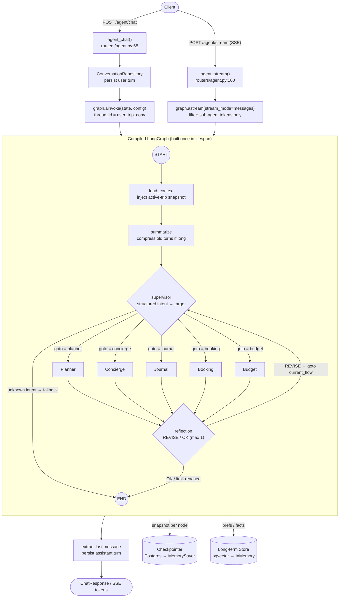
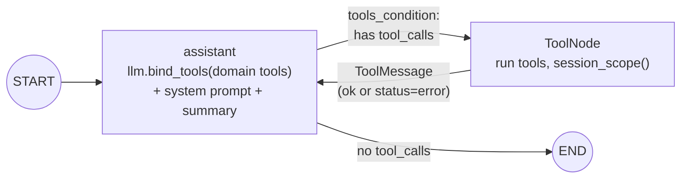
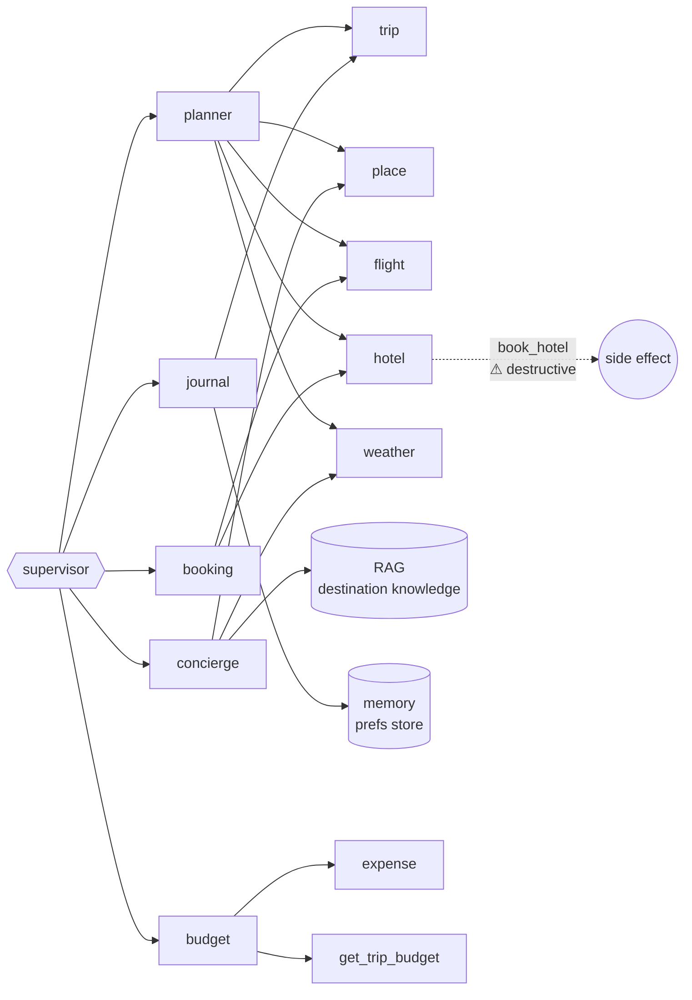

# Travel Agent — Chatbot Flow Diagram

Current backend agent flow on `feat/monorepo-fe`. Companion to `WORKFLOW.md`.
Render with any Mermaid-aware viewer (GitHub, VS Code Mermaid preview, mermaid.live).

## 1. End-to-end chatbot flow

## 2. Sub-agent ReAct loop (each specialist)

## 3. Sub-agent → tool-domain map

## 4. Tool inventory by domain

| Domain | Tools |
|---|---|
| trip | `get_trip_summary`, `get_trip_budget`, `list_trip_places`, `add_place_to_trip`*, `add_itinerary_item`* |
| place | `search_places`, `nearby_places`, `resolve_place`, `parse_nl_query`, `list_place_categories` |
| flight | `search_flights` |
| hotel | `search_hotels`, `book_hotel`† |
| weather | `get_weather`, `get_packing`, `get_air_quality` |
| expense | `add_expense`*, `list_expenses`, `expense_summary` |
| memory | `save_user_preference`*, `get_user_preferences` |
| rag | `search_destination_knowledge` |

`*` write · `†` destructive
