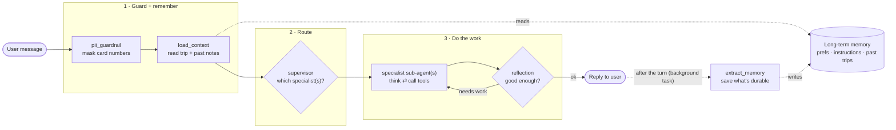
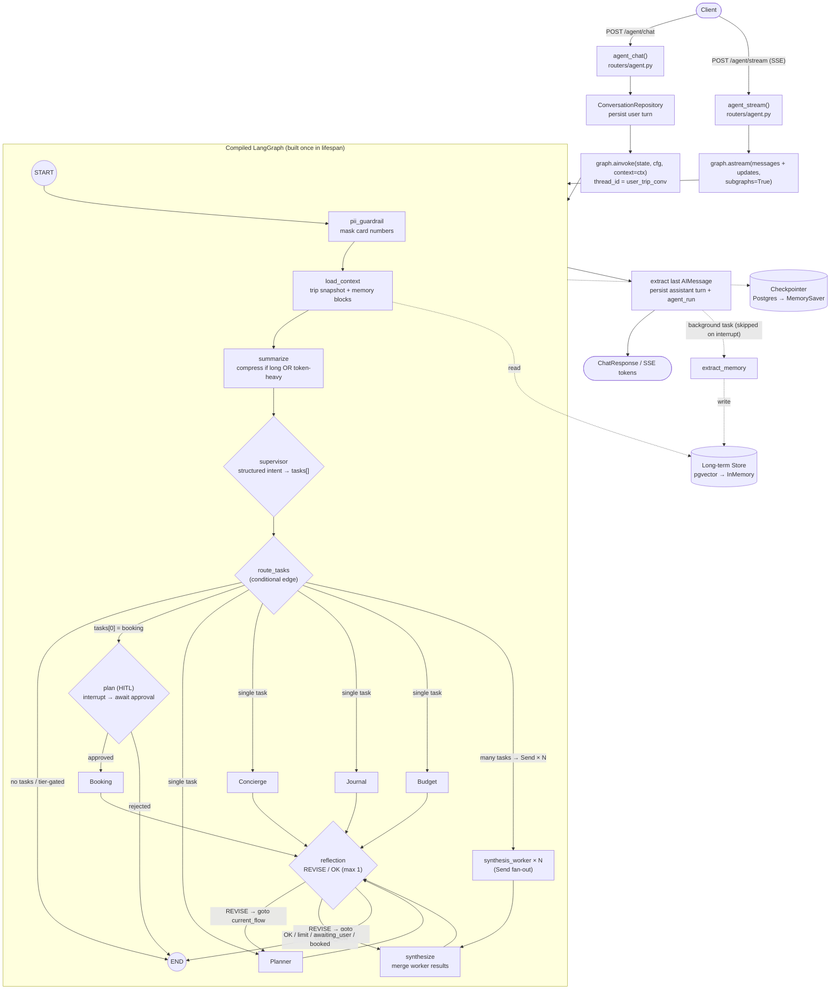
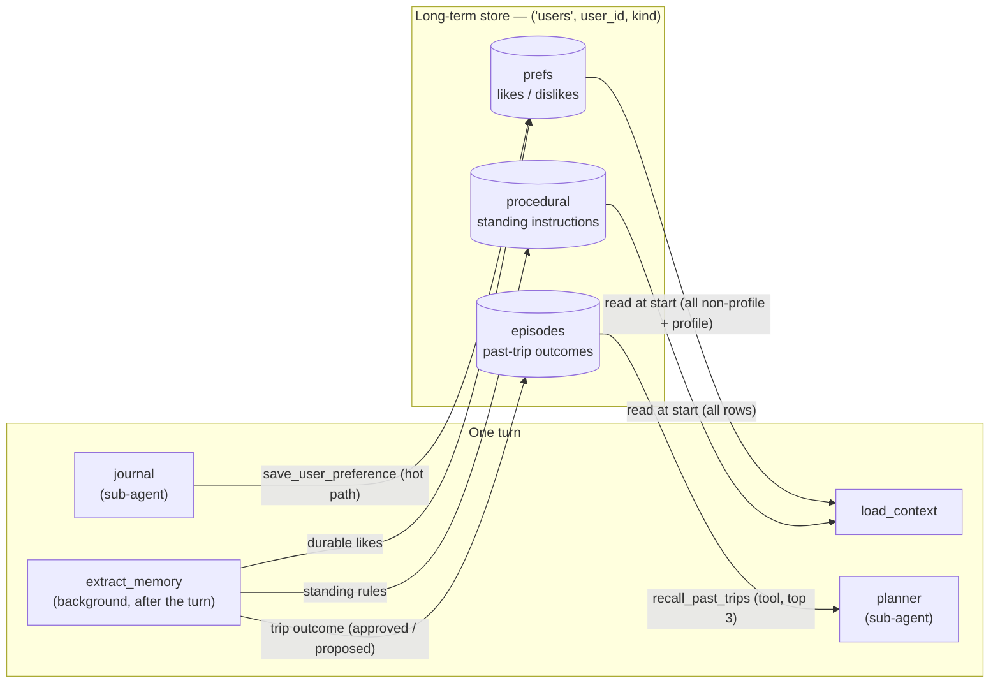
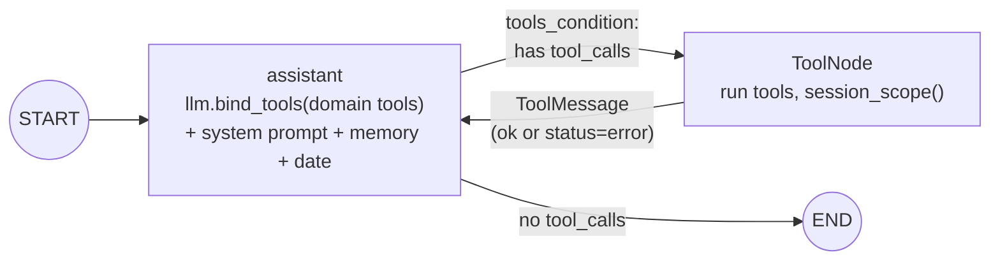
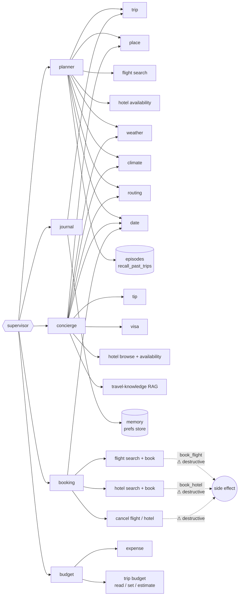

# Travel Agent — Chatbot Flow Diagram

Current backend agent flow. Companion to `WORKFLOW.md`.
Render with any Mermaid-aware viewer (GitHub, VS Code Mermaid preview, mermaid.live).
Last verified: 2026-09-21.

---

## 1. The big picture (simple view)

One user message travels through the graph left-to-right. It **reads** long-term
memory on the way in, **does the work** in the middle, and **saves** new memory
*after* the turn, in the background.

**In words:**

1. **Guard + remember** — `pii_guardrail` masks credit-card numbers, then
   `load_context` pulls the active trip snapshot plus the user's standing
   instructions, profile, and preferences from the store.
2. **Route** — `supervisor` classifies one or more intents into an ordered
   `tasks` list (planner / concierge / journal / booking / budget).
3. **Do the work** — a single-intent turn runs one specialist's *think ⇄
   use-tools* loop; a multi-intent turn fans out to parallel workers that a
   `synthesize` node merges. `reflection` may send a weak answer back once.
4. **Learn** — memory extraction runs as a **post-response background task**
   (not a graph node), saving durable preferences, standing instructions, and
   trip outcomes for next time.

---

## 2. End-to-end flow (full detail)

> `route_tasks` is pure code: a single task goes straight to its specialist, a
> `booking` task detours through the HITL `plan` node, and two or more tasks fan
> out to parallel `synthesis_worker` instances via `Send` that converge on
> `synthesize`. A REVISE routes `goto=current_flow` (the specialist or
> `synthesize` that produced the answer) — never back to the supervisor.

---

## 3. Memory lifecycle (read + write)

Long-term memory lives in one store, namespaced per user as
`("users", <user_id>, <kind>)`. Three kinds, each read and written at a different
point in the turn. Every read passes through the store-layer poisoning guard.

- **prefs** — durable likes/dislikes. Written explicitly by the journal tool
  `save_user_preference`, and in the background by `extract_memory`. Read whole
  by `load_context` (no cap since PR #218); reserved keys `name`/`gender`/
  `travel_group` form the profile block.
- **procedural** — standing instructions ("always book aisle seats"). All rows
  read by `load_context` into the system prompt; written by `extract_memory`
  under a 6-key canonical allowlist.
- **episodes** — per-trip outcomes. Recalled by the planner via
  `recall_past_trips` (top 3) so it adapts instead of planning from scratch;
  written by `extract_memory` with `outcome="approved"` when the plan passed the
  HITL gate, else `"proposed"`.

> `extract_memory` is a **post-response background task**, not a graph node. It
> is skipped when `allow_memory_write=False` or a HITL interrupt is pending, and
> any write error is swallowed so a failed extraction never breaks the reply.
> On read, each row is checked by `memory/guard.py` and stamped with a
> month-granularity `(recorded …)` age marker (`format_age`, PR #216).

---

## 4. Sub-agent ReAct loop (each specialist)

Every specialist also binds the private `needs_clarification` tool (not in the
public manifest / MCP surface); calling it sets `awaiting_user=True` and
reflection ends the turn early.

## 5. Sub-agent → tool-domain map

## 6. Tool inventory by domain

Source of truth: `tools/registry.py` (`TOOLS_BY_DOMAIN`). Every tool declares an
explicit `args_schema` that also declares its injected args (PR #204).

| Domain | Tools |
|---|---|
| trip | `get_trip_summary`, `get_trip_budget`, `list_trip_places`, `list_trips`, `add_place_to_trip`*, `add_itinerary_item`*, `create_trip`*, `set_trip_budget`*, `estimate_trip_budget` |
| place | `search_places`, `nearby_places`, `resolve_place`, `parse_nl_query`, `list_place_categories` |
| flight | `search_flights`, `book_flight`† |
| hotel | `search_hotels`, `browse_hotels`, `book_hotel`† |
| booking | `cancel_flight`†, `cancel_hotel`† |
| weather | `get_weather`, `get_packing`, `get_air_quality` |
| climate | `get_climate` |
| routing | `get_route`, `get_city_route` |
| tip | `get_local_tips` |
| visa | `get_visa` |
| knowledge (RAG) | `search_travel_knowledge` |
| expense | `add_expense`*, `list_expenses`, `expense_summary` |
| memory | `save_user_preference`*, `get_user_preferences` |
| episodes | `recall_past_trips` |
| date | `resolve_date` |
| _private_ | `needs_clarification` (not registered in the manifest / MCP surface) |

`*` write · `†` destructive. `list_trips` is served in-agent but excluded from
the MCP surface (its injected `user_id` would become caller-supplied); MCP also
omits destructive tools and any tool needing an injected `store`/`tool_call_id`.
