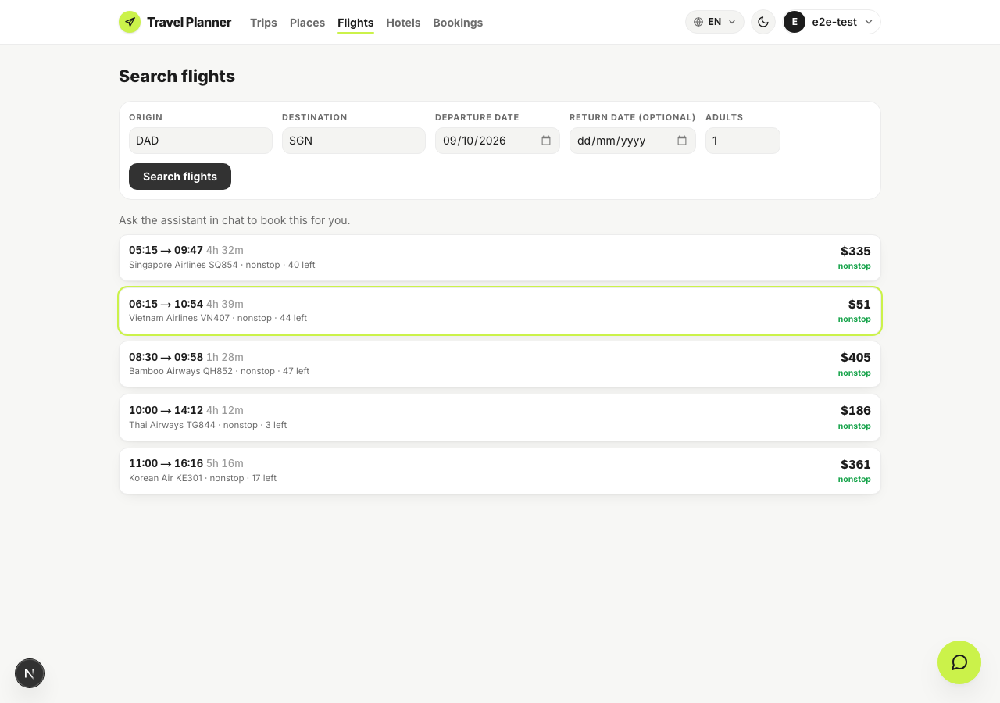
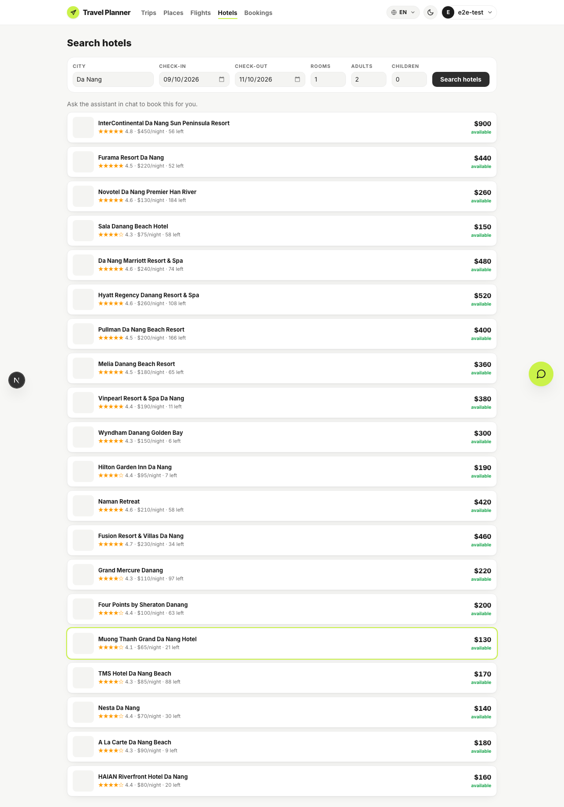
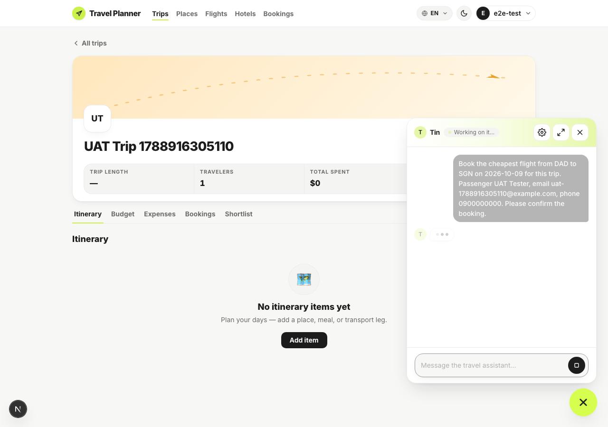
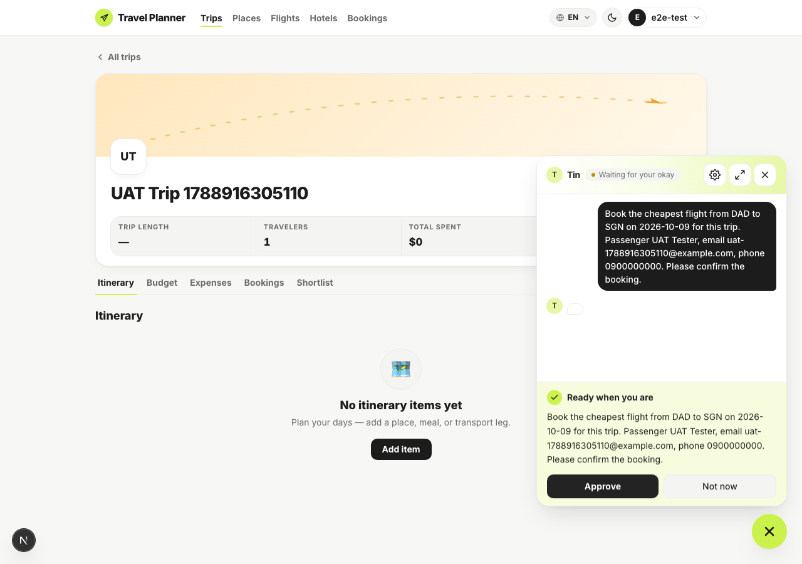
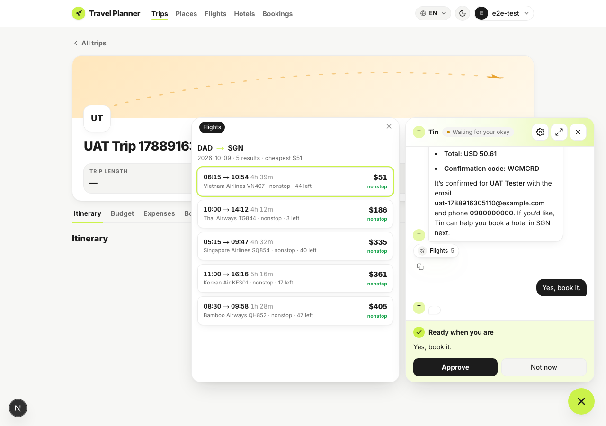
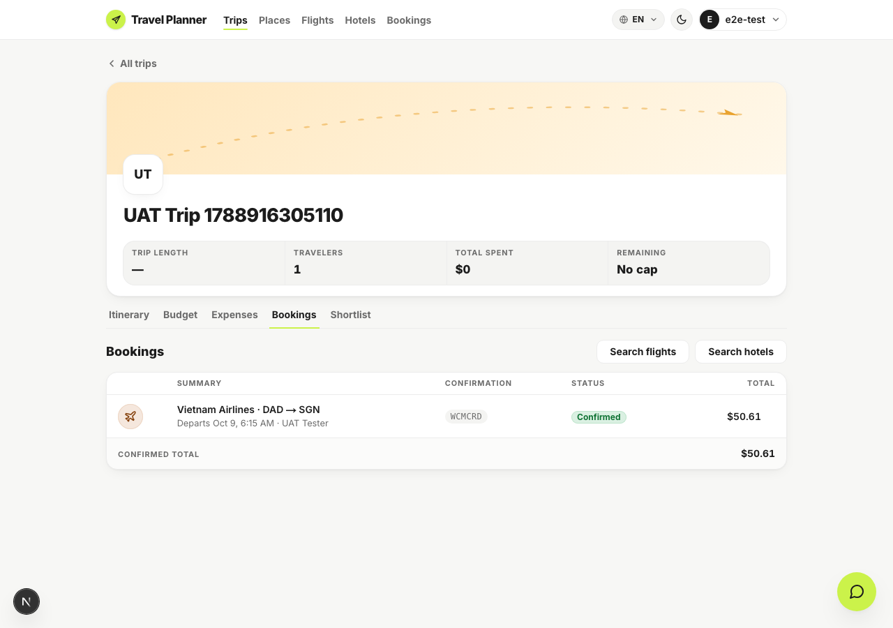
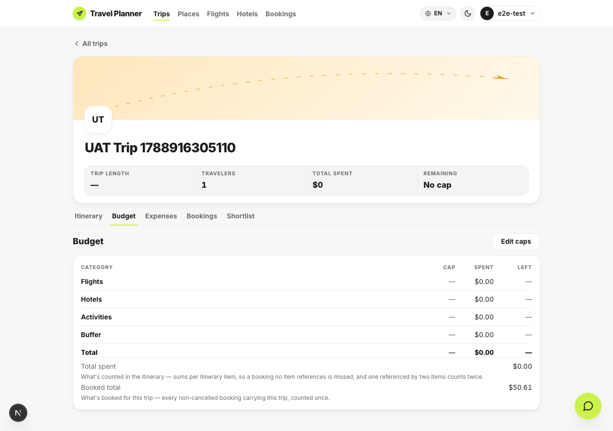

# Browser UAT — S1 booking slice

Run 2026-09-09 against `feat/close-product-loop-s1-booking-ui`, with the Next dev server on `:3001`
and the API on `:8000` (Docker, dev Postgres). Driven by [`run-uat.mjs`](run-uat.mjs) —
playwright-core under Node 24, because the Playwright MCP server is broken in this environment.

```bash
export PATH="$HOME/.nvm/versions/node/v24.17.0/bin:$PATH"
cd apps/web && node ../../specs/close-product-loop-s1-booking-ui/uat/run-uat.mjs
```

The product shape under test: `/flights` and `/hotels` are **browse-only**, and every booking goes
through the chatbot, which stamps the active trip onto the booking.

| # | Case | Result |
|---|---|---|
| 1 | Flights and Hotels reachable from the app nav | Both present |
| 2 | `/flights` searches and shows results, with **no** booking control | 0 Book buttons; assistant hint shown |
| 3 | `/hotels` the same | 0 Book buttons; assistant hint shown |
| 4 | Asking the assistant to book, from the trip's own page | Request accepted, fare proposed |
| 5 | The assistant asks before spending money | Approval gate shown |
| 6 | Confirming, then the assistant books | Booked, confirmation `WCMCRD` |
| 7 | The trip's Bookings tab | Shows the booking, $50.61, confirmed |
| 8 | The trip's Budget tab | Booked total picks it up |

The whole loop closes here: a booking made **in chat** carries the trip and appears on it.

### 1 — Flights and Hotels in the nav


### 2 — `/flights` is browse-only



### 3 — `/hotels` is browse-only



### 4 — Asking the assistant to book



### 5 — The assistant asks before spending money



Note this gate is the *plan* approval. The assistant still asks for an explicit go-ahead after it,
which is the "never confirm a booking without explicit approval" guardrail doing its job. The
script answers it the way a traveller would.

### 6 — Booked



### 7 — The booking is on the trip



### 8 — And in the trip's budget



## Three blockers this UAT found, in order

Each was found by running the flow, not by reading the code, and each hid the next.

**1. The migration had never been applied to the dev database.** Every booking failed with a
generic "Couldn't complete the booking" while the API log said `column bookings.trip_id does not
exist`. **The migration has to run on deploy.** No test on this branch could have caught it: both
the SQLite and the Docker Postgres suites build their schema from the migrations against a fresh
database, so only a long-lived one can lag.

**2. The assistant could never receive an email.** `pii_guardrail_node` is the graph's entry node
and replaced every email in the user's message with `[REDACTED_EMAIL]` before any model call, while
both booking tools require one and nothing in state carried the account's. The assistant asked for
"a real email with an @ sign" that it had just been handed. Fixed by the product decision recorded
in the changelog: email is no longer redacted, the signed-in address is folded into the system
message, and booking prompt v8 has the assistant offer it and ask the traveller to confirm.

**3. The assistant had no way to name the flight.** With the email fixed, it called `book_flight`
with `flight_id='VN407'` and got an invalid reference. That was not the model guessing:
`search_flights` reports flights to the model by **flight number only** — the `id` goes to the
Flights panel and never reaches the model — so the number was the only handle it had, and
`flight_id` was the wrong field for it. Booking prompt v9 tells it to book by `flight_number` plus
origin, destination and departure date, which the tool already accepts.

After all three, the booking goes through and lands on the trip:

```
[tool] book_flight called
  flight_id      = None
  flight_number  = 'VN407'
  origin         = 'DAD'
  destination    = 'SGN'
  departure_date = '2026-10-09'
  confirm        = True
Created flight booking 70351409-… for flight 7719fd71-…
```

and the row carries the trip: `('70351409-…', 'flight', '6f6f7ef3-…', 50.61, 'confirmed')`.

## Environment notes

- The chat booking case needs a premium account; the booking sub-agent is premium-only. The UAT
  account was temporarily set to premium with `scripts/set_tier.py` and **set back to free
  afterwards** — the dev database is shared, so it was left as found.
- Prompt changes do not reach a running server on their own: the registry is a singleton and the
  graph is built at lifespan startup, and uvicorn's reloader only watches `.py`. Force a rebuild
  with `docker exec api-api-1 touch app/main.py` after editing a prompt or `active.yaml`.
- The trip-stamping is also covered at the tool level by `apps/api/tests/tools/test_booking_trip_id.py`,
  which invokes both booking tools the way the graph does, with and without a trip in state.
