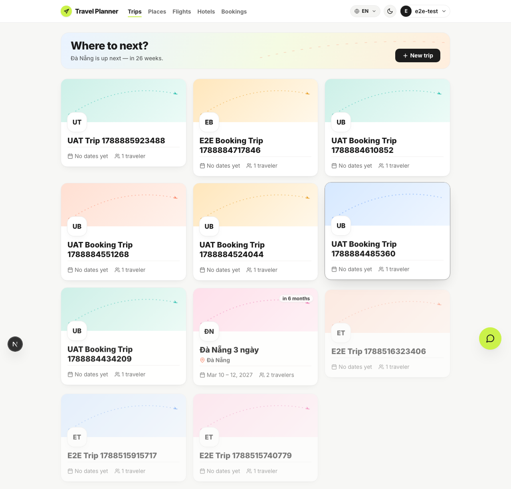
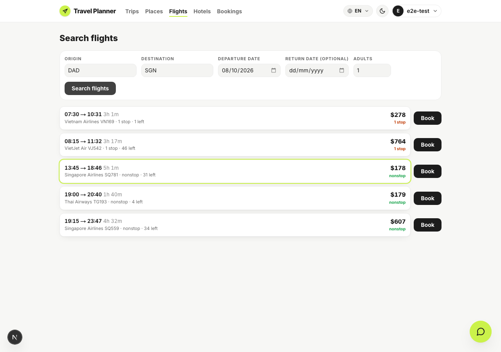
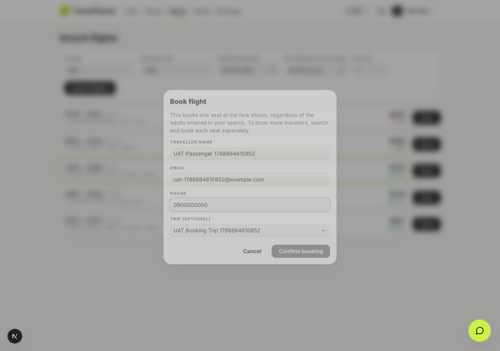
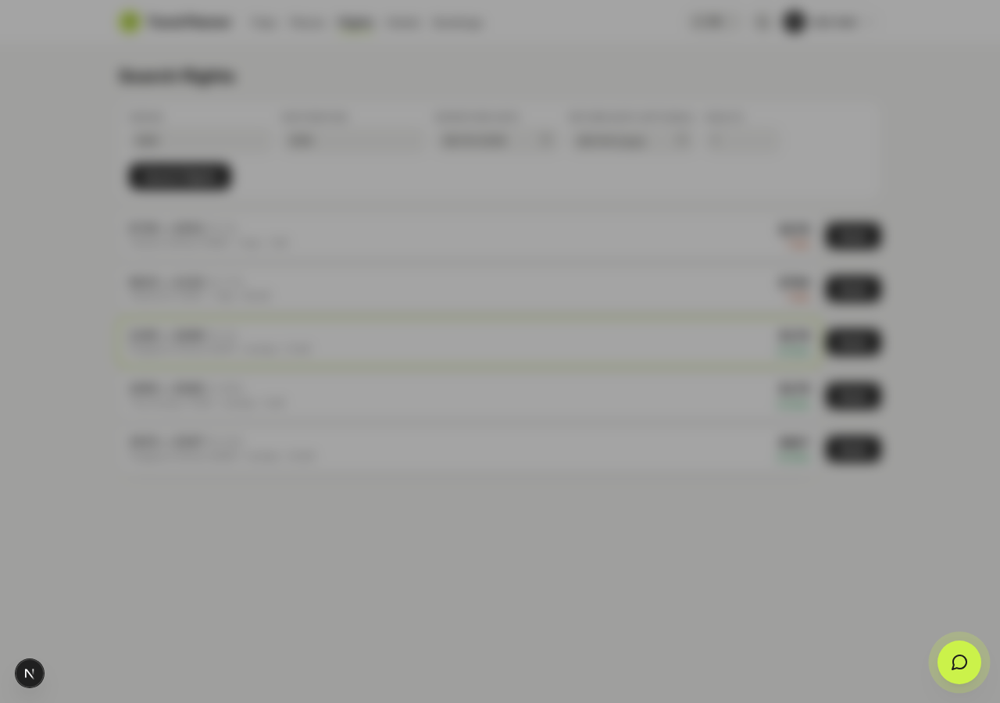
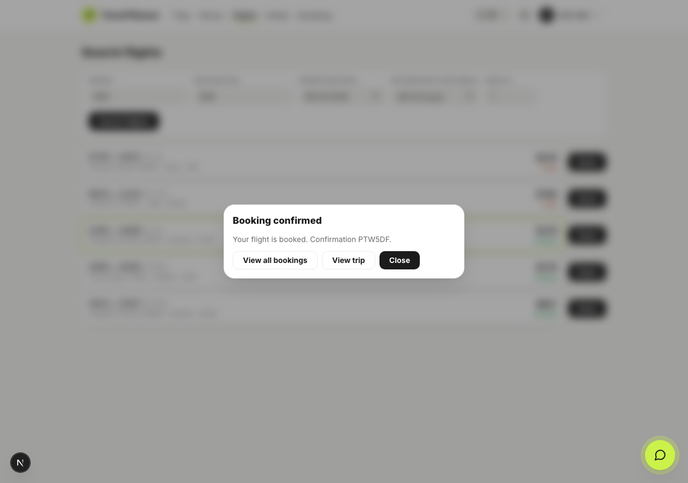
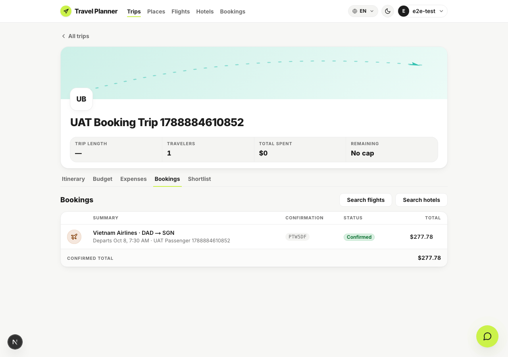
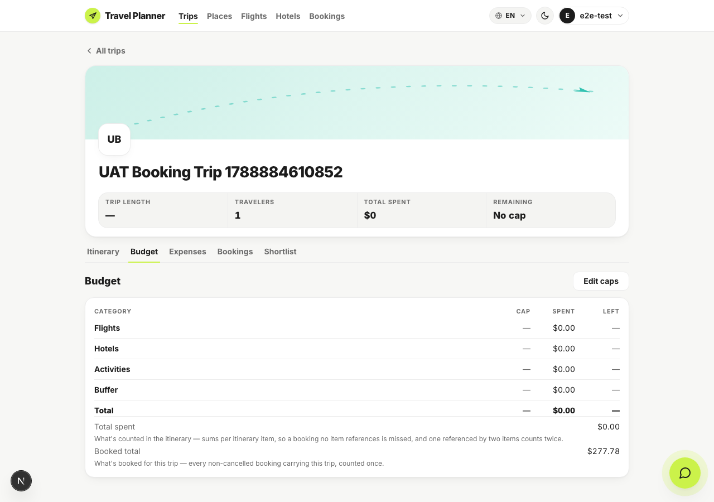
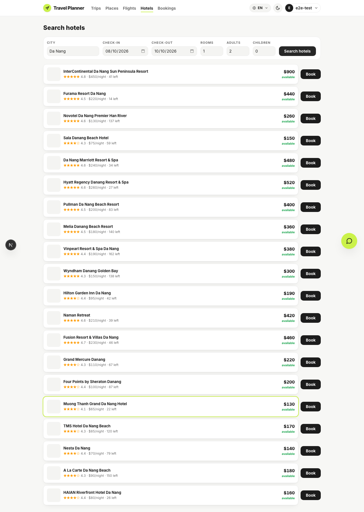
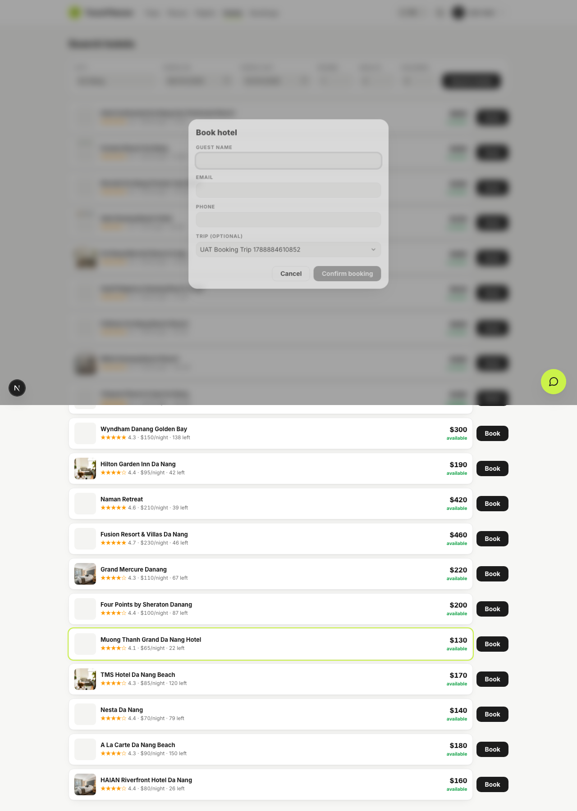

# Browser UAT — S1 booking slice

Run 2026-09-08 against the branch `feat/close-product-loop-s1-booking-ui` at `fbf39ad`, with the
Next dev server on `:3001` and the API on `:8000` (Docker, dev Postgres).

Driven by [`run-uat.mjs`](run-uat.mjs) — playwright-core under Node 24, because the Playwright MCP
server is broken in this environment. Re-run it with:

```bash
export PATH="$HOME/.nvm/versions/node/v24.17.0/bin:$PATH"
cd apps/web && node ../../specs/close-product-loop-s1-booking-ui/uat/run-uat.mjs
```

Every case below was captured from a real browser against a real backend. Nothing here is mocked.

| # | Case | Result |
|---|---|---|
| 1 | Flights and Hotels reachable from the app nav | Both entries present |
| 2 | Flight search returns bookable fares (DAD → SGN) | 5 fares, cheapest marked |
| 3 | Book dialog: one-seat notice, trip preselected from `?tripId=` | Notice shown, trip preselected |
| 4a | **Free account** books → refused | Upgrade dialog, nothing booked |
| 4b | **Premium account** books → confirmed | Confirmation code returned |
| 5 | The booking appears on the trip's Bookings tab | `PTW5DF`, confirmed, $277.78 |
| 6 | Budget shows both totals, labelled | Total spent $0.00 · Booked total $277.78 |
| 7 | Hotel availability for the chosen dates | Da Nang results with nightly rates |
| 8 | Hotel book dialog, trip preselected | Dialog opens with the trip set |

### 1 — Flights and Hotels in the nav



### 2 — Flight search results



### 3 — Book dialog



### 4a — Free account is refused



### 4b — Premium account books



### 5 — The booking on its trip



### 6 — Both budget totals



### 7 — Hotel availability



### 8 — Hotel book dialog



## What case 6 is showing

`Total spent $0.00` next to `Booked total $277.78` is **correct, not a bug**. They answer different
questions and the tab says so on screen: total spent is what is counted in the itinerary, summed per
itinerary item, so it misses a booking no item references; booked total is every non-cancelled
booking carrying this trip, counted once. The booking here was made from `/flights` and was never
added as an itinerary item, so only the second number sees it.

## Both tiers, in one run

The script branches on whatever the server answers, so a single run covers whichever tier the
account has. Case 4a came from the account as it normally is (free). For 4b the account was
temporarily set to premium with `scripts/set_tier.py`, the run repeated, **and the tier set back to
free afterwards** — the dev database is shared, so it was left as found.

## One real defect this UAT found

The first premium attempt failed with the generic "Couldn't complete the booking" message. The API
log gave the cause: `column bookings.trip_id does not exist`. The dev Postgres was still at
`a7c3e9f1b2d4` — the migration had never been applied there, only in the test databases the suite
creates from scratch. Running `alembic upgrade head` from `apps/api` fixed it, and the run above is
post-upgrade.

Worth noting for whoever deploys this: **the migration has to run**, and until it does, every
booking attempt fails with a message that does not say why. No automated check on this branch would
have caught it, because both the SQLite suite and the Docker Postgres suite build their schema from
the migrations rather than against a long-lived database.
