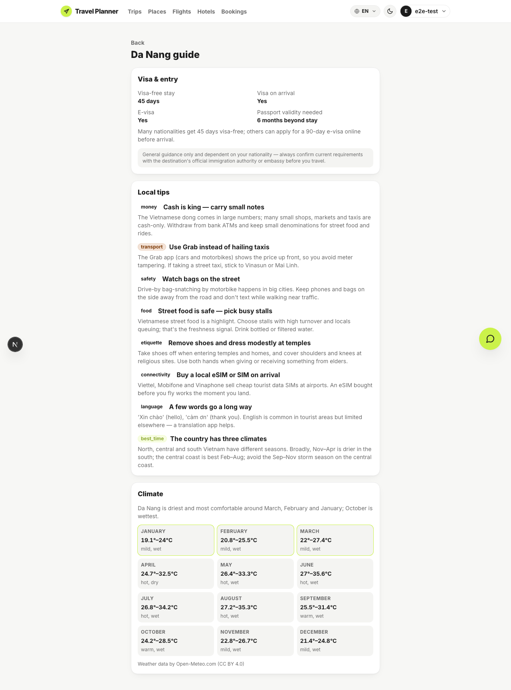
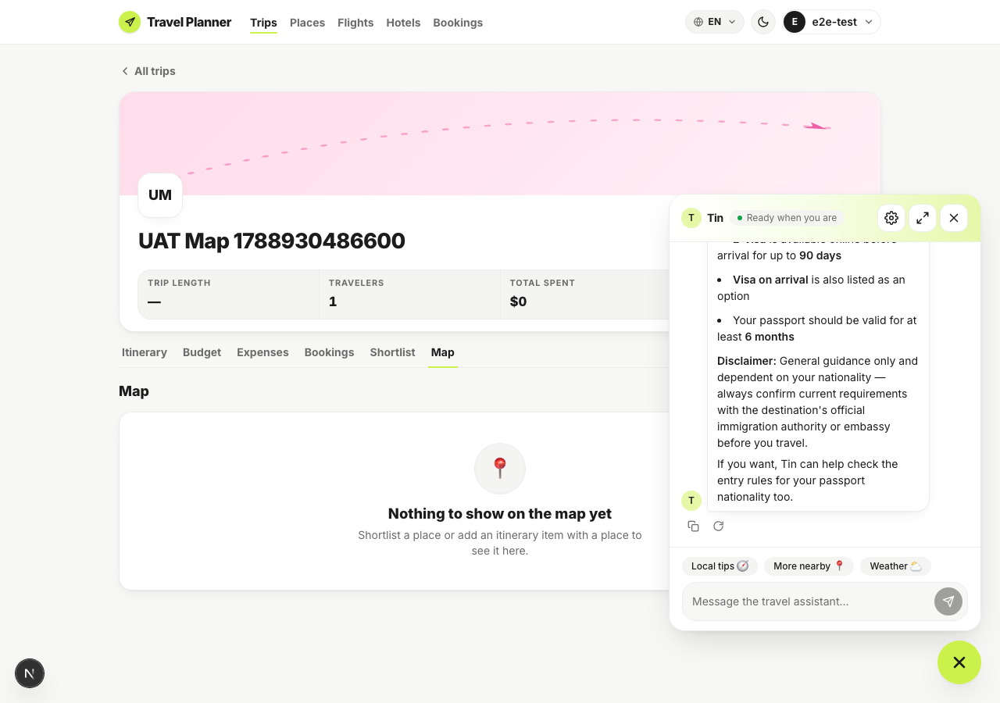
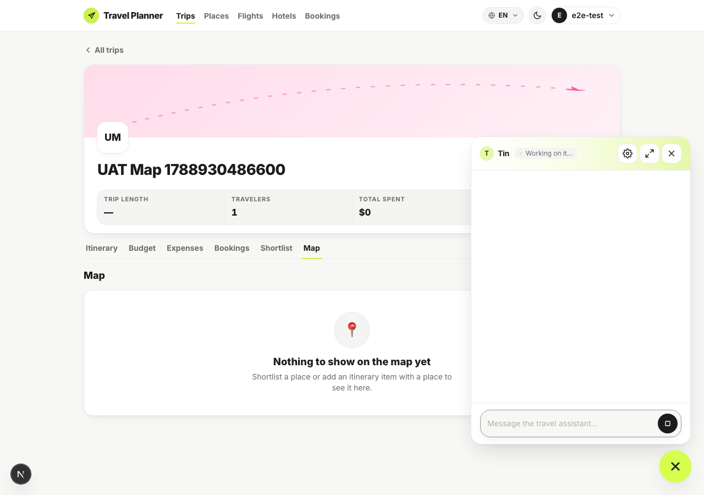
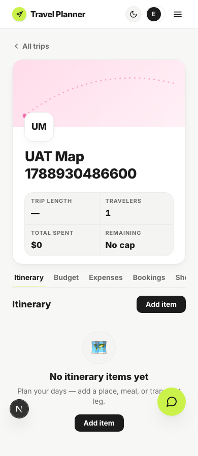
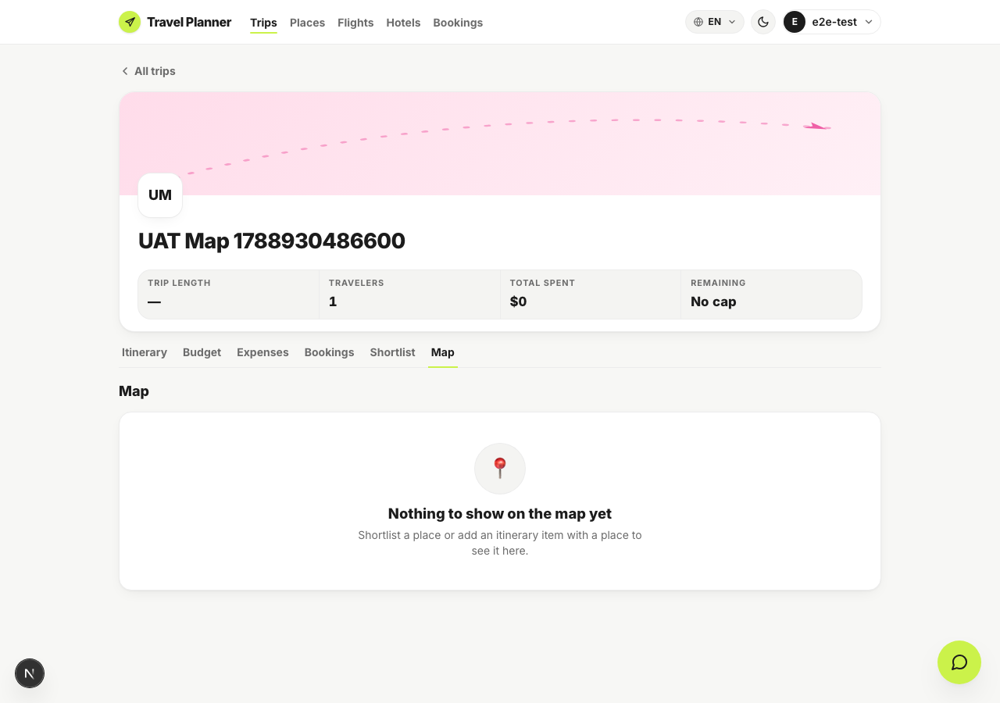

# Browser UAT — slice 2

Run 2026-09-09 against `feat/close-product-loop-s2-guide-and-map`. Driven by
[`run-uat.mjs`](run-uat.mjs) — playwright-core under Node 24, because the Playwright MCP server is
broken in this environment.

This run exists to settle the three things the summary said no test could prove.

| # | Question the tests could not answer | Answer |
|---|---|---|
| 1 | Does `/guide/[city]` render in a browser? | Yes — all three sections, disclaimer verbatim |
| 2 | Does the assistant reach for `get_visa` in a live turn? | Yes — `[tool] get_visa called`, no RAG fallback |
| 3 | Does the six-tab row still read at a narrow width? | **No.** It overflowed. Found, measured, fixed. |

## The servers this needed

Not the Docker stack. That container mounts the **main checkout**, which is on another session's
branch and has none of this code. This UAT ran the worktree's own API on `:8001` (against the same
dev Postgres) and its own Next server on `:3200`.

## 1 — The guide page



Visa entry facts, seven local tips across their categories, and a twelve-month climate grid. The
disclaimer is rendered word for word, not summarised:

> General guidance only and dependent on your nationality — always confirm current requirements with
> the destination's official immigration authority or embassy before you travel.

## 2 — The assistant uses the tool

Asked, in a real turn: *"Do I need a visa for Vietnam?"*



The API log settles which path it took:

```
2026-09-09 12:08:28 [app.tools] INFO: [tool] get_visa called
```

`get_visa`, not `search_travel_knowledge`, and no trace of v11's "I don't have that information".
The answer carries the visa-free days, the e-visa route, visa-on-arrival, the passport-validity
rule, and the disclaimer passed through intact. Before this slice the same question had no
structured source to reach for and the prompt told the assistant to say so.



## 3 — The six-tab row, which turned out to be broken

The plan flagged this as unmeasured and left it to UAT. It was right to.

At 390px the tab row was **434px of content in a 342px box with `overflow-x: visible`**, so it spilled
and dragged the whole document to **458px against a 390px viewport** — the page scrolled sideways and
"Map" sat half off-screen. Five tabs had fit; six did not.

Fixed in the same run: the row now scrolls within itself (`overflow-x: auto`, tabs `shrink-0`,
scrollbar hidden). Re-measured:

| | before | after |
|---|---|---|
| document scrollWidth at 390px viewport | 458 (overflows) | 390 (ok) |
| tablist overflow-x | `visible` | `auto` |



## 4 — The Map tab



The tab registers and renders its empty state. **Not proven here:** a map with markers actually on
it — the UAT trip was created fresh and has no saved places or dated itinerary items, so no tiles
and no markers were exercised. Plotting is covered by component tests only.

## Environment notes

- `apps/api/.env` and `apps/web/.env.local` were copied into the worktree for this run and removed
  afterwards; the worktree deliberately has neither, because their presence changes how parts of the
  suite behave.
- The web app was pointed at `:8001` for the run. That edit lived only in the copied
  `.env.local`, which is gone.
