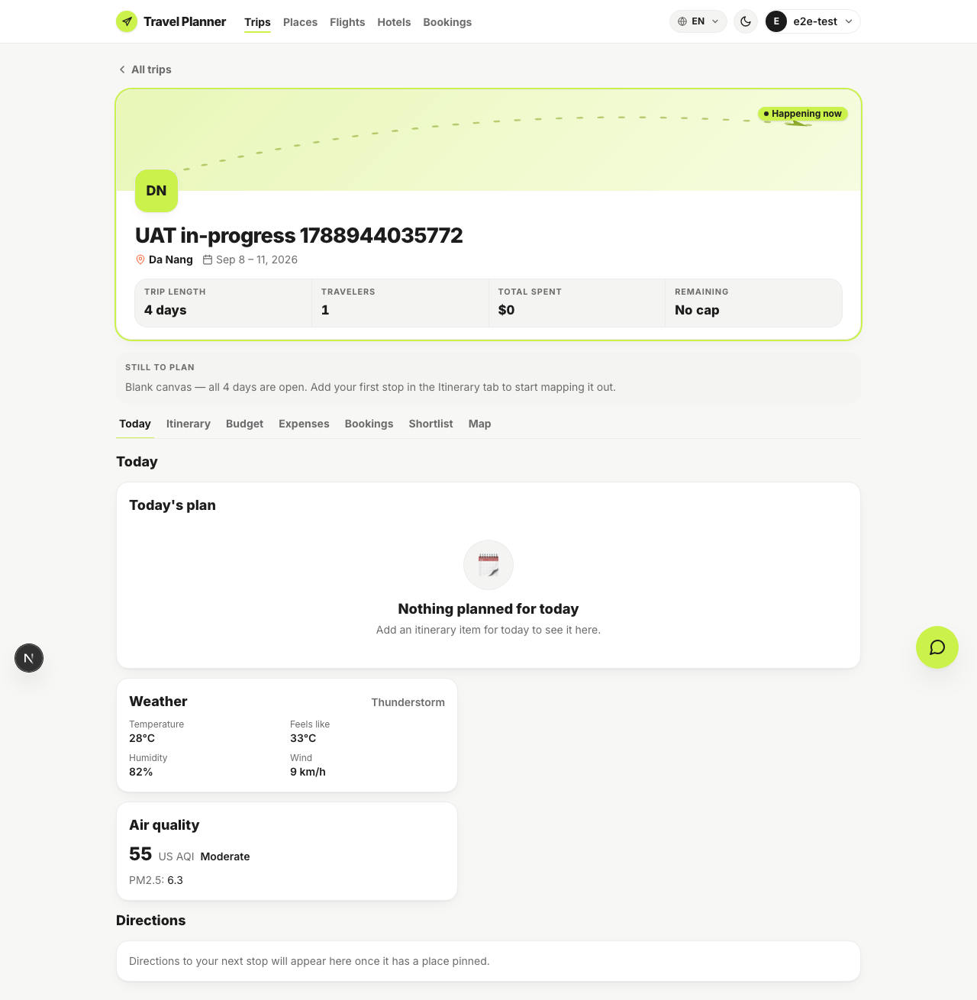
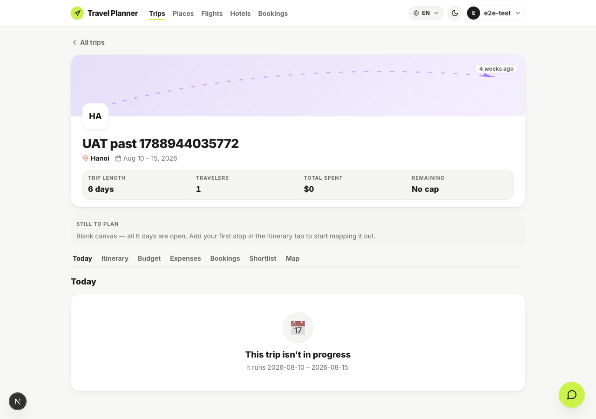
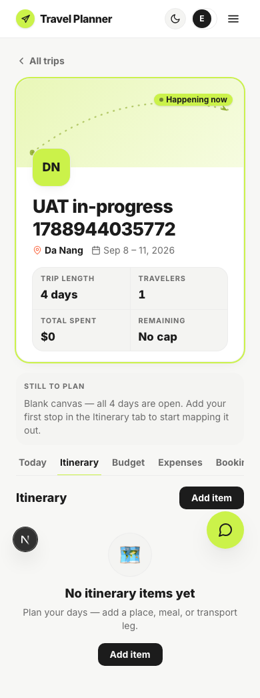
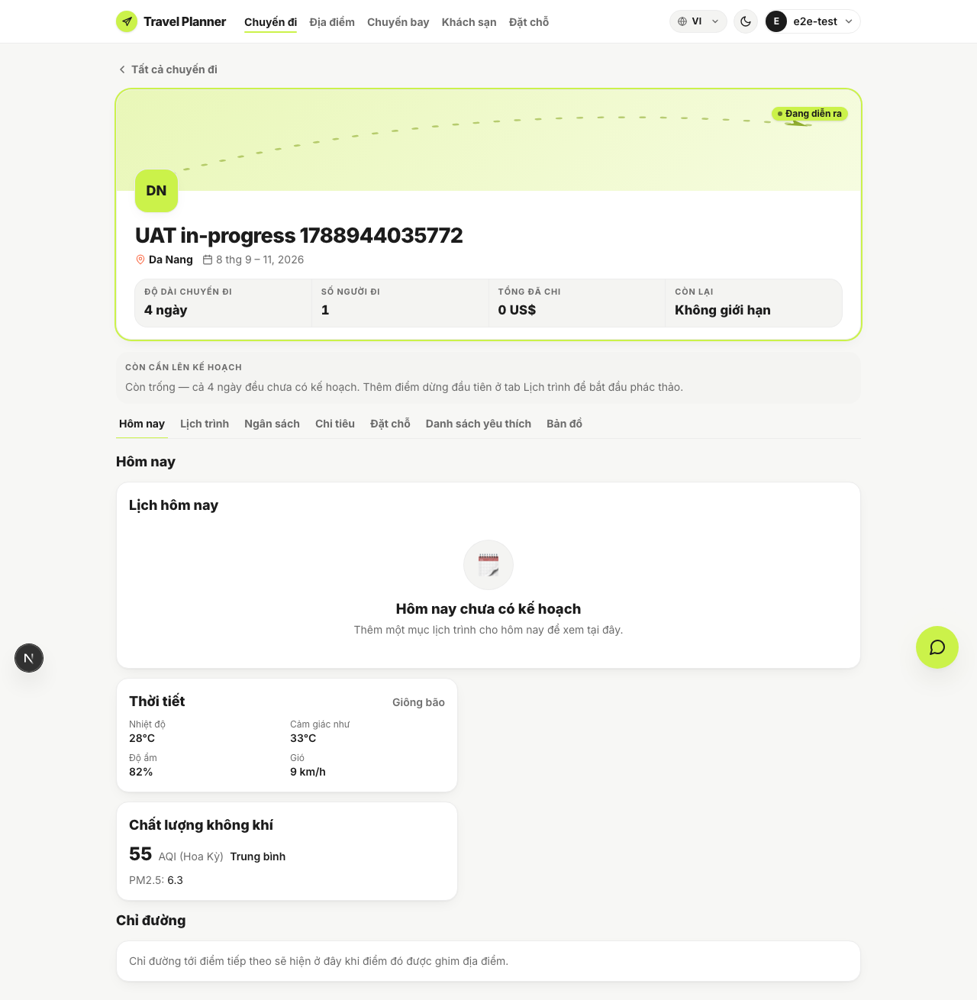

# Browser UAT — slice S3, the Today tab

Five cases, all passing. Run against the worktree's own web server on `:3200` and the shared
Docker API on `:8000`, which is correct here because this slice changes no backend.

```bash
export PATH="$HOME/.nvm/versions/node/v24.17.0/bin:$PATH"
cd apps/web && pnpm dev -p 3200 &
cd apps/web && node ../../specs/close-product-loop-s3-today/uat/run-uat.mjs
```

| # | Case | Verdict | Evidence |
|---|---|---|---|
| UAT-1 | A trip whose dates cover today shows the Today tab with a real day | PASS | `01-today-in-progress.png` |
| UAT-2 | Weather and air-quality cards render rather than vanish | PASS | `02-weather-and-air.png` |
| UAT-3 | A trip outside its window shows the dated "not in progress" state | PASS | `03-not-in-progress.png` |
| UAT-4 | Seven tabs do not widen the document at 390px | PASS | `04-seven-tabs-390.png` |
| UAT-5 | The `vi` locale renders localized Today copy | PASS | `05-vietnamese.png` |

## What each case proves

**UAT-1 and UAT-2** — the composed tab on a live trip in Da Nang. The day-plan card, the weather
card and the air-quality card all render.



**UAT-2 is the case that matters most**, because it is the defect the independent review found.
Before the fix, a failed or slow `/weather` made both cards return `null` and disappear with no
spinner, no error and no empty state. They now carry the same ladder `MapTab` uses.

**UAT-3** — the same tab on a trip that ended four weeks ago. "This trip isn't in progress",
with the trip's real dates beneath it.



**UAT-4 — the item the plan explicitly left unmeasured.** Seven tabs at a 390px viewport.
`document.documentElement.scrollWidth` is 390 and `window.innerWidth` is 390, so the page does not
scroll sideways; the tab strip scrolls inside itself, which is what the `overflow-x-auto` plus
`shrink-0` fix from slice S2 was for.



**UAT-5 — the localization decision, proven live.** Under `vi` the weather condition reads
"Giông bão" and the air-quality band reads "Trung bình". Neither string comes from the API, which
returned "Thunderstorm" and "Moderate". They are resolved on the frontend from the WMO
`weather_code` and the `us_aqi` integer, which is how this slice speaks Vietnamese without a
backend change.



## Two script bugs found and fixed during the run

Both first-pass failures were the harness, not the product, and both are worth recording because
the screenshots contradicted the assertions.

- **UAT-3** matched `/not in progress/`. The UI says "This trip isn't in progress". The state was
  correct on screen while the assertion called it a failure.
- **UAT-5** navigated to `?lang=vi`. There is no such query parameter; the locale is cookie-based
  (`locale`, read server-side by next-intl). The page stayed in English and the assertion was
  right for the wrong reason.

The lesson is the one this repo keeps relearning: read the screenshot before believing the verdict.

## Not covered

- **A populated directions card.** `GET /places/route` needs a `place_id` on both items, and a
  trip created through the UI has none, so every run exercises the unavailable note rather than a
  real route. Proving the populated path needs a trip seeded with catalog places.
- **The default tab.** Today is first in the strip but the page still opens on Itinerary. That is
  pre-existing behaviour and outside this slice, but it means a traveller mid-trip does not land
  on Today. Worth a decision in a later slice.
