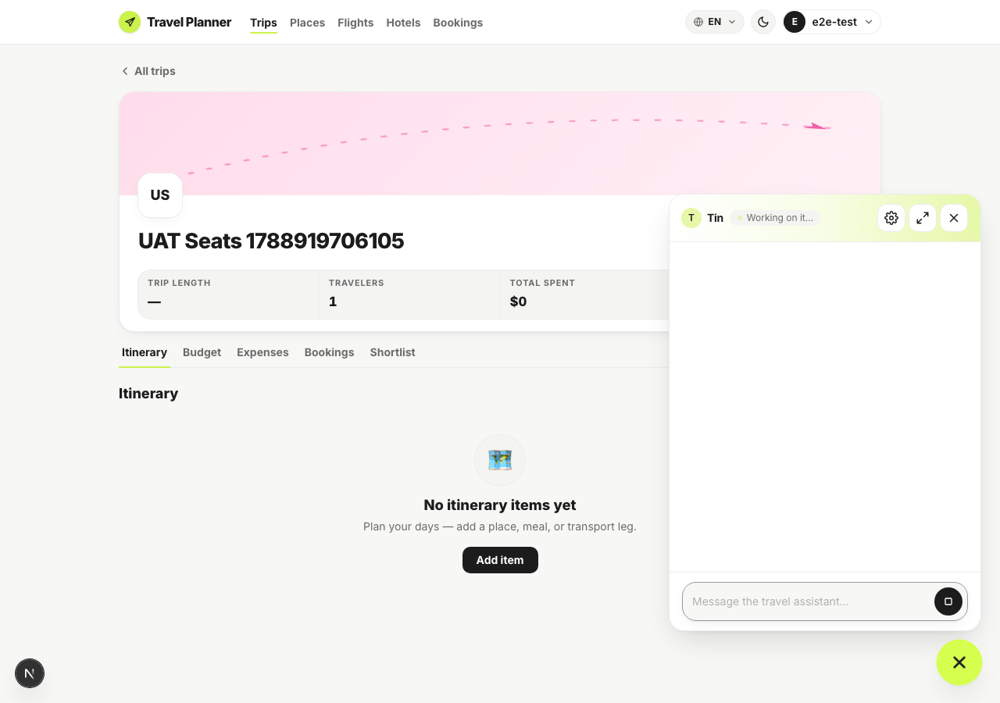
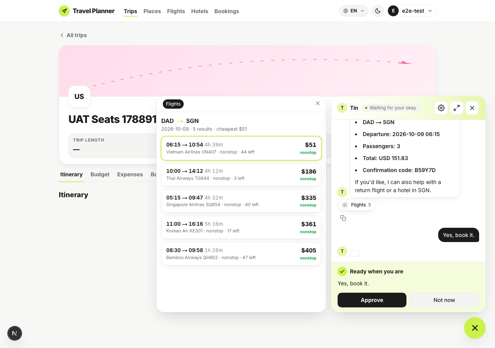
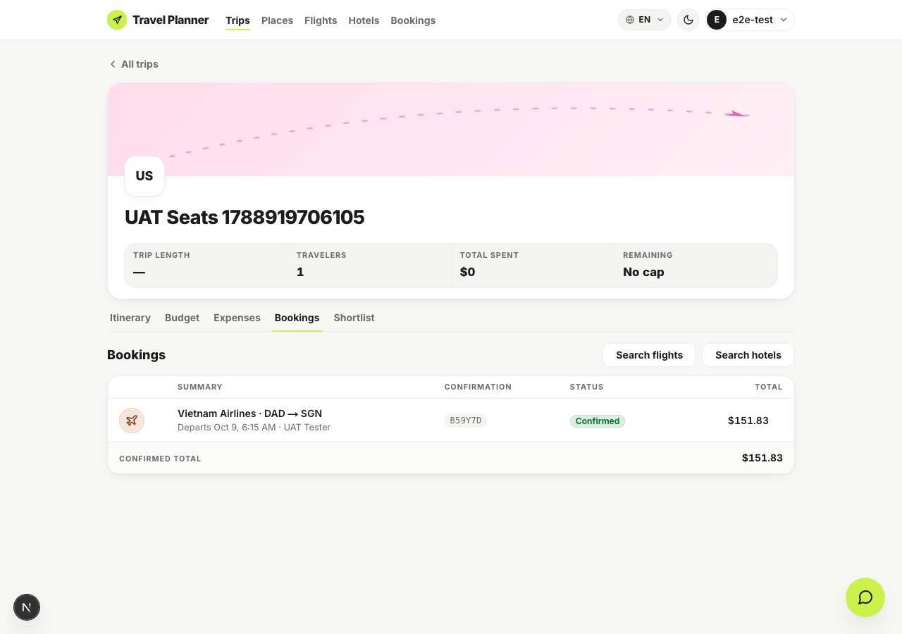

# Browser UAT — does the assistant book the seats it was asked for?

Run 2026-09-09 against `feat/close-product-loop-s1-booking-ui` at `ac405b8`, web dev server on
`:3001`, API on `:8000` (Docker, dev Postgres), graph rebuilt after the prompt change.

The tests already prove the tool carries `passengers` and prices it, and that prompt v10 loads with
its rules intact. Neither shows the **model** filling the field in a live turn. That is the one
thing this run is for.

```bash
export PATH="$HOME/.nvm/versions/node/v24.17.0/bin:$PATH"
cd apps/web && node ../../specs/flight-booking-passenger-count/uat/run-uat.mjs
```

## What happened

Asked in chat, from the trip's own page: *"Book the cheapest flight from DAD to SGN on 2026-10-09
for 3 people…"*



The assistant searched, proposed the $51 fare, and stated the party back before booking —
**Passengers: 3**, **Total: USD 151.83** — then asked for approval.



After approving and confirming, the booking lands on the trip at the party price, not the single
fare:



## The evidence, not just the screenshots

The tool call, from the API log:

```
[tool] book_flight called
  flight_id      = None
  flight_number  = 'VN407'
  origin='DAD'  destination='SGN'  departure_date='2026-10-09'
  passengers     = 3
  confirm        = True
Created flight booking 123c479c-… for flight 7719fd71-…
```

and the row it wrote:

| field | value |
|---|---|
| `total_price` | 151.83 |
| `details.passengers` | 3 |
| per seat | 50.61 |
| `trip_id` | `bb47ac92-…` |

So the model chose the field, the service multiplied, and the trip picked it up. Before this change
the same request produced one seat at 50.61.

## One thing worth deciding

**The Bookings tab does not say how many seats.** The row reads
`Vietnam Airlines · DAD → SGN — Departs Oct 9, 6:15 AM · UAT Tester` with a total of `$151.83`. The
number is right, but nothing on that line explains why it is three times the fare; a reader has to
know. The assistant says "Passengers: 3" in chat, so the information exists — it just does not reach
the trip page.

Adding `· 3 seats` to the summary line is small, but it is UI work that was not asked for, so it is
written down here rather than done. (The trip header's "TRAVELERS 1" beside it is the trip's own
field, unrelated to any booking.)

## Environment notes

- The booking sub-agent is premium-only. The UAT account was set to premium for this run and **set
  back to free afterwards** — the dev database is shared.
- The plan-approval gate is not the booking confirmation: the assistant asks for an explicit
  go-ahead after it, and the script answers both.
- A prompt edit does not reach a running server on its own. `docker exec api-api-1 touch app/main.py`
  after changing a prompt or `active.yaml`.
