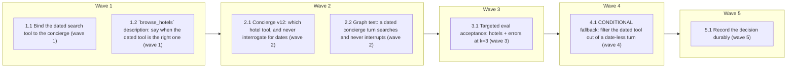

# Concierge: hotel search with and without dates (#147)

<!-- AT-A-GLANCE:BEGIN (generated — do not edit; refreshed by render_plan.py --summarize) -->
## At a glance

**7 tasks · 5 waves · 18 files · 3/7 done**

| Wave | Task | Title | Files | Done (acceptance) |
|---|---|---|---|---|
| 1 | 1.1 | Bind the dated search tool to the concierge (wave 1) | apps/api/app/tools/registry.py, apps/api/tests/tools/test_tool_registry.py | the rewritten guard passes; `git diff --stat app/tools/registry.py` shows one fi… |
| 1 | 1.2 | `browse_hotels` description: say when the dated tool is the right one (wave 1) | apps/api/app/tools/hotel_tools.py, apps/api/tests/tools/test_hotel_tools.py | both new tests pass with the rest of the file; `git diff app/tools/hotel_tools.p… |
| 2 | 2.1 | Concierge v12: which hotel tool, and never interrogate for dates (wave 2) | apps/api/app/prompts/concierge/v12.md, apps/api/app/prompts/active.yaml, apps/api/app/prompts/CHANGELOG.md, apps/api/tests/prompts/test_concierge_prompt.py | both concierge pin tests pass and every active prompt still loads; `diff app/pro… |
| 2 | 2.2 | Graph test: a dated concierge turn searches and never interrupts (wave 2) | apps/api/tests/agents/test_hotel_search_intent.py | the two new tests pass alongside the three existing ones; the booking-interrupt … |
| 3 | 3.1 | Targeted eval acceptance: hotels + errors at k=3 (wave 3) | specs/gh-147-dated-hotel-availability-routing/SUMMARY.md, apps/api/eval/reports/gh147-hotels.json, apps/api/eval/reports/gh147-errors.json, apps/api/eval/reports/gh147-hotels-smoke.json, apps/api/eval/reports/gh147-errors-smoke.json | both report JSONs exist and cover their capabilities; the SUMMARY per-golden tab… |
| 4 | 4.1 | CONDITIONAL fallback: filter the dated tool out of a date-less turn (wave 4) | apps/api/app/agents/subagents/_base.py, apps/api/tests/agents/test_hotel_search_intent.py | either the Status Log records `skipped — not triggered` with the wave-3 evidence… |
| 5 | 5.1 | Record the decision durably (wave 5) | docs/solutions/agent/concierge-hotel-tool-choice.md, docs/solutions/INDEX.md, docs/solutions/critical-patterns.md | the record exists with complete frontmatter, is listed in INDEX and critical-pat… |

### Progress
- [ ] 1.1 — Bind the dated search tool to the concierge (wave 1)
- [x] 1.2 — `browse_hotels` description: say when the dated tool is the right one (wave 1)
- [x] 2.1 — Concierge v12: which hotel tool, and never interrogate for dates (wave 2)
- [ ] 2.2 — Graph test: a dated concierge turn searches and never interrupts (wave 2)
- [ ] 3.1 — Targeted eval acceptance: hotels + errors at k=3 (wave 3)
- [x] 4.1 — CONDITIONAL fallback: filter the dated tool out of a date-less turn (wave 4)
- [ ] 5.1 — Record the decision durably (wave 5)
<!-- AT-A-GLANCE:END -->

## 1. Motivation

Golden `hotels-multi_turn-en-01` ("I'm looking for a hotel in Da Nang" → "Check-in September 10 2026, check-out September 14 2026, 2 adults, 1 child") makes the concierge call the dateless `browse_hotels` and reply "I can help narrow hotels, but I can't check real room availability", while the DB oracle computes 24/24 rooms available from 140.0. The reply is truthful about the concierge's own toolset: `TOOLS_BY_DOMAIN` binds `search_hotels` to `planner` and `booking` only. Supervisor v11 nonetheless routes hotel lookups — naming *availability* explicitly — to the concierge, and three goldens pin `expected_flow: concierge` + `expected_tools: [search_hotels]`. The contract and the wiring disagree; the wiring is what moves (E002/A). Investigation + impact analysis: `SUMMARY.md`, `ESCALATIONS.md`; research: `research-brief.md`.

## 2. Non-goals

- **No booking power for the concierge.** `book_hotel` stays in the `booking` domain; booking remains the only HITL-gated, premium, money-holding route.
- No edit to the `search_hotels` docstring — it is read by `planner` and `booking` too, and changing it would alter two other agents for free (research-brief Risk 2).
- No supervisor prompt change: v11 already routes availability lookups to the concierge.
- No golden or baseline edits — the eval dataset is the oracle for this fix, not an output of it.
- No graph/`_base.py` change in waves 1–3; the runtime tool filter is the wave-4 fallback only, and only if wave 3 shows the regression.
- No FE change: `AgentActivityTrail.tsx` already maps both tool names to the hotels panel.

## Global Constraints

- Branch `fix/gh-147-dated-hotel-availability-routing` off `main` (0a7b6d7, in-place). Run backend commands from `apps/api/` with `../../.venv/bin/python`.
- Prompt bump convention (`docs/solutions/agent/supervisor-active-yaml-is-a-pointer.md`): copy `concierge/v11.md` → `v12.md`, edit only the lines named in the task, point `active.yaml` `concierge: 12`, prepend a `CHANGELOG.md` entry headed `## gh-147-dated-hotel-availability-routing — …`. **Never** put prose in `active.yaml`.
- The rule must land in **both** places the model reads independently — the concierge prompt **and** the model-visible `browse_hotels` description — per `docs/solutions/agent/planner-search-first-save-later.md`; a fix in only one leaves the other arguing for the old behaviour.
- Tests first: write the failing test, confirm it fails, then make the change.
- Same-wave tasks never share a file. Stage and commit as **separate** commands (PreToolUse hook blocks `git add … && git commit …`). No tooling trailers in commit messages.
- A live check needs a graph rebuild (`docker exec api-api-1 touch app/main.py`); prompt `.md` files are not hot-reloaded.
- Eval runs need the Docker Postgres db and `apps/api/.env`, and run **inside the container**; the harness invokes the graph directly, so DB `enabled` toggles do not apply (`docs/solutions` / memory: `eval-harness-bypasses-db-config-and-context`).
- Lane `normal`: per-task review on. Waves 1–3 are unconditional; **wave 4 is conditional** on the wave-3 result and wave 5 closes the record.

## 3. Success Criteria

| ID | Behavior (observable) | Check (re-runnable) | Expected |
|------|-------------------------|-----------------------|------------|
| SC-1 | The concierge can call both hotel search tools and still cannot book | `cd apps/api && ../../.venv/bin/python -c "from app.tools.registry import get_tools_for;n={t.name for t in get_tools_for('concierge')};assert {'search_hotels','browse_hotels'}<=n;assert 'book_hotel' not in n"` | exit 0 |
| SC-2 | The registry guard tests state the new invariant and pass | `cd apps/api && ../../.venv/bin/python -m pytest tests/tools/test_tool_registry.py -q` | exit 0 |
| SC-3 | No destructive tool is reachable from the concierge (money stays behind the HITL gate) | `cd apps/api && ../../.venv/bin/python -c "from app.tools.registry import TOOL_METADATA,get_tools_for;assert not {t.name for t in get_tools_for('concierge') if TOOL_METADATA[t.name]['destructive']}"` | exit 0 |
| SC-4 | The public tool surface is unchanged — no tool added to or removed from the MCP manifest | `cd apps/api && ../../.venv/bin/python -c "from app.tools.registry import ALL_TOOLS;import json;assert len({t.name for t in ALL_TOOLS})==len(ALL_TOOLS);assert {'search_hotels','browse_hotels','book_hotel'}<={t.name for t in ALL_TOOLS}"` | exit 0 |
| SC-5 | `browse_hotels`'s description names the dated tool, and `search_hotels`'s keeps the anti-guess rule while dropping the re-ask round-trip | `cd apps/api && ../../.venv/bin/python -c "from app.tools.hotel_tools import browse_hotels as b,search_hotels as s;bd=' '.join(b.description.split());sd=' '.join(s.description.split());assert 'no dates' in bd and 'search_hotels' in bd;assert 'for a real reservation with exact dates' not in bd;assert 'never guess or assume a value the traveller has not given' in sd;assert 'restate them and ask the traveller to confirm' not in sd"` | exit 0 |
| SC-6 | Concierge v12 is the active prompt and states the two-tool choice rule mechanically | `cd apps/api && ../../.venv/bin/python -c "from app.prompts.registry import registry;assert registry.active_version('concierge')==12;t=' '.join(registry.get('concierge').split());assert 'never ask for dates, rooms or guests in order to browse' in t;assert 'already given you check-in and check-out' in t"` | exit 0 |
| SC-7 | The MIN-50 dedup pin and every prompt/version test still pass | `cd apps/api && ../../.venv/bin/python -m pytest tests/prompts -q` | exit 0 |
| SC-8 | A concierge turn that carries dates calls `search_hotels`, returns a dated hotels panel, and does **not** pause for plan approval | `cd apps/api && ../../.venv/bin/python -m pytest tests/agents/test_hotel_search_intent.py -q` | exit 0 |
| SC-9 | Hotel tool behaviour (panels, localization, bad dates) is unregressed | `cd apps/api && ../../.venv/bin/python -m pytest tests/tools/test_hotel_tools.py tests/tools/test_booking_tools.py tests/tools/test_hotel_tools_language.py -q` | exit 0 |
| SC-10 | The targeted eval acceptance result is recorded per golden — the three dated targets and the dateless goldens that must not regress | `cd apps/api && ../../.venv/bin/python -c "import json,glob;ids=set(c['golden_id'] for f in glob.glob('eval/reports/gh147-*.json') for c in json.load(open(f))['per_case']);assert {'hotels-multi_turn-en-01','hotels-multi_turn-vi-01','hotels-happy-en-02','hotels-happy-vi-01','hotels-happy-en-01','errors-happy-vi-01','errors-multi_turn-vi-01'}<=ids"` | exit 0 |

The full BE suite (`pytest tests/`, ~3 min) and `make eval-check` (paid, judged, 84 cases) run at `finishing-a-development-branch` / phase acceptance, never in a task `Verify`.

## 4. Tasks

### Task 1.1 — Bind the dated search tool to the concierge (wave 1)

- **Files:** apps/api/app/tools/registry.py, apps/api/tests/tools/test_tool_registry.py
- **Action:** Test first: rewrite `test_hotel_tool_split` in `tests/tools/test_tool_registry.py` (currently asserts `"search_hotels" not in concierge`, the MIN-51 guard) to state the new invariant — the concierge holds **both** `browse_hotels` and `search_hotels` and holds **no** destructive tool (assert `book_hotel not in concierge` *and* the general `not {n for n in concierge if TOOL_METADATA[n]["destructive"]}`, so a future destructive tool leaking in also trips it); keep the existing `booking` assertions (`search_hotels` and `book_hotel` in `booking`), the `ALL_TOOLS` membership assertions and the two `TOOL_METADATA` assertions unchanged; update the test's docstring from "concierge gets the dateless browse_hotels" to the new rule, citing #147. Run it and confirm it fails. Then in `app/tools/registry.py` add `+ HOTEL_AVAILABILITY_TOOLS` to the `"concierge"` entry of `TOOLS_BY_DOMAIN`, immediately after `+ HOTEL_SEARCH_TOOLS`, and update the two-line comment above `TOOLS_BY_DOMAIN` only if it states the old split. `HOTEL_AVAILABILITY_TOOLS` is already imported (line 19); add no new import. Do not touch the `planner`, `booking`, `journal` or `budget` entries, `ALL_TOOLS`, `_DESTRUCTIVE`, `_WRITE`, or `TOOL_METADATA`.
- **Verify:** `cd apps/api && ../../.venv/bin/python -m pytest tests/tools/test_tool_registry.py tests/tools/test_clarification_tools.py -q`
- **Done:** the rewritten guard passes; `git diff --stat app/tools/registry.py` shows one file, one changed line; the concierge tool count is 16 and `book_hotel` is absent; no destructive tool is reachable from the concierge.
- **Criteria:** SC-1, SC-2, SC-3, SC-4
- **Interfaces:** Consumes the existing HOTEL_AVAILABILITY_TOOLS group and the TOOLS_BY_DOMAIN extension point. Produces `apps/api/app/tools/registry.py` (concierge binding), `apps/api/tests/tools/test_tool_registry.py` (new invariant).

### Task 1.2 — `browse_hotels` description: say when the dated tool is the right one (wave 1)

- **Files:** apps/api/app/tools/hotel_tools.py, apps/api/tests/tools/test_hotel_tools.py
- **Action:** Test first: in `tests/tools/test_hotel_tools.py` add `test_browse_hotels_description_points_at_search_hotels` asserting the whitespace-normalized `browse_hotels.description` contains `no dates`, contains `search_hotels`, and does **not** contain `for a real reservation with exact dates` (the v11 clause that sent dated searches to booking). Do **not** assert on the bare phrase `the booking flow` — the replacement text legitimately keeps it for `book_hotel`. Add `test_search_hotels_description_unchanged` asserting `search_hotels.description` still contains `collect every one from the traveller and never guess` — a standing guard that this task never widens into the shared docstring. Run both and confirm the first fails. Then edit **only** the second paragraph of `browse_hotels`'s docstring in `app/tools/hotel_tools.py` (the sentence beginning "It does **not** check date-specific availability and does **not** book — for a real reservation with exact dates, the booking flow's ``search_hotels`` (availability) and ``book_hotel`` handle that.") to read: "Use it when the traveller has given **no dates** — it does not check date-specific availability and does not book. As soon as they give check-in and check-out, use ``search_hotels`` instead, which checks real availability for those dates; ``book_hotel`` (the actual reservation) stays with the booking flow." Change nothing else in the file — not the `search_hotels` docstring, not `SearchHotelsArgs`/`BrowseHotelsArgs`, not the tool bodies, not the group constants at the foot of the file.
- **Verify:** `cd apps/api && ../../.venv/bin/python -m pytest tests/tools/test_hotel_tools.py -q`
- **Done:** both new tests pass with the rest of the file; `git diff app/tools/hotel_tools.py` touches only lines inside `browse_hotels`'s docstring; `ruff check app/tools/hotel_tools.py tests/tools/test_hotel_tools.py` reports 0 findings.
- **Criteria:** SC-5, SC-9
- **Interfaces:** Consumes the @tool decorator's docstring-as-description exposure (the text the model reads at selection time) and the fact that browse_hotels is concierge-private (HOTEL_SEARCH_TOOLS has exactly one consumer). Produces `apps/api/app/tools/hotel_tools.py` (browse docstring), `apps/api/tests/tools/test_hotel_tools.py` (two description pins).

### Task 2.1 — Concierge v12: which hotel tool, and never interrogate for dates (wave 2)

- **Files:** apps/api/app/prompts/concierge/v12.md, apps/api/app/prompts/active.yaml, apps/api/app/prompts/CHANGELOG.md, apps/api/tests/prompts/test_concierge_prompt.py
- **Action:** Test first: in `tests/prompts/test_concierge_prompt.py` add `test_concierge_prompt_picks_the_right_hotel_tool` asserting the whitespace-normalized active concierge text contains `never ask for dates, rooms or guests in order to browse`, `already given you check-in and check-out`, and `You still do not book`; update the module docstring to mention v12 alongside MIN-50. Keep `test_concierge_prompt_mentions_exclude_names_on_followup` untouched. Run and confirm the new test fails. Then copy `app/prompts/concierge/v11.md` → `v12.md` and rewrite **only** the `## Hotels` section (v11 lines 75–92), leaving every other section byte-identical. The new section must state, in this order: (a) two tools, one choice — `browse_hotels` for a city-level look with no dates, `search_hotels` for real availability once the traveller has given dates; (b) the mechanical rule — "If the traveller has not given dates, call `browse_hotels` with just the city; **never ask for dates, rooms or guests in order to browse**"; (c) the other half — "If the traveller has already given you check-in and check-out, call `search_hotels` with exactly the values they gave (dates, rooms, adults, children) — do not re-ask for what they already said, and do not invent what they did not; if only some of it is there, ask once for the missing piece rather than the whole set"; (d) non-ISO dates go through `resolve_date` first, never computed by hand; (e) the shortlist/panel/no-fabrication rules carried over verbatim from v11 (top 4–5, the tool returns a side panel, never invent a hotel/price/availability); (f) the booking boundary, reworded — "**You still do not book.** You can now check and quote real availability for dates the traveller gave you, but the reservation itself belongs to the booking flow; once they have chosen, offer the hand-off" — the v11 sentence "you do not quote date-specific availability" must be **gone**. Set `active.yaml` `concierge: 11` → `12`. Prepend a CHANGELOG entry headed `## gh-147-dated-hotel-availability-routing — the concierge searches hotels with and without dates` with one bullet for concierge v12 (copied v11; `## Hotels` rewritten; the "does not quote date-specific availability" rule dropped because the concierge now holds the dated tool) and one for the code half (registry binding + `browse_hotels` description, Tasks 1.1–1.2), closing with `` `active.yaml`: concierge → 12 ``.
- **Verify:** `cd apps/api && ../../.venv/bin/python -m pytest tests/prompts -q`
- **Done:** both concierge pin tests pass and every active prompt still loads; `diff app/prompts/concierge/v11.md app/prompts/concierge/v12.md` shows one contiguous hunk inside `## Hotels`; `active.yaml` reads `concierge: 12`; the CHANGELOG entry is the first `## ` heading in the file.
- **Criteria:** SC-6, SC-7
- **Interfaces:** Consumes the prompt registry pointer (active.yaml → vN.md) and the tool names bound in Task 1.1. Produces `apps/api/app/prompts/concierge/v12.md`, `apps/api/app/prompts/active.yaml` (concierge → 12), `apps/api/app/prompts/CHANGELOG.md` (entry), `apps/api/tests/prompts/test_concierge_prompt.py` (v12 pin).

### Task 2.2 — Graph test: a dated concierge turn searches and never interrupts (wave 2)

- **Files:** apps/api/tests/agents/test_hotel_search_intent.py
- **Action:** Extend the existing MIN-51 test module (do not rewrite it; `test_hotel_search_routes_to_concierge_without_interrupt`, `test_booking_intent_still_interrupts` and `test_concierge_can_call_browse_hotels` stay as they are). Add `test_concierge_can_call_search_hotels_with_dates`, modelled on `test_concierge_can_call_browse_hotels`: drive a `FakeLLM` whose first response is an `AIMessage` with a `search_hotels` tool call (`city="Da Nang"`, `check_in`/`check_out` a fixed **future** date pair, `rooms=1`, `adults=2`, `children=1`), build the sub-agent with `get_tools_for("concierge")`, invoke it with a dated human turn, and assert a `ToolMessage` named `search_hotels` came back with `artifact["kind"] == "hotels"` and `artifact["data"]["nights"] > 0` (the dated panel, not the catalog one). Add `test_concierge_dated_hotel_turn_does_not_interrupt` using the module's `_build`/`_invoke` helpers with `intent_target="concierge"` and a dated hotel message, asserting no `__interrupt__` and `current_flow == "concierge"`. Also assert in one line that `"book_hotel" not in {t.name for t in get_tools_for("concierge")}`. Update the module docstring to record that the concierge now holds both hotel search tools (#147) and that FakeLLM validates the **wiring**, never the model's tool choice — which only the eval can prove. Use a date far enough ahead that the tool's past-date guard cannot fire as the suite ages.
- **Verify:** `cd apps/api && ../../.venv/bin/python -m pytest tests/agents/test_hotel_search_intent.py tests/agents/test_concierge_dedup.py -q`
- **Done:** the two new tests pass alongside the three existing ones; the booking-interrupt regression guard still passes; no other test file is touched.
- **Criteria:** SC-8
- **Interfaces:** Consumes the concierge binding from Task 1.1 and build_subagent's FakeLLM-driven wiring. Produces `apps/api/tests/agents/test_hotel_search_intent.py` (dated-turn coverage).

### Task 3.1 — Targeted eval acceptance: hotels + errors at k=3 (wave 3)

- **Files:** specs/gh-147-dated-hotel-availability-routing/SUMMARY.md, apps/api/eval/reports/gh147-hotels.json, apps/api/eval/reports/gh147-errors.json, apps/api/eval/reports/gh147-hotels-smoke.json, apps/api/eval/reports/gh147-errors-smoke.json
- **Action:** Rebuild the graph so the new prompt is live (`docker exec api-api-1 touch app/main.py`), then run the two targeted judged evals **inside the container**, with the Docker db up and `apps/api/.env` present: `python -m eval --suite full --capability hotels --repeat 3 --out eval/reports/gh147-hotels.json` and the same for `--capability errors --out eval/reports/gh147-errors.json`. **`hotels-happy-vi-01`, `hotels-happy-en-01` and `errors-happy-vi-01` carry `suite: smoke`, so `--suite full` skips them** — the at-risk dateless goldens need a second pair of runs with `--suite smoke` (`gh147-hotels-smoke.json`, `gh147-errors-smoke.json`). Record in `SUMMARY.md` a per-golden result table covering, at minimum: the three targets `hotels-multi_turn-en-01`, `hotels-multi_turn-vi-01`, `hotels-happy-en-02` (must now pass) and the four at-risk dateless goldens `hotels-happy-vi-01`, `hotels-happy-en-01`, `errors-happy-vi-01`, `errors-multi_turn-vi-01` (must still pass), plus `hotels-ambiguous-*`. For any golden that regressed, record the tools actually called — the diagnostic that decides wave 4 is whether the model called `search_hotels`, or asked for dates, on a turn that carried none. Do **not** run `make eval-baseline`; the committed baseline is refreshed only by the full judged run at delivery. Do not edit any golden.
- **Verify:** `cd apps/api && ../../.venv/bin/python -c "import json;r=json.load(open('eval/reports/gh147-hotels.json'));ids={c['golden_id'] for c in r['per_case']};assert {'hotels-multi_turn-en-01','hotels-happy-vi-01'}<=ids"`
- **Done:** both report JSONs exist and cover their capabilities; the SUMMARY per-golden table is filled from them with no hand-edited numbers; the three target goldens pass and the four dateless goldens are explicitly reported pass or fail (a fail here is not a blocker — it is the wave-4 trigger).
- **Criteria:** SC-10
- **Interfaces:** Consumes the shipped binding + v12 prompt (waves 1–2), the Docker db and apps/api/.env. Produces `apps/api/eval/reports/gh147-hotels.json`, `apps/api/eval/reports/gh147-errors.json`, and the per-golden table in `specs/gh-147-dated-hotel-availability-routing/SUMMARY.md`.

### Task 4.1 — CONDITIONAL fallback: filter the dated tool out of a date-less turn (wave 4)

- **Files:** apps/api/app/agents/subagents/_base.py, apps/api/tests/agents/test_hotel_search_intent.py
- **Action:** **Run this task only if Task 3.1 recorded a dateless-golden regression** (the concierge asked for dates, or called `search_hotels`, on a turn that carried none). Otherwise mark it `skipped — not triggered` in the Status Log and leave `_base.py` untouched. If triggered: make the choice a graph fact instead of prose, reusing the extension point that already exists — the `assistant` node's invoke-time tool filter in `build_subagent` (the same mechanism that drops `EPISODIC_TOOL_NAME` when `allow_episodic` is false). Add a narrow, named predicate that removes `search_hotels` from `active_tools` when the conversation carries no resolved date, mirroring the episodic filter's shape; do not add a new state field, a new node, or a new abstraction, and do not change routing, `trip_guard`, or any other domain's toolset. Cover it with a FakeLLM test in `tests/agents/test_hotel_search_intent.py`: a dateless concierge turn must not even be offered `search_hotels`, while the dated turn from Task 2.2 still is. Record the trigger evidence (which goldens, which traces) and the decision in `SUMMARY.md` under `### Deviations`.
- **Verify:** `cd apps/api && ../../.venv/bin/python -m pytest tests/agents/test_hotel_search_intent.py tests/agents/test_subagents.py -q`
- **Done:** either the Status Log records `skipped — not triggered` with the wave-3 evidence, or the filter ships with a passing test and the dateless goldens are re-run green in a second targeted eval recorded in SUMMARY.
- **Criteria:** SC-8
- **Interfaces:** Consumes the wave-3 eval evidence and build_subagent's existing invoke-time tool filter. Produces `apps/api/app/agents/subagents/_base.py` (conditional filter), `apps/api/tests/agents/test_hotel_search_intent.py` (filter coverage).

### Task 5.1 — Record the decision durably (wave 5)

- **Files:** docs/solutions/agent/concierge-hotel-tool-choice.md, docs/solutions/INDEX.md, docs/solutions/critical-patterns.md
- **Action:** Write the `docs/solutions` record for this decision, in the shape of `docs/solutions/agent/planner-search-first-save-later.md` (frontmatter: `problem_type: decision`, `module: agent/concierge`, `severity: critical`, `applicable_when`, `affects`, `confidence`, `confirmed_at`). It must carry: the failure (a routing contract promising a capability the toolset lacked, so the agent truthfully denied it); the general principle — **a prompt or routing rule that promises a capability must be corroborated against the toolset that will execute it, and an eval golden that pins both `expected_flow` and `expected_tools` must be checked against `TOOLS_BY_DOMAIN` when written, or it fails forever for a reason no prompt fix reaches**; the second principle — when one agent holds two overlapping tools, the choice rule belongs in the prompt **and** the model-visible description of the tool that is easiest to over-reach for, pinned by content tests; the MIN-51 history (the same binding failed live review by interrogating for dates) and how v12 answers it; and the wave-4 fallback, whether or not it fired. Link `[[planner-search-first-save-later]]`, `[[supervisor-active-yaml-is-a-pointer]]`, `[[negative-grep-is-not-absence]]`. Add the INDEX row and the `critical-patterns.md` line.
- **Verify:** `cd /Users/minhtran/Documents/minhtran3124/developer/travel-pi && test -s docs/solutions/agent/concierge-hotel-tool-choice.md && grep -q "concierge-hotel-tool-choice" docs/solutions/INDEX.md && grep -q "concierge-hotel-tool-choice" docs/solutions/critical-patterns.md`
- **Done:** the record exists with complete frontmatter, is listed in INDEX and critical-patterns, and states the outcome of wave 3 (and wave 4 if it fired) rather than the plan's expectation.
- **Criteria:** SC-10
- **Interfaces:** Consumes the wave-3/4 outcomes and the existing docs/solutions frontmatter contract. Produces `docs/solutions/agent/concierge-hotel-tool-choice.md`, `docs/solutions/INDEX.md`, `docs/solutions/critical-patterns.md`.

## 5. Risks

- **Date interrogation returns (highest; previously observed).** `search_hotels` has six required args and a docstring ordering the model to collect every one; MIN-51 records the concierge interrogating travellers for dates when it held that tool. Four currently-passing dateless goldens are exposed. Mitigated by shipping the v12 rule and the `browse_hotels` description in the same branch as the binding (never after), and by the wave-4 code fallback, which the user has authorized in-branch.
- **Proof is probabilistic.** FakeLLM tests validate wiring, not tool choice — their own docstring says so. SC-1…SC-9 can all pass while the model still misbehaves; only wave 3 is truth-tier, and it is nondeterministic (k=3).
- **Blast radius via a shared docstring.** Editing `search_hotels`'s docstring would silently change planner and booking behaviour. Fenced off by SC-5's standing assertion that its text is unchanged.
- **Panel tab collision (cosmetic, accepted).** A dateless browse and a dated search both emit `kind="hotels"`, so the second replaces the first in the side panel. Pre-existing for planner turns; out of scope.
- **Eval cost and environment.** Two k=3 judged runs are paid and need the Docker db + `.env` inside the container; `make test-docker`'s `down -v` shares the compose project and would kill the dev stack mid-run.

## 6. Status Log

- 2026-09-09 — Intake (`SUMMARY.md`): Lane `normal`, Confidence `high`. E001 (route to planner) raised and decided, then superseded the same day by **E002 = option A** (bind both hotel search tools to the concierge, no booking power).
- 2026-09-09 — Research (`research-brief.md`, Standard, no external surface): recommendation **reuse existing**; keep the rule out of the shared `search_hotels` docstring; code-gate kept as the fallback.
- 2026-09-09 — Plan drafted (proposed). User decisions folded in: eval gate = **targeted first (`hotels`, `errors`, k=3), full `make eval-check` once before the PR**; fallback if v12 does not hold = **code-gate in this branch** (Task 4.1), not a follow-up issue.
- 2026-09-09 — Waves 1–2 executed and reviewed. W1: 4/4 verdicts pass (one Minor fixed in `505ed2b`). W2: spec pass on both, quality `needs_fixes` on 2.1 for one Important finding about the shared `search_hotels` docstring — deferred by user decision (measure first). Task 1.2 hit a plan contradiction (verbatim docstring vs its own assertion); the implementer escalated and the controller narrowed the assertion + patched the plan. Commits `ac4c085`, `2789a73`, `505ed2b`, `d489a71`, `6d1ac3c`.
- 2026-09-09 — **Task 3.1 done.** `hotels` full 5/6, `errors` full 5/6, both smoke suites 2/2. `hotels-multi_turn-en-01` (#147) and `hotels-multi_turn-vi-01` now PASS; `hotels-happy-en-02` fails only `reply_language` (#148). Plan gap found and corrected during execution: the three at-risk dateless goldens carry `suite: smoke`, which `--suite full` skips — SC-10 now reads all four gh147 reports. All dateless goldens still call `browse_hotels`.
- 2026-09-09 — **Task 4.1: `skipped — not triggered`.** The MIN-51 date-interrogation regression did not reappear in any wave-3 run, so the code-gate fallback was not built and `app/agents/subagents/_base.py` is untouched.
- 2026-09-09 — Final review chain. Intent review: **PASS** (no gap, no drift, no unapproved scope; two record-honesty nits fixed in `4f13f42`). Correctness review: no blocking runtime bug in the diff, but one real behavioural gap — the `search_hotels` summary could name a sold-out hotel as the cheapest option. Fixed in `418cd98`, narrowed in `fa4279e`, and finally moved out of the prompt entirely in the commit after it, after the eval showed prompt-level availability wording made the model narrate its own shortlist as the search result (5/6 → 3/6 → 4/6 → 5/6). Full BE suite: 2245 passed / 59 failed, and the 59 are byte-identical to the same run at base `0a7b6d7` (local `.env` contamination: dashboard basic-auth 401s, OpenAI key present).
- 2026-09-09 — Remaining before delivery: one full `make eval-check` (user-authorized, not yet run) and the PR.
- 2026-09-09 — Full `eval-check` run (user-authorized): **hotels 50.0% → 83.3%**, flight_search +16.7%, suggestions +10.0%, everything else flat. Gate exits 1 on `language` (−14.3%), but both flagged goldens fail at **base** too — proved by two `--capability language` runs on a detached `0a7b6d7` (6/7 and 5/7, with `language-ambiguous-vi-01` red in both). Baseline deliberately not refreshed. Browser UAT green with screenshots (`uat/`).
- 2026-09-09 — **Shipped to PR.** Targeted suite `pytest tests/tools tests/agents tests/prompts` → 720 passed, 2 failed (`test_routing_tools.py` offline-estimate pair — both in the base-identical failure set, local `.env` contamination). Receipt gate `check_review_receipt.py --require correctness,intent` exit 0. Branch pushed, PR opened against `main`.

### Task 6.1 — Shared `search_hotels` description: reuse what the traveller gave (wave 6)

- **Files:** apps/api/app/tools/hotel_tools.py, apps/api/tests/tools/test_hotel_tools.py, apps/api/app/prompts/CHANGELOG.md
- **Action:** Follow-up authorized by the user after the branch shipped, closing the wave-2 review's deferred Important finding. In `search_hotels`'s docstring replace "collect every one from the traveller and never guess or assume them … If any of these values only appeared earlier in the conversation, restate them and ask the traveller to confirm before searching" with a version that keeps the anti-hallucination half ("never guess or assume a value the traveller has not given") and drops the confirmation round-trip ("Values the traveller gave earlier in the conversation are still theirs: search with them instead of asking again, and echo them back in your reply so they can correct you. Ask only for a value that is genuinely missing, ambiguous, or contradicted by something they said later."). Repoint the standing pin `test_search_hotels_description_unchanged` — renamed to `test_search_hotels_description_reuses_what_the_traveller_gave` — at the new rule, asserting the anti-guess sentence is present and the re-ask sentence is gone. Note the change in the CHANGELOG's gh-147 entry. This description is read by the planner and booking agents too; do not change `SearchHotelsArgs`, the tool body, or any prompt.
- **Verify:** `cd apps/api && ../../.venv/bin/python -m pytest tests/tools/test_hotel_tools.py -q`
- **Done:** the repointed pin passes; `git diff apps/api/app/tools/hotel_tools.py` touches only `search_hotels`'s third docstring paragraph; `ruff check` clean.
- **Criteria:** SC-5
- **Interfaces:** Consumes the tool decorator's docstring-as-description exposure, read by the concierge, planner and booking agents alike. Produces `apps/api/app/tools/hotel_tools.py` (search description), `apps/api/tests/tools/test_hotel_tools.py` (repointed pin).

## 6. Status Log (continued)

- 2026-09-09 — Task 6.1 done; eval coverage was initially BLOCKED. The docstring change ships with its unit pin (`pytest tests/tools/test_hotel_tools.py` exit 0) but **no eval evidence**: the OpenAI account ran out of credits mid-session, so `--capability hotels` and `--capability booking` both returned `agent_run raised RateLimitError: 429 … no credits remaining` on every case (0/6 and 0/8). Every eval number recorded earlier in this spec predates that and stands. Re-run `python -m eval --suite full --capability hotels --repeat 3` and the same for `booking` once credits are restored.
- 2026-09-09 — **Task 6.1 eval coverage delivered** after the account was topped up: `hotels` 5/6 (83.3%, unchanged) and `booking` 6/8 (75.0%, exactly the committed baseline). A dateless smoke golden (`hotels-happy-en-01`) flipped to `needs_clarification`, so it was measured on both sides — 1 fail in 3 runs at `2989de9` (pre-edit) vs 2 in 4 on the branch, identical failure signature — i.e. pre-existing flakiness, not a regression from the edit. Reports: `gh147-hotels-v6`, `gh147-booking-v6`, `gh147-hotels-smoke-v6{,b}`, `gh147-smoke-base{1,2,3}` (gitignored; numbers transcribed into SUMMARY).
- 2026-09-09 — **Planner path measured** (the last gap): `flight_search` **6/6 (100%)** vs a baseline of 83.3%, `routing` 15/17 → 16/17 → 15/17 across three runs vs a baseline of 88.2%. `routing-multi-en-04` went red while `routing-multi_turn-en-01` went green; the former mentions a hotel, so it was isolated by reverting **only** the `search_hotels` paragraph on the same HEAD — it is red on that side too (red 3/3 with the edit, red 1/2 without). Its own `notes` say it was derived from supervisor v10 and the supervisor is v11, so it reads as a stale golden. Reports: `gh147-flightsearch-v7`, `gh147-routing-v7{,b}`, `gh147-routing-ctrl{,1,2}` — note `gh147-routing-ctrl.json` is mislabelled: a failed `cd` meant the revert had not applied, so it is a third with-edit run, counted as such above.

