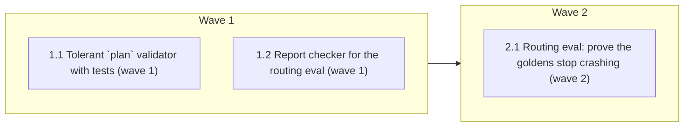

# Supervisor `plan` tolerates invalid entries instead of crashing the turn

<!-- AT-A-GLANCE:BEGIN (generated — do not edit; refreshed by render_plan.py --summarize) -->
## At a glance

**3 tasks · 2 waves · 6 files · 3/3 done**

| Wave | Task | Title | Files | Done (acceptance) |
|---|---|---|---|---|
| 1 | 1.1 | Tolerant `plan` validator with tests (wave 1) | apps/api/app/agents/supervisor.py, apps/api/tests/agents/test_supervisor_plan_semantics.py | Both files pass; `ruff check` and `ruff format --check` on the two touched files… |
| 1 | 1.2 | Report checker for the routing eval (wave 1) | apps/api/scripts/check_gh180_routing_report.py, apps/api/tests/fixtures/eval/gh180_pre_fix_routing_report.json | Script exits 1 on the fixture (whose `routing-multi_turn-vi-01` entry carries th… |
| 2 | 2.1 | Routing eval: prove the goldens stop crashing (wave 2) | apps/api/eval/reports/gh180-routing.json, specs/gh-180-supervisor-plan-invalid-entries/SUMMARY.md | Checker exits 0 on the fresh report; SUMMARY has one Verify row for each of SC-1… |

### Progress
- [x] 1.1 — Tolerant `plan` validator with tests (wave 1)
- [x] 1.2 — Report checker for the routing eval (wave 1)
- [x] 2.1 — Routing eval: prove the goldens stop crashing (wave 2)
<!-- AT-A-GLANCE:END -->

## 1. Motivation

GitHub issue #180. `SupervisorIntent.plan` is typed `list[_SecondaryTarget] | None` where
`_SecondaryTarget` is a `Literal` of four specialist names. When the model puts anything else in
the list — a nested `{'target_agent': 'journal', 'slots': None}` object, or the bare string
`'booking'` — pydantic raises `ValidationError` inside the supervisor node, the node is not
retried (`ValidationError` is not in `_is_retryable_llm`), and the whole traveller turn dies.
The field description already promises "Duplicate or invalid steps are dropped in code"; today
that promise is false because validation raises before the task-list loop in `supervisor.py` (~lines 318-332) ever runs. The
same crash makes `routing-multi_turn-en-01` / `-vi-01` flip between runs and pollutes the eval
gate.

Inputs: `specs/gh-180-supervisor-plan-invalid-entries/SUMMARY.md` (intake + the pre-plan
side-effect check). No `design.md` / `research-brief.md`: normal lane, familiar code, single
approach fixed by the issue — the artifact policy in `rules/orchestration.md` does not trigger
them.

## 2. Non-goals

- **No prompt bump (no supervisor v13).** The wire schema already sends
  `enum: [planner, concierge, journal, budget]` for `plan`, and v12 already says `plan` must
  never contain `booking`; the model disobeys anyway, which is why the fix lives in code. A
  new prompt version would touch `active.yaml` + `CHANGELOG.md` and invites the concurrent-branch
  collision recorded in `docs/solutions/agent/concurrent-branches-collide-on-prompt-version.md`.
  Reopen only if the routing eval after Task 2.1 still shows the model nesting objects at a
  rate that hurts secondary-intent recall.
- **No change to the wire schema.** `plan` keeps its `Literal` element type so the enum hint
  the model reads stays byte-identical (SC-4).
- **No `booking` as a follow-on.** The HITL non-goal (MIN-65 D3) stands; `booking` in `plan` is
  dropped, never coerced into a task.
- **No baseline rewrite in this spec.** `make eval-baseline` overwrites the whole committed
  baseline from `reports/latest.json`; a routing-only run must not be blessed as the baseline.
  Re-baseline only from a full judged run, as a separate decision.
- **No retry-policy change.** Making `ValidationError` retryable would re-roll the dice instead
  of fixing the contract.

## 3. Success Criteria

All checks run from the REPOSITORY ROOT with `.venv/bin/python`. `verify_summary.py --check` executes
them with the repo root as cwd, so a check written to run from `apps/api/` exits 127 and, when
negated with a leading `!`, passes vacuously.

| ID | Behavior (observable) | Check (re-runnable) | Expected |
|------|-------------------------|-----------------------|------------|
| SC-1 | A nested `{'target_agent': 'journal', 'slots': None}` entry in `plan` is coerced to `'journal'`; no `ValidationError` | `.venv/bin/python -m pytest apps/api/tests/agents/test_supervisor_plan_semantics.py -q -k nested_object_is_coerced` | exit 0 |
| SC-2 | The bare string `'booking'` in `plan` is dropped; validation succeeds with the remaining entries | `.venv/bin/python -m pytest apps/api/tests/agents/test_supervisor_plan_semantics.py -q -k booking_in_plan_is_dropped` | exit 0 |
| SC-3 | Unparseable entries (unknown string, int, dict without a valid `target_agent`, nested `booking`) are dropped and `plan` becomes `None` when nothing survives | `.venv/bin/python -m pytest apps/api/tests/agents/test_supervisor_plan_semantics.py -q -k unparseable_entries_are_dropped` | exit 0 |
| SC-4 | The JSON schema sent to the model still lists the four-name enum for `plan` items (the `Literal` is kept) | `.venv/bin/python -m pytest apps/api/tests/agents/test_supervisor_plan_semantics.py -q -k wire_schema_keeps_plan_enum` | exit 0 |
| SC-5 | End to end through the supervisor node: a raw payload with a nested journal entry yields tasks `[planner, journal]` | `.venv/bin/python -m pytest apps/api/tests/agents/test_supervisor_plan_semantics.py -q -k coerced_plan_reaches_tasks` | exit 0 |
| SC-6 | Every dropped entry is logged at WARNING with the rejected value | `.venv/bin/python -m pytest apps/api/tests/agents/test_supervisor_plan_semantics.py -q -k dropped_entry_is_logged` | exit 0 |
| SC-7 | The old contract test that expected `ValidationError` for `plan=["booking"]` is gone and the file's full run passes | `.venv/bin/python -m pytest apps/api/tests/agents/test_supervisor_plan_semantics.py -q` | exit 0 |
| SC-8 | Lint is clean on the touched files | `.venv/bin/ruff check apps/api/app/agents/supervisor.py apps/api/tests/agents/test_supervisor_plan_semantics.py apps/api/scripts/check_gh180_routing_report.py` | exit 0 |
| SC-9 | In a fresh routing eval report, neither `multi_turn` golden records a `ValidationError` | `.venv/bin/python apps/api/scripts/check_gh180_routing_report.py apps/api/eval/reports/gh180-routing.json` | exit 0 |
| SC-10 | Formatting is clean on the touched files | `.venv/bin/ruff format --check apps/api/app/agents/supervisor.py apps/api/tests/agents/test_supervisor_plan_semantics.py apps/api/scripts/check_gh180_routing_report.py` | exit 0 |
| SC-11 | The report checker rejects the pre-fix fixture that holds the crash | `! .venv/bin/python apps/api/scripts/check_gh180_routing_report.py apps/api/tests/fixtures/eval/gh180_pre_fix_routing_report.json` | exit 0 — the checker itself exits 1 |

## Global Constraints

- Run every Python command from `apps/api/` with `../../.venv/bin/python`. This worktree is a
  SIBLING directory of the main checkout, so its root `.venv` is a symlink to the main
  checkout's venv, already created during isolation setup. Do not create a second venv.
- Never copy `apps/api/.env` into this worktree: it reddens about 57 tests (delenv + dashboard
  basic-auth). Task 2.1 reads the main checkout's `.env` through `--env-file` instead.
- Keep `plan: list[_SecondaryTarget] | None` as the declared type. Filter in a
  `@field_validator("plan", mode="before")` so the JSON schema is unchanged (SC-4).
- Coercion rule, exactly: a `str` that is one of `planner|concierge|journal|budget` passes; a
  `dict` whose `target_agent` is one of those four is coerced to that string; everything else
  (including `'booking'` in either form) is dropped with `logger.warning`. An empty result
  becomes `None`. A non-list value (`None` stays `None`; a bare `str` or `dict` is treated as
  `[value]`; anything else is dropped) never iterates characters. Order is preserved; dedupe
  stays in the task-list loop in `supervisor.py` (~lines 318-332, not in the
  validator) so the existing tests keep their contract.
- Do not touch `apps/api/app/prompts/**` or `active.yaml`.
- Do not edit `eval/baselines/main.json`.
- `ruff format` + `ruff check` on every touched file; line length 88.
- Do not delete existing test functions except `test_plan_with_booking_still_rejected`, which is
  rewritten (its assertion is the behaviour this spec reverses).
- The hook `ruff-on-edit` strips imports added before their usage: add import and usage in the
  same edit (`docs/solutions` / memory `ruff-on-edit-strips-unused-imports`).

## 4. Tasks

### Task 1.1 — Tolerant `plan` validator with tests (wave 1)

- **Files:** apps/api/app/agents/supervisor.py, apps/api/tests/agents/test_supervisor_plan_semantics.py
- **Action:** Test-first. In `tests/agents/test_supervisor_plan_semantics.py` add a section
  "Invalid plan entries degrade instead of raising" with these tests, all built via
  `SupervisorIntent.model_validate({...})` on raw dict/str input (FakeLLM returns pre-built
  objects and never reaches the validator):
  `test_nested_object_is_coerced` (plan `[{'target_agent': 'journal', 'slots': None}]` →
  `intent.plan == ['journal']`),
  `test_booking_in_plan_is_dropped` (plan `['booking', 'concierge']` → `['concierge']`),
  `test_unparseable_entries_are_dropped` (plan `['nope', 7, {'x': 1}, {'target_agent': 'booking'}]`
  → `intent.plan is None`),
  `test_wire_schema_keeps_plan_enum` (`SupervisorIntent.model_json_schema()['properties']['plan']`
  contains an `anyOf` array branch whose `items.enum` equals exactly
  `['planner', 'concierge', 'journal', 'budget']`),
  `test_coerced_plan_reaches_tasks` (feed `SupervisorIntent.model_validate({'target_agent':
  'planner', 'plan': [{'target_agent': 'journal', 'slots': None}]})` to `FakeLLM` via the
  existing `_agents_for` helper → `['planner', 'journal']`),
  `test_dropped_entry_is_logged` (`caplog` at WARNING on logger `app.agents.supervisor` contains
  the string `booking` after validating plan `['booking']`).
  Rewrite `test_plan_with_booking_still_rejected` as `test_booking_in_plan_is_dropped` (above);
  remove the now-unused `ValidationError` import only if nothing else in the file uses it.
  Then in `app/agents/supervisor.py` add `@field_validator("plan", mode="before")` on
  `SupervisorIntent` implementing the coercion rule from Global Constraints (module `logger`
  already exists at line 39), and edit the `plan` field description so the sentence
  "Duplicate or invalid steps are dropped in code." reads "Duplicate, invalid or nested
  steps are dropped or unwrapped in code; each entry is a bare specialist name." — keep every
  other sentence verbatim because `tests/prompts/test_supervisor_prompt.py:78` asserts three of
  them. Import `field_validator` from `pydantic` in the same edit as its first use.
- **Verify:** `.venv/bin/python -m pytest apps/api/tests/agents/test_supervisor_plan_semantics.py tests/prompts/test_supervisor_prompt.py -q`
- **Done:** Both files pass; `ruff check` and `ruff format --check` on the two touched files exit 0; the JSON schema for `plan` is unchanged from before the edit (SC-4 test green).
- **Criteria:** SC-1, SC-2, SC-3, SC-4, SC-5, SC-6, SC-7, SC-8, SC-10
- **Interfaces:** Consumes the existing SupervisorIntent pydantic model and the _agents_for test helper (both already in the repo). Produces `apps/api/app/agents/supervisor.py` (tolerant validator, updated description) and `apps/api/tests/agents/test_supervisor_plan_semantics.py` (six new tests, one rewritten).

### Task 1.2 — Report checker for the routing eval (wave 1)

- **Files:** apps/api/scripts/check_gh180_routing_report.py, apps/api/tests/fixtures/eval/gh180_pre_fix_routing_report.json
- **Action:** Write a small stdlib-only script that loads a report JSON produced by
  `python -m eval`. Shape (verified on `eval/reports/gh173-before.json`): top-level
  `per_case` is a list; each entry has `golden_id`, `capability`, `scenario`, `passed`, and
  `checks` (a list of `{name, passed, score, detail}`); a crashed turn shows as a check named
  `agent_run` with `passed: false` and a `detail` starting `agent run raised ValidationError`.
  Select every entry whose `golden_id` starts with `routing-multi_turn-`; exit 1 if any of them
  has a check whose `detail` contains `ValidationError`, or if fewer than two distinct
  `golden_id`s match. Print one line per entry: `golden_id`, `passed`, and the first 120
  characters of any failing check's `detail`. Exit 0 otherwise.
  `apps/api/eval/reports/` is gitignored (`.gitignore:63`) and absent from a fresh worktree, so
  create the tracked fixture `tests/fixtures/eval/gh180_pre_fix_routing_report.json` by copying
  from the main checkout's `eval/reports/gh173-before.json` only the `schema_version`,
  `run_meta`, and the two `per_case` entries whose `golden_id` starts with
  `routing-multi_turn-` (one of them carries the `agent_run` ValidationError detail). Note
  `.gitignore` also swallows `scripts/`: stage with `git add -f` (memory
  `gh-166-list-trips-shipped`).
- **Verify:** `! .venv/bin/python apps/api/scripts/check_gh180_routing_report.py apps/api/tests/fixtures/eval/gh180_pre_fix_routing_report.json`
- **Done:** Script exits 1 on the fixture (whose `routing-multi_turn-vi-01` entry carries the ValidationError detail) and its output contains both `routing-multi_turn-vi-01` and `routing-multi_turn-en-01`; `ruff check` and `ruff format --check` on the script exit 0.
- **Criteria:** SC-11
- **Interfaces:** Consumes the eval report JSON shape defined in evalkit/types.py (existing) and the main checkout's untracked gh173-before.json report. Produces `apps/api/scripts/check_gh180_routing_report.py` and `apps/api/tests/fixtures/eval/gh180_pre_fix_routing_report.json`.

### Task 2.1 — Routing eval: prove the goldens stop crashing (wave 2)

- **Files:** apps/api/eval/reports/gh180-routing.json, specs/gh-180-supervisor-plan-invalid-entries/SUMMARY.md
- **Action:** Run the judged routing eval in a ONE-OFF container built from the running stack's
  image. The long-lived `api-api-1` container bind-mounts the MAIN checkout's `apps/api`
  (verified: `.../travel-pi/apps/api -> /app`), so `docker exec api-api-1 ...` would evaluate
  main's code and prove nothing about this branch. The eval binding still needs the seeded
  agent-config and the `db` service (memory `eval-harness-bypasses-db-config-and-context`), so
  reuse the running stack's network and the main checkout's `.env` without copying it. Start the
  stack with `docker compose up -d` from the MAIN checkout's `apps/api` if `db` is down; never
  run `docker compose down -v`, which kills the shared dev stack (memory
  `docker-test-compose-shares-project-name`). Command, run from this worktree's `apps/api`:
  `docker run --rm --network api_default --env-file /Users/minhtran/Documents/minhtran3124/developer/travel-pi/apps/api/.env -e DATABASE_URL=postgresql+psycopg://travel:travel@db:5432/travel -v "$(git rev-parse --show-toplevel)/apps/api":/app -w /app api-api python -m eval --suite full --capability routing --repeat 3 --out eval/reports/gh180-routing.json`.
  Then run the Task 1.2 checker on the report and stage the report with `git add -f` (the
  directory is gitignored) so SC-9 stays re-runnable from the repo. Record in SUMMARY `### Verify` the checker row
  (Criterion SC-9) and, under `### Not auto-verified`, the eval command itself with its
  wall-clock time (it exceeds the 60 s Verify budget). If either `multi_turn` golden still
  fails on `flow_match` rather than on a crash, record that as a pre-existing routing gap
  (issue #155) — it is not this spec's regression.
- **Verify:** `.venv/bin/python apps/api/scripts/check_gh180_routing_report.py apps/api/eval/reports/gh180-routing.json`
- **Done:** Checker exits 0 on the fresh report; SUMMARY has one Verify row for each of SC-1..SC-11 with its exit code, `python .claude/scripts/verify_summary.py --lane gh-180-supervisor-plan-invalid-entries` exits 0, and the eval command is listed under Not auto-verified.
- **Criteria:** SC-9
- **Interfaces:** Consumes external runtime inputs (the running Postgres service on the shared compose network, the already-built api image, and the main checkout's provider key supplied by env-file) plus `apps/api/scripts/check_gh180_routing_report.py`. Produces `apps/api/eval/reports/gh180-routing.json` and the completed `specs/gh-180-supervisor-plan-invalid-entries/SUMMARY.md`.

## 5. Risks

- **Silent loss of a secondary intent.** Accepted trade (issue #180). Mitigated by coercing the
  nested-object case (the common one) and logging every drop at WARNING so the loss is visible
  in logs and eval traces.
- **weakening-validation hook.** Rewriting `test_plan_with_booking_still_rejected` removes a
  `pytest.raises` line; the gate is warn-mode. If it fires, note it in SUMMARY Deviations; do
  not re-declare the lane.
- **Eval cost/time.** Task 2.1 is a paid judged run (~19 goldens × k=3 plus judge calls). Run it
  once; do not loop it.
- **Reports are gitignored.** `apps/api/eval/reports/` is ignored (`.gitignore:63`); the older
  gh147/gh173 reports exist only in the main checkout. Force-add only `gh180-routing.json`; do
  not overwrite `latest.json`.
- **The dev container evaluates main, not this branch.** `api-api-1` bind-mounts the main
  checkout, so a plain `docker exec` yields a report that proves nothing about the fix. Task 2.1
  uses the one-off `docker run` above.
- **Model still nests objects often.** If the report shows the coercion path firing on most
  runs, revisit the non-goal on a prompt note in a follow-up issue rather than here.

## 6. Status Log

- 2026-09-10 — plan written (writing-plans); intake lane normal / confidence high.
- 2026-09-10 — tasks 1.1, 1.2 complete; commit fae2561. Wave-1 Verify green; both per-task reviews
  returned spec PASS / quality PASS. Controller also fixed a second stale contract test in
  `tests/agents/test_task_ledger.py`, outside every task's Files set — a plan gap the task-scoped
  Verify could not see.
- 2026-09-10 — reviewer Minor findings applied; commit 9776b43, re-reviewed PASS / PASS.
- 2026-09-10 — task 2.1 complete; commit 9474268. Routing eval run against the branch code in a
  one-off container; SC-9 green.
- 2026-09-10 — branch review chain: intent PASS, correctness FAIL then PASS. Two real defects fixed
  in commit 515d1f5 (TypeError escaping the validator on an unhashable nested value; report checker
  green on a non-ValidationError crash). Full suite 2388 passed. Plan shipped.
