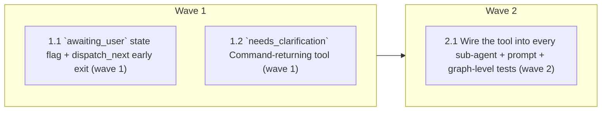

# Task Ledger Early Exit (MIN-68 / #99)

<!-- AT-A-GLANCE:BEGIN (generated — do not edit; refreshed by render_plan.py --summarize) -->
## At a glance

**3 tasks · 2 waves · 9 files · 0/3 done**

| Wave | Task | Title | Files | Done (acceptance) |
|---|---|---|---|---|
| 1 | 1.1 | `awaiting_user` state flag + dispatch_next early exit (wave 1) | apps/api/app/agents/state.py, apps/api/app/agents/nodes.py, apps/api/tests/agents/test_ledger_early_exit.py | All 4 unit tests pass; `dispatch_next` clears the queue and routes to reflection… |
| 1 | 1.2 | `needs_clarification` Command-returning tool (wave 1) | apps/api/app/tools/clarification_tools.py, apps/api/tests/tools/test_clarification_tools.py | Tool returns `Command(update={"awaiting_user": True, "messages": [ToolMessage]})… |
| 2 | 2.1 | Wire the tool into every sub-agent + prompt + graph-level tests (wave 2) | apps/api/app/agents/subagents/_base.py, apps/api/app/prompts/communication_style/v7.md, apps/api/app/prompts/active.yaml, apps/api/app/prompts/CHANGELOG.md, apps/api/tests/agents/test_ledger_early_exit.py | Both graph-level tests pass; all pre-existing ledger tests and tool-registry tes… |



### Progress
- [ ] 1.1 — `awaiting_user` state flag + dispatch_next early exit (wave 1)
- [ ] 1.2 — `needs_clarification` Command-returning tool (wave 1)
- [ ] 2.1 — Wire the tool into every sub-agent + prompt + graph-level tests (wave 2)
<!-- AT-A-GLANCE:END -->

## 1. Motivation

Once the supervisor emits a multi-step `plan`, `dispatch_next` (`apps/api/app/agents/nodes.py:233`)
drains `pending_flows` purely on queue emptiness. When the first specialist is **blocked on the
traveller** (e.g. "at the end of this month" is too vague to lock a date, so it asks a clarifying
question), the remaining queued sub-agents still run — full LLM turns plus tool calls — producing
output the traveller never sees. Issue #99 measured ~4 wasted LLM round-trips and ~13s of a 16s
turn on one blocked turn.

Intake decisions (recorded in `SUMMARY.md`):

- **Exit policy: abandon.** A blocked sub-agent clears the remaining ledger and the turn proceeds
  to reflection → END. The next turn re-plans from scratch with the clarified info (the answer
  often invalidates the old plan anyway). Parking/resume was explicitly rejected.
- **Signal mechanism (decided here, delegated to planning):** a dedicated **`Command`-returning
  tool** `needs_clarification`, appended to every sub-agent's toolset in `_base.py`.

Why a tool and not a prompt marker: the repo already has the exact precedent —
`create_trip` (`app/tools/trip_tools.py:225`) returns `Command(update={...})` from inside a
sub-agent's `ToolNode` and its state update propagates to the parent graph (that is how `trip_id`
is set today). A tool call is a deterministic, code-visible signal; a text marker parsed out of
the reply is LLM-fragile and risks leaking into user-visible text. The tool is deliberately **not**
registered in `app/tools/registry.py`, so it stays off the MCP server and `/agent/manifest`
(registry-driven auto-exposure) — it is graph control-flow, not a domain capability.

## 2. Non-goals

- **No park/resume.** `pending_flows` is not persisted for the follow-up turn (rejected at intake).
- **No supervisor changes.** The supervisor may still emit a full plan; the exit is runtime.
- **No reflection changes.** A blocked turn still passes through reflection exactly like the
  queue-empty path today (surgical change; skipping reflection is a separate optimization).
- **No per-agent prompt edits.** The instruction lives once in the shared `communication_style`
  prompt (covers all 5 sub-agents via `_base.py`).
- **No MCP / manifest exposure** of the new tool, and no SSE event-shape changes.

## 3. Success Criteria

1. A sub-agent that calls `needs_clarification` ends the turn after its reply: `pending_flows`
   is cleared, no queued sub-agent runs, reflection still reviews the answer.
2. The signal is single-turn: the next turn starts with `awaiting_user=False` and a fresh ledger
   drains normally (same thread).
3. All existing ledger behavior is unchanged when the tool is not called
   (`tests/agents/test_task_ledger.py` stays green).
4. `needs_clarification` does not appear in `get_tools_for(...)`, `ALL_TOOLS`, or the MCP server.
5. Full suite green: `cd apps/api && make test` — owned by `finishing-a-development-branch`
   at branch finish, not by any task below.

## 4. Tasks

### Task 1.1 — `awaiting_user` state flag + dispatch_next early exit (wave 1)

- **Files:** apps/api/app/agents/state.py, apps/api/app/agents/nodes.py, apps/api/tests/agents/test_ledger_early_exit.py
- **Action:** TDD — create `apps/api/tests/agents/test_ledger_early_exit.py` with the unit tests
  below, run it (must fail), then implement, then re-run.

  Test file (wave-1 content; Task 2.1 appends graph-level tests to this same file later):

  ```python
  """Ledger early exit — a sub-agent blocked on the traveller abandons the
  remaining ``pending_flows`` instead of draining them (MIN-68 / #99).

  Wave 1: pure-code unit tests for the ``awaiting_user`` flag.
  Wave 2 appends graph-level FakeLLM tests driving the ``needs_clarification`` tool.
  """

  from __future__ import annotations

  from types import SimpleNamespace

  from app.agents.nodes import dispatch_next, load_context_node


  # ---------------------------------------------------------------------------
  # dispatch_next: awaiting_user short-circuits the ledger
  # ---------------------------------------------------------------------------


  def test_dispatch_next_awaiting_user_abandons_queue():
      cmd = dispatch_next(
          {"awaiting_user": True, "pending_flows": ["concierge", "budget"]}
      )
      assert cmd.goto == "reflection"
      assert cmd.update == {"pending_flows": []}


  def test_dispatch_next_awaiting_user_with_empty_queue_still_reflects():
      cmd = dispatch_next({"awaiting_user": True, "pending_flows": []})
      assert cmd.goto == "reflection"


  def test_dispatch_next_without_flag_drains_normally():
      cmd = dispatch_next({"pending_flows": ["concierge", "budget"]})
      assert cmd.goto == "concierge"
      assert cmd.update["current_flow"] == "concierge"
      assert cmd.update["pending_flows"] == ["budget"]


  # ---------------------------------------------------------------------------
  # load_context: the flag is single-turn — reset at the start of every turn
  # ---------------------------------------------------------------------------


  def test_load_context_resets_awaiting_user():
      result = load_context_node(
          {"trip_id": None, "user_id": None}, SimpleNamespace(store=None)
      )
      assert result["awaiting_user"] is False
      assert result["plan_approved"] is False  # existing reset stays intact
  ```

  Implementation — `apps/api/app/agents/state.py`: add one field to `TravelAgentState`,
  directly after `pending_flows` (match the existing inline-comment style):

  ```python
      awaiting_user: bool  # set by the needs_clarification tool when a sub-agent is
      # blocked on the traveller; dispatch_next then abandons the remaining
      # ledger for this turn instead of draining it (MIN-68)
  ```

  Implementation — `apps/api/app/agents/nodes.py`:

  1. In `load_context_node`, extend the turn-start reset (keep the existing comment, extend it):

     ```python
     # Reset the HITL plan-approval signal at the start of every fresh turn so
     # episode outcome="approved" is scoped to the turn that actually resumed
     # from the approval interrupt (issue #63). A resume turn (Command(resume=...))
     # does NOT re-enter load_context, so the approving turn keeps plan_approved=True;
     # background memory extraction reads the flag from that turn's final-state
     # snapshot before the *next* turn's load_context clears it.
     # awaiting_user is likewise single-turn (MIN-68): a clarifying question asked
     # last turn must not abandon THIS turn's fresh ledger.
     result: dict = {"plan_approved": False, "awaiting_user": False}
     ```

  2. In `dispatch_next`, insert the early-exit check between reading `pending` and the
     existing `if pending:` drain, and mention it in the docstring:

     ```python
     pending = state.get("pending_flows") or []
     # MIN-68: a sub-agent that called needs_clarification is blocked on the
     # traveller — running the queued follow-ons would spend LLM/tool calls on
     # output the traveller never sees (the reply is the clarifying question).
     # Abandon the rest of the plan; next turn re-plans with the answer.
     if state.get("awaiting_user"):
         logger.info(
             "[agent] dispatch_next → reflection (awaiting traveller; "
             "abandoning %d queued step(s))",
             len(pending),
         )
         return Command(update={"pending_flows": []}, goto="reflection")
     if pending:
         ...  # existing drain unchanged
     ```

     Docstring: add one line — "When ``awaiting_user`` is set (a sub-agent called the
     ``needs_clarification`` tool), the remaining queue is abandoned and the turn goes
     straight to reflection (MIN-68)."
- **Verify:** `cd apps/api && ../../.venv/bin/python -m pytest tests/agents/test_ledger_early_exit.py -x -q`
- **Done:** All 4 unit tests pass; `dispatch_next` clears the queue and routes to reflection when
  `awaiting_user` is set; `load_context_node` resets the flag every turn.

### Task 1.2 — `needs_clarification` Command-returning tool (wave 1)

- **Files:** apps/api/app/tools/clarification_tools.py, apps/api/tests/tools/test_clarification_tools.py
- **Action:** TDD — write the test first, run it (must fail: module missing), then implement.

  New file `apps/api/tests/tools/test_clarification_tools.py`:

  ```python
  """The needs_clarification signal tool (MIN-68)."""

  from __future__ import annotations

  from langgraph.types import Command

  from app.tools.clarification_tools import needs_clarification
  from app.tools.registry import ALL_TOOLS, get_tools_for


  def test_needs_clarification_returns_awaiting_user_command():
      result = needs_clarification.invoke(
          {
              "type": "tool_call",
              "id": "call-clarify-1",
              "name": "needs_clarification",
              "args": {},
          }
      )
      assert isinstance(result, Command)
      assert result.update["awaiting_user"] is True

      messages = result.update["messages"]
      assert len(messages) == 1
      msg = messages[0]
      assert msg.__class__.__name__ == "ToolMessage"
      assert msg.tool_call_id == "call-clarify-1"


  def test_needs_clarification_stays_out_of_registry_and_mcp():
      # Control-flow signal, not a domain capability: never in the registry,
      # therefore never MCP-exposed nor in /agent/manifest (both are
      # registry-driven).
      names = {t.name for t in ALL_TOOLS}
      assert "needs_clarification" not in names
      for domain in ("planner", "concierge", "journal", "booking", "budget"):
          assert "needs_clarification" not in {
              t.name for t in get_tools_for(domain)
          }
  ```

  New file `apps/api/app/tools/clarification_tools.py` (complete):

  ```python
  """Clarification signal tool (MIN-68, specs/min-68-ledger-early-exit).

  Deliberately NOT registered in ``app.tools.registry``: it is graph
  control-flow (state signal consumed by ``dispatch_next``), not a domain
  capability — keeping it out of the registry keeps it off the MCP server and
  ``/agent/manifest``, which are registry-driven. ``build_subagent``
  (``app.agents.subagents._base``) appends it to every sub-agent's toolset.
  """

  from __future__ import annotations

  import logging
  from typing import Annotated

  from langchain_core.messages import ToolMessage
  from langchain_core.tools import InjectedToolCallId, tool
  from langgraph.types import Command

  logger = logging.getLogger(__name__)


  @tool
  def needs_clarification(
      tool_call_id: Annotated[str, InjectedToolCallId],
  ) -> Command:
      """Signal that you are blocked on the traveller and cannot proceed.

      Call this ONCE when you cannot complete the request without a detail
      only the traveller can provide (an exact date, a destination, a
      headcount) — then finish your reply by asking for exactly that missing
      detail. Any remaining queued work for this turn is cancelled; it will be
      re-planned after the traveller answers. Do NOT call this when a tool
      merely failed or returned nothing — report that honestly instead.

      :param tool_call_id: The originating tool call id, injected by LangGraph
          (not model-supplied) so the resulting ``ToolMessage`` pairs with
          this call.
      :return: A ``Command`` setting ``awaiting_user`` and emitting the paired
          ``ToolMessage``.
      """
      logger.info("[agent] tool=needs_clarification (blocked on traveller)")
      return Command(
          update={
              "awaiting_user": True,
              "messages": [
                  ToolMessage(
                      content=(
                          "Understood — remaining queued work for this turn is "
                          "cancelled. Finish your reply by asking the traveller "
                          "for exactly the missing detail."
                      ),
                      tool_call_id=tool_call_id,
                  )
              ],
          }
      )
  ```

  Note (from `docs/solutions/agent/explicit-args-schema-breaks-tool-injection.md`): do NOT pass an
  explicit `args_schema=` — the bare `@tool` decorator must infer the schema so
  `InjectedToolCallId` injection keeps working through `ToolNode`.
- **Verify:** `cd apps/api && ../../.venv/bin/python -m pytest tests/tools/test_clarification_tools.py -x -q`
- **Done:** Tool returns `Command(update={"awaiting_user": True, "messages": [ToolMessage]})`;
  it is absent from `ALL_TOOLS` and every `get_tools_for(...)` group.

### Task 2.1 — Wire the tool into every sub-agent + prompt + graph-level tests (wave 2)

- **Files:** apps/api/app/agents/subagents/_base.py, apps/api/app/prompts/communication_style/v7.md, apps/api/app/prompts/active.yaml, apps/api/app/prompts/CHANGELOG.md, apps/api/tests/agents/test_ledger_early_exit.py
- **Action:** TDD — append the graph-level tests below to
  `tests/agents/test_ledger_early_exit.py`, run (must fail: tool unknown to sub-agents), then wire.

  Tests to append (helpers duplicated from `test_task_ledger.py` on purpose — test modules
  don't import each other here). **Imports go into the top-of-file import block** (merged with
  the existing wave-1 imports, same edit as the test bodies so ruff-on-edit never sees them
  unused) — appending them mid-file would trip E402:

  ```python
  from app.agents.graph import build_graph
  from app.agents.supervisor import SupervisorIntent
  from app.clients.llm import FakeLLM
  from langchain_core.messages import HumanMessage
  from langgraph.checkpoint.memory import MemorySaver
  from langgraph.store.memory import InMemoryStore
  ```

  Test bodies (appended after the wave-1 tests):

  ```python
  # ---------------------------------------------------------------------------
  # Graph-level: a blocked sub-agent abandons the ledger (wave 2, MIN-68)
  # ---------------------------------------------------------------------------

  _CLARIFY_CALL = {
      "content": "",
      "tool_calls": [
          {"name": "needs_clarification", "args": {}, "id": "call-clarify-1"}
      ],
  }


  def _build(structured_responses, main_responses, fast_responses):
      main = FakeLLM(
          structured_responses=structured_responses, responses=main_responses
      )
      fast = FakeLLM(responses=fast_responses)
      return build_graph(
          llm=main, fast_llm=fast, checkpointer=MemorySaver(), store=InMemoryStore()
      )


  def _invoke(graph, msg: str, thread_id: str):
      return graph.invoke(
          {"messages": [HumanMessage(content=msg)], "user_id": "u1", "trip_id": None},
          {"configurable": {"thread_id": thread_id}},
      )


  def test_blocked_subagent_abandons_queued_steps():
      # Both queued follow-ons are main-tier agents (budget/journal are
      # FAST_AGENTS and would consume fast_responses, making a sentinel there
      # dead scripting) — so a regression would surface a NEVER-RUN sentinel.
      graph = _build(
          structured_responses=[
              SupervisorIntent(target_agent="planner", plan=["concierge", "planner"])
          ],
          main_responses=[
              _CLARIFY_CALL,
              "Which exact date do you want to depart?",
              "NEVER-RUN concierge answer",
              "NEVER-RUN planner follow-on answer",
          ],
          fast_responses=["OK"],
      )
      out = _invoke(graph, "plan a trip at the end of this month", "t-blocked")

      assert out["awaiting_user"] is True
      assert out["pending_flows"] == []
      assert out["current_flow"] == "planner"  # queued steps never ran

      contents = [str(m.content) for m in out["messages"]]
      assert "Which exact date do you want to depart?" in contents
      assert not any("NEVER-RUN" in c for c in contents)


  def test_awaiting_user_is_single_turn():
      # Turn 1 blocks; turn 2 (same thread) must drain a fresh ledger normally.
      graph = _build(
          structured_responses=[
              SupervisorIntent(target_agent="planner", plan=["concierge"]),
              SupervisorIntent(target_agent="planner", plan=["concierge"]),
          ],
          main_responses=[
              _CLARIFY_CALL,
              "Which exact date do you want to depart?",
              "flights found",
              "weather is clear",
          ],
          fast_responses=["OK"],
      )
      out1 = _invoke(graph, "plan a trip end of this month", "t-single-turn")
      assert out1["awaiting_user"] is True

      out2 = _invoke(graph, "March 3rd", "t-single-turn")
      assert out2["awaiting_user"] is False
      contents = [str(m.content) for m in out2["messages"]]
      assert "flights found" in contents
      assert "weather is clear" in contents  # fresh ledger drained
  ```

  Wiring — `apps/api/app/agents/subagents/_base.py`, inside `build_subagent`, first line of the
  function body (before `style = ...`), plus the import:

  ```python
  from app.tools.clarification_tools import needs_clarification
  ```

  ```python
      # MIN-68: every specialist can signal "blocked on the traveller" so
      # dispatch_next abandons the remaining ledger instead of draining it.
      # Appended here (not in the tool registry) so it stays off MCP/manifest.
      tools = [*tools, needs_clarification]
  ```

  (`tools` is now always non-empty, so every sub-agent gets a `ToolNode`; the episodic filter in
  `assistant` is name-based and unaffected. Add the import together with its usage in one edit —
  the ruff-on-edit hook strips imports that are momentarily unused.)

  Prompt — copy `app/prompts/communication_style/v6.md` to `v7.md` unchanged, then append:

  ```markdown

  ## Blocked on the Traveller

  - When you cannot complete the request without a detail only the traveller can provide
    (an exact date, a destination, a headcount), call the `needs_clarification` tool ONCE,
    then finish your reply by asking for exactly that missing detail — nothing more.
  - Never call `needs_clarification` because a tool failed or returned nothing — that is an
    honesty case (see above), not a clarification case.
  ```

  `app/prompts/active.yaml`: `communication_style: 6` → `communication_style: 7`.

  `app/prompts/CHANGELOG.md`: add a newest-first entry following the existing format:

  ```markdown
  ## ledger-early-exit — signal "blocked on the traveller" instead of draining the plan

  specs/min-68-ledger-early-exit (MIN-68 / #99): when a queued multi-step plan hits a
  specialist that needs a clarifying answer, the remaining steps used to run anyway and
  produce output the traveller never sees. Sub-agents now carry a `needs_clarification`
  tool (control-flow, not registry/MCP-exposed) that sets `awaiting_user`, making
  `dispatch_next` abandon the rest of the ledger; the next turn re-plans.

  - **communication_style v7** — appended a `## Blocked on the Traveller` section telling
    every specialist to call `needs_clarification` once when only the traveller can
    unblock them, and never for tool failures. Everything else unchanged from v6.

  `active.yaml`: communication_style → 7. Others unchanged.
  ```
- **Verify:** `cd apps/api && ../../.venv/bin/python -m pytest tests/agents/test_ledger_early_exit.py tests/agents/test_task_ledger.py tests/tools/test_tool_registry.py -x -q`
- **Done:** Both graph-level tests pass; all pre-existing ledger tests and tool-registry tests
  stay green; `communication_style` active version is 7.

## 5. Risks

- **Over-triggering:** the model might call `needs_clarification` for tool failures or minor
  gaps, silently degrading multi-step turns. Mitigated by the tool description + the prompt's
  explicit "never for tool failures" rule; the `[agent] tool=needs_clarification` and
  `dispatch_next → reflection (awaiting traveller...)` log lines make occurrences observable.
- **Booking also gets the tool** (via `_base.py`): harmless — a booking turn has an empty ledger,
  so the flag is a no-op there, and it resets next turn.
- **Dev-loop invisibility:** prompt/`active.yaml` edits do NOT reach a running dev agent (registry
  singleton + graph baked at lifespan; see
  `docs/solutions/agent/supervisor-active-yaml-is-a-pointer.md`). Manual verification against the
  Docker stack needs `docker exec api-api-1 touch app/main.py` to force a rebuild.
- **Reflection still spends one fast-LLM call on blocked turns.** Accepted (non-goal); the win is
  the abandoned sub-agent turns (~4 LLM round-trips + tools per blocked turn).

## 6. Status Log

- 2026-07-20 — Plan drafted (post-intake: lane normal, exit policy "abandon", signal = Command tool).
- 2026-07-21 — Wave 1 complete (tasks 1.1 + 1.2, one commit `1460c26` — the untracked-py gate
  requires new .py files staged together). Spec review ✅ both tasks; quality review Approved
  (docstring wiring-tense note resolves itself when wave 2 lands). Deviation: Rule 1 —
  exact-shape assert in tests/agents/test_state.py extended for the additive `awaiting_user`
  key (plan gap: that file should have been in Task 1.1's Files set).
- 2026-07-21 — Wave 2 complete (task 2.1, commit `b8336d1`). Spec review ✅ (verbatim match,
  scope exact); quality review Approved (2 informational minors: `_base.py` no-tools `else`
  branch now unreachable-by-construction; FakeLLM response cycling is order-coupled). Wave-1's
  docstring-tense finding confirmed closed. Verify: 64 passed (ledger+registry files);
  broader tests/agents+tests/prompts 249 passed. 2 failures in tests/tools/test_routing_tools.py
  confirmed pre-existing (live ORS key in .env; also fail on the unmodified wave-1 tree).
- 2026-07-21 — Final gates. Adversarial correctness review (6 angles → 6 deduped findings →
  independent scoring): 1 entered the fix-loop after direct repro (duplicate parallel
  needs_clarification calls → InvalidUpdateError turn crash) — fixed with a last-write-wins
  reducer, commit `6f13aaf`; 5 recorded as Advisory Findings in SUMMARY.md. Intent review
  (blind to this plan, oracle = issue #99 verbatim + intake decisions): ✅ no divergence.
- 2026-07-21 — shipped via `feat/min-68-ledger-early-exit` (full suite 1752 passed).
