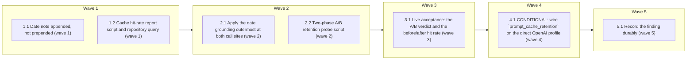

# Prompt caching: warm prefix across idle gaps, date note last, hit rate measurable

<!-- AT-A-GLANCE:BEGIN (generated — do not edit; refreshed by render_plan.py --summarize) -->
## At a glance

**7 tasks · 5 waves · 16 files · 0/7 done**

| Wave | Task | Title | Files | Done (acceptance) |
|---|---|---|---|---|
| 1 | 1.1 | Date note appended, not prepended (wave 1) | apps/api/app/agents/state.py, apps/api/tests/agents/test_state.py | the four date tests pass; `git diff --stat app/agents/state.py` shows one file; … |
| 1 | 1.2 | Cache hit-rate report script and repository query (wave 1) | apps/api/app/repositories/agent_run.py, apps/api/scripts/cache_hit_report.py, apps/api/tests/scripts/test_cache_hit_report.py | tests pass; the script run against the dev database prints the per-node table an… |
| 2 | 2.1 | Apply the date grounding outermost at both call sites (wave 2) | apps/api/app/agents/supervisor.py, apps/api/app/agents/subagents/_base.py, apps/api/tests/agents/test_state.py | the extended capture test passes; the SC-3 structural check passes; the diff is … |
| 2 | 2.2 | Two-phase A/B retention probe script (wave 2) | apps/api/scripts/probe_cache_retention.py, apps/api/tests/scripts/test_probe_cache_retention.py | tests pass including the TIE case; ruff clean; `--seed` against the real key pri… |
| 3 | 3.1 | Live acceptance: the A/B verdict and the before/after hit rate (wave 3) | specs/prompt-caching-system-prefix/SUMMARY.md | SUMMARY §Verify has one row per command above with real exit codes; the eval-smo… |
| 4 | 4.1 | CONDITIONAL: wire `prompt_cache_retention` on the direct OpenAI profile (wave 4) | apps/api/app/core/config.py, apps/api/app/clients/llm.py, apps/api/tests/clients/test_llm.py, apps/api/tests/core/test_config_llm.py | either the Status Log records `skipped — not triggered` with the Task 3.1 verdic… |
| 5 | 5.1 | Record the finding durably (wave 5) | docs/solutions/agent/prompt-caching-implicit-idle-eviction.md, docs/solutions/INDEX.md | the record exists with complete frontmatter and is listed in INDEX and critical-… |

### Progress
- [ ] 1.1 — Date note appended, not prepended (wave 1)
- [ ] 1.2 — Cache hit-rate report script and repository query (wave 1)
- [ ] 2.1 — Apply the date grounding outermost at both call sites (wave 2)
- [ ] 2.2 — Two-phase A/B retention probe script (wave 2)
- [ ] 3.1 — Live acceptance: the A/B verdict and the before/after hit rate (wave 3)
- [ ] 4.1 — CONDITIONAL: wire `prompt_cache_retention` on the direct OpenAI profile (wave 4)
- [ ] 5.1 — Record the finding durably (wave 5)
<!-- AT-A-GLANCE:END -->

## 1. Motivation

Measurement on the dev Postgres (2026-09-10, 166 turns) shows OpenAI implicit caching is already at
71.9% (specialists 75.8%, supervisor 49.4%) and that 28 of 30 supervisor misses follow an idle gap
(>60 min → 0/17 hits). The candidate lever is cache **retention** (`prompt_cache_retention="24h"`, accepted by
`gpt-5.4-mini` in a live probe), not the prefix — but a 21 min A/B tied against the `in_memory`
control, so the benefit is unproven and the parameter ships behind a flag (design D2). Moving the date note last stays in scope as the
cheap, standards-correct fix for the day-rollover / per-timezone split (2/30 misses). Decisions and
alternatives: `design.md` (D1–D4); evidence: `SUMMARY.md`, `research-brief.md`; scope authority:
`ESCALATIONS.md` E001 → A, E002 → B.

## 2. Non-goals

- No Anthropic `cache_control`, no `prompt_cache_key`, no change to `app/core/pricing.py`.
- No prompt `.md` / `active.yaml` change; no summarizer or graph topology change.
- No dashboard UI; the report is a script.
- No change to `metrics.py` — `cached_tokens` is already captured per LLM step.

## Global Constraints

- Lane `high-risk`. Backend commands run from `apps/api/` with `../../.venv/bin/python`; scripts
  run as `python -m scripts.<name>` from `apps/api/`.
- **Worktree**: implementation runs in `../travel-pi-prompt-caching-system-prefix` on branch
  `feat/prompt-caching-system-prefix` off `main` (34f9920). The worktree has no `.venv` of its own —
  a symlink to the main checkout's venv makes every `../../.venv/bin/python` command in this plan
  work verbatim. Do **not** copy `apps/api/.env` in: it reddens the delenv and dashboard tests, and
  waves 1–2 are offline (SQLite, `FakeLLM`).
- **`.gitignore` trap**: line 31 is a bare `scripts/`, which matches a directory of that name at
  **any** depth. So new files under `apps/api/scripts/` *and* under `apps/api/tests/scripts/` are
  ignored; the existing files in both directories are tracked, which hides it completely. All four
  new files in this plan (`scripts/cache_hit_report.py`, `scripts/probe_cache_retention.py`,
  `tests/scripts/test_cache_hit_report.py`, `tests/scripts/test_probe_cache_retention.py`) need
  `git add -f`, **and so do later edits to them**: for a file already tracked under an ignored
  directory, a plain `git add` still stages it but exits non-zero with an "ignored" warning, so an
  `add && commit` chain stops after staging and the next commit silently sweeps the change in (this
  happened once — see SUMMARY). Always `git add -f` there, and check `git diff --cached --name-only`
  before every commit.
- **Implementers do not commit.** Same-wave subagents share one index and race it (entangled
  commits, files left uncommitted). Each task implements and verifies only; the controller stages
  and commits per task, serially, after the task reports.
- **Spec files are read-only for implementers.** `specs/prompt-caching-system-prefix/` is committed
  once at the end with a fully covered SUMMARY — `commit-quality-gate.sh` Check 1.6 blocks any
  commit touching a slug whose SUMMARY does not yet cover every SC in its PLAN.
- Tests first: write the failing test, confirm it fails, then change the code. The ruff-on-edit hook
  strips an import added before its usage — add import and usage in one edit.
- `prompt_cache_retention` is sent **only** when `profile.sdk == "openai"` **and** no `base_url`
  resolved (direct OpenAI, never a gateway) **and** the settings value is non-empty.
- `ground_current_date` is applied **outermost** at both call sites; nothing else reorders the
  system-message blocks.
- Same-wave tasks never share a file. Stage and commit as separate commands; no tooling trailers.
- Live checks (wave 3) need Docker Postgres + `apps/api/.env`; a graph rebuild is required after the
  code change (`docker exec api-api-1 touch app/main.py`). Wave-3 API calls are paid and tiny.
- `### Rollback` in `SUMMARY.md` is mandatory (high-risk): `git revert` per commit; the retention
  flag can be turned off without a code deploy via `OPENAI_PROMPT_CACHE_RETENTION=`.

## 3. Success Criteria

| ID | Behavior (observable) | Check (re-runnable) | Expected |
|------|-------------------------|-----------------------|------------|
| SC-1 | The date-grounding note is the last block of a grounded system message and the base prompt is first | `cd apps/api && ../../.venv/bin/python -c "from app.agents.state import ground_current_date as g;from langchain_core.messages import SystemMessage as S;c=g(S(content='BASE PROMPT'),'Asia/Ho_Chi_Minh').content;assert c.startswith('BASE PROMPT');assert c.rstrip().endswith('ambiguous.');assert c.index('CURRENT DATE')>c.index('BASE PROMPT')"` | exit 0 |
| SC-2 | On a real sub-agent invocation the model sees base prompt, then summary, then the reply-language pin, then the date note — and every date rule still reaches it | `cd apps/api && ../../.venv/bin/python -m pytest tests/agents/test_state.py -q` | exit 0 |
| SC-3 | Both call sites apply the date grounding outermost (no inner call left) | `cd apps/api && ../../.venv/bin/python -c "import inspect,app.agents.supervisor as s,app.agents.subagents._base as b;src=inspect.getsource(s)+inspect.getsource(b);assert 'system_with_summary(state, ground_current_date' not in src;assert src.count('ground_current_date(')==2"` | exit 0 |
| SC-4 | The hit-rate report aggregates `llm` steps per node and model and gates on `--min-ratio` | `cd apps/api && ../../.venv/bin/python -m pytest tests/scripts/test_cache_hit_report.py -q` | exit 0 |
| SC-5 | The report runs against a real database | `cd apps/api && ../../.venv/bin/python -m scripts.cache_hit_report --since 7d` | exit 0 |
| SC-6 | The A/B retention probe's two phases are unit-tested against a fake model, including the tie verdict | `cd apps/api && ../../.venv/bin/python -m pytest tests/scripts/test_probe_cache_retention.py -q` | exit 0 |
| SC-7 | Live: after a >60 min idle gap the probe printed a verdict comparing the `24h` arm against the `in_memory` control — and the one-shot run is recorded | `python3 -c "import json;d=json.load(open('specs/prompt-caching-system-prefix/evidence/retention_probe_production.json'));assert d['exit_code']==0;assert d['verdict'] in ('RETENTION-WINS','TIE','BOTH-MISS','CONTROL-ONLY');assert d['true_gap_min']>=60"` | exit 0 — the committed record of the live `--check` run shows exit 0, one of the four verdict cells, and a true idle gap of at least 60 min. Amended 2026-09-10 before the run: see the note under this table |
| SC-8 | Retention wiring, when present, is scoped to the direct OpenAI profile and a non-empty flag; when the conditional wave is skipped, no retention parameter exists in `app/` at all | `cd apps/api && ../../.venv/bin/python -c "import inspect,pathlib;from app.core.config import Settings;src=inspect.getsource(__import__('app.clients.llm',fromlist=['x']));wired=hasattr(Settings(),'openai_prompt_cache_retention');hits=[f for f in pathlib.Path('app').rglob('*.py') if 'prompt_cache_retention' in f.read_text()];assert (wired and 'resolved_base_url is None' in src and 'prompt_cache_retention' in src) or (not wired and not hits)"` | exit 0 — holds whether or not Task 4.1 fired |
| SC-9 | Lint is clean on the changed app files, scripts and their tests | `cd apps/api && ../../.venv/bin/ruff check app scripts tests/scripts tests/agents/test_state.py` | exit 0 |
| SC-10 | The durable record exists and the solutions index agrees with it | `python3 .claude/scripts/rebuild_solution_index.py --check` | exit 0 |

**SC-7 amendment (2026-09-10, made before the result existed).** The original check re-ran
`--check`. Review round two made the probe spend itself on first contact with the cache, so after a
completed run `--check` exits 3 by design and the original check can never be re-run. The behaviour
claimed is unchanged. The check now asserts the committed record of the one live run, and asserts no
particular verdict, so it cannot be tailored to the outcome. It reaches **traceability** only; the
truth was reached once, live — see SUMMARY "Not auto-verified".

The full BE suite (`make test`, ~3 min) and `make eval-smoke` (18 cases, real agent, includes the
`dates` goldens that guard D1) run at `finishing-a-development-branch`, never in a task `Verify`.

## 4. Tasks

### Task 1.1 — Date note appended, not prepended (wave 1)

- **Files:** apps/api/app/agents/state.py, apps/api/tests/agents/test_state.py
- **Action:** Test first: in `tests/agents/test_state.py` extend `test_ground_current_date_injects_today`
  and the two timezone tests to assert order — `content.startswith("BASE PROMPT")` and
  `content.index("CURRENT DATE") > content.index("BASE PROMPT")` — and add
  `test_ground_current_date_note_is_last_block` asserting the rstripped content ends with the note's
  final sentence (`"ambiguous."`). Run; confirm the order assertions fail. Then in
  `app/agents/state.py` change the single return of `ground_current_date` to
  `SystemMessage(content=f"{base.content}\n\n{note}")` and fix the docstring's first paragraph to say
  the note is appended last so the stable prompt stays at token 0, citing OpenAI's "place timestamps
  at the end" guidance in one sentence. Do not touch `system_with_summary`, `with_reply_language`, or
  the note text — it must stay byte-identical.
- **Verify:** `cd apps/api && ../../.venv/bin/python -m pytest tests/agents/test_state.py -q -k ground_current_date`
- **Done:** the four date tests pass; `git diff --stat app/agents/state.py` shows one file; the note wording is unchanged.
- **Criteria:** SC-1
- **Interfaces:** Consumes the existing ground_current_date(base, tz) signature, unchanged. Produces `apps/api/app/agents/state.py` (append semantics), `apps/api/tests/agents/test_state.py` (order pins).

### Task 1.2 — Cache hit-rate report script and repository query (wave 1)

- **Files:** apps/api/app/repositories/agent_run.py, apps/api/scripts/cache_hit_report.py, apps/api/tests/scripts/test_cache_hit_report.py
- **Action:** Test first, following `tests/scripts/test_set_tier.py` (temp SQLite via
  `Base.metadata.create_all`, settings monkeypatched): insert two `llm` steps for node `supervisor`
  (`input_tokens=3000/cached_tokens=2816` and `3000/0`), one `tool` step that must be ignored, and one
  `llm` step for node `assistant`; assert `build_report(rows)` returns per node-and-model dicts with
  `calls, input, cached, misses, ratio` plus an `overall` ratio; assert `main(["--since","1d","--min-ratio","0.9"])`
  exits 1 and `--min-ratio 0.4` exits 0. Confirm failure. Then add
  `AgentRunRepository.llm_steps_since(since: datetime) -> list[AgentRunStep]` selecting `kind == "llm"`
  and `created_at >= cutoff` with the same ISO-string cutoff idiom as `totals`, and write
  `scripts/cache_hit_report.py` in the `set_tier.py` style: argparse `--since` (`Nd`/`Nh`, default
  `7d`), `--node` filter, optional `--min-ratio` float, a pure `build_report(rows)` for testability, a
  fixed-width table print, exit 1 when below `--min-ratio`. The module docstring names this spec and
  the `python -m scripts.cache_hit_report` invocation, and states that nodes whose prompts are under
  1,024 tokens (`reflection`, `synthesize`, `summarize`) legitimately report 0%.
- **Verify:** `cd apps/api && ../../.venv/bin/python -m pytest tests/scripts/test_cache_hit_report.py -q`
- **Done:** tests pass; the script run against the dev database prints the per-node table and exits 0.
- **Criteria:** SC-4, SC-5, SC-9
- **Interfaces:** Consumes AgentRunStep columns node, model, input_tokens, cached_tokens, kind, created_at. Produces `apps/api/app/repositories/agent_run.py` (llm_steps_since), `apps/api/scripts/cache_hit_report.py`, `apps/api/tests/scripts/test_cache_hit_report.py`.

### Task 2.1 — Apply the date grounding outermost at both call sites (wave 2)

- **Files:** apps/api/app/agents/supervisor.py, apps/api/app/agents/subagents/_base.py, apps/api/tests/agents/test_state.py
- **Action:** Test first: extend `test_subagent_receives_todays_date_in_system_prompt` (the capture
  pattern is already there) to invoke with `summary="trip to Tokyo"` and `language="vi"`, then assert
  on `system_msg.content`: `startswith("base system")`, `index("Tokyo") < index("CURRENT DATE")`, the
  reply-language pin's index `< index("CURRENT DATE")`, and `rstrip().endswith("ambiguous.")`. Confirm
  it fails, since today the note comes first. Then change the two call sites:
  `supervisor.py:254` becomes `ground_current_date(system_with_summary(state, base), ctx.timezone)`;
  `_base.py:251-255` builds `system_with_summary(state, system)`, then `with_reply_language(...)`,
  then `ground_current_date(system_msg, tz)` last. Keep the existing comments and add one line naming
  design D1. No other edits in either file.
- **Verify:** `cd apps/api && ../../.venv/bin/python -m pytest tests/agents/test_state.py tests/agents/test_supervisor_language.py -q`
- **Done:** the extended capture test passes; the SC-3 structural check passes; the diff is exactly two app files plus the test file.
- **Criteria:** SC-2, SC-3
- **Interfaces:** Consumes Task 1.1's append semantics. Produces `apps/api/app/agents/supervisor.py`, `apps/api/app/agents/subagents/_base.py` (outermost grounding), `apps/api/tests/agents/test_state.py` (order pin on a real sub-agent call).

### Task 2.2 — Two-phase A/B retention probe script (wave 2)

- **Files:** apps/api/scripts/probe_cache_retention.py, apps/api/tests/scripts/test_probe_cache_retention.py
- **Action:** Test first: monkeypatch `_build_chat_model` to return a `FakeLLM` whose `AIMessage`
  carries `usage_metadata.input_token_details = {"cache_read": N}` with N configurable per retention
  value. Assert `--seed` writes a state file with two nonces and a timestamp; `--check` exits 2 when
  elapsed is under 60 min (monkeypatch `time.time`); and at 60 min or more it exits 0 printing
  `RETENTION-WINS` when only the `24h` arm reads cached tokens, `TIE` when both do, `CONTROL-ONLY` when only
  the control does (the fourth cell, added during implementation), and `BOTH-MISS`
  when neither does. The control arm is not optional — a single-arm probe cannot attribute a hit to
  the parameter, which is exactly what the 2026-09-10 21-minute run got wrong. Then write the script:
  argparse `--seed | --check`, `--state` (default `.harness-state/cache_retention_probe.json` under
  `apps/api/`), `--model` (default `get_settings().llm_model`), `--min-gap-min` (default 60); a
  roughly 3k-token nonced prompt; two calls per retention value on seed so the cache write lands, one
  per value on check; one printed line per arm with input, cache_read, HIT or MISS and elapsed
  minutes, then the verdict token. The docstring must warn that a cache read refreshes the entry, so
  every `--check` restarts the idle clock and a re-check needs a fresh `--seed`. The script calls
  `_build_chat_model("openai", model, model_kwargs={"prompt_cache_retention": value})` explicitly, so
  it stays independent of the Task 4.1 flag.
- **Verify:** `cd apps/api && ../../.venv/bin/python -m pytest tests/scripts/test_probe_cache_retention.py -q`
- **Done:** tests pass including the TIE case; ruff clean; `--seed` against the real key prints two seeded nonces.
- **Criteria:** SC-6, SC-9
- **Interfaces:** Consumes _build_chat_model and the OpenAI prompt_cache_retention parameter. Produces `apps/api/scripts/probe_cache_retention.py`, `apps/api/tests/scripts/test_probe_cache_retention.py`.

### Task 3.1 — Live acceptance: the A/B verdict and the before/after hit rate (wave 3)

- **Files:** specs/prompt-caching-system-prefix/SUMMARY.md
- **Action:** In the Docker stack with `apps/api/.env`: (1) record the before number by running the
  report on the current data and pasting the fresh output; (2) `python -m scripts.probe_cache_retention --seed`;
  (3) rebuild the graph (`docker exec api-api-1 touch app/main.py`) and run `make eval-smoke` so real
  turns exercise the reordered prompt — the `dates` goldens are the D1 behaviour guard and any
  regression there blocks; (4) after a gap of more than 60 minutes, `python -m scripts.probe_cache_retention --check`;
  (5) `python -m scripts.cache_hit_report --since 2h`. Write every command and exit code into
  `SUMMARY.md` §Verify with the `Criterion` column, both report tables and the probe lines into
  §What changed, and the verdict token verbatim. The verdict decides wave 4 per `ESCALATIONS.md` E003
  — no further human gate.
- **Verify:** `cd apps/api && ../../.venv/bin/python -m scripts.probe_cache_retention --check`
- **Done:** SUMMARY §Verify has one row per command above with real exit codes; the eval-smoke `dates` cases pass; the verdict token is recorded and wave 4 is marked triggered or skipped.
- **Criteria:** SC-5, SC-7
- **Interfaces:** Consumes the Task 1.2 and Task 2.2 scripts, the Docker stack and a real API key. Produces `specs/prompt-caching-system-prefix/SUMMARY.md` (evidence tables, verdict, wave-4 trigger decision).

### Task 4.1 — CONDITIONAL: wire `prompt_cache_retention` on the direct OpenAI profile (wave 4)

- **Files:** apps/api/app/core/config.py, apps/api/app/clients/llm.py, apps/api/tests/clients/test_llm.py, apps/api/tests/core/test_config_llm.py
- **Action:** **Runs only when Task 3.1's verdict is `RETENTION-WINS`.** On any other verdict — `TIE`, `BOTH-MISS` or `CONTROL-ONLY` —
  skip the task, record `skipped — not triggered` in the SUMMARY Status Log with the verdict as
  evidence, and leave `app/clients/llm.py` untouched — SC-8 holds either way. When triggered: test
  first. In `tests/clients/test_llm.py` add three tests using the `init_chat_model` capture pattern of
  `test_build_chat_model_native_profile_has_no_base_url`: (a) provider `openai` gives captured kwargs
  `model_kwargs == {"prompt_cache_retention": "24h"}`; (b) provider `clinepass` (gateway) and provider
  `anthropic` give no `model_kwargs` key; (c) the setting emptied gives no `model_kwargs` key even for
  `openai`. In `tests/core/test_config_llm.py` add `test_openai_prompt_cache_retention_validation`:
  `24h`, `in_memory` and `""` (mapping to `None`) accepted, anything else raising. Confirm they fail.
  Then add `openai_prompt_cache_retention: str | None = "24h"` to `Settings` next to `llm_base_url`
  with a `field_validator` mapping `""` to `None` and rejecting values outside `{"24h","in_memory"}`,
  and inside the existing `if profile.sdk == "openai":` block in `_build_chat_model`, after
  `stream_usage`, add the guarded assignment only when `resolved_base_url is None and s.openai_prompt_cache_retention`.
  Comment why: gateways may reject an unknown parameter and the server 400s on a bad value (probe
  2026-09-10). No caller passes `model_kwargs`, so assert that rather than merging.
- **Verify:** `cd apps/api && ../../.venv/bin/python -m pytest tests/clients/test_llm.py tests/core/test_config_llm.py -q`
- **Done:** either the Status Log records `skipped — not triggered` with the Task 3.1 verdict, or all tests in both files pass and the SC-8 dual-branch check still holds.
- **Criteria:** SC-8, SC-9
- **Interfaces:** Consumes ProviderProfile.sdk, the resolved base_url, Settings, and the Task 3.1 verdict. Produces `apps/api/app/core/config.py` (openai_prompt_cache_retention), `apps/api/app/clients/llm.py` (guarded kwarg), `apps/api/tests/clients/test_llm.py`, `apps/api/tests/core/test_config_llm.py`.

### Task 5.1 — Record the finding durably (wave 5)

- **Files:** docs/solutions/agent/prompt-caching-implicit-idle-eviction.md, docs/solutions/INDEX.md
- **Action:** Via the `compound` skill, write a `knowledge`-type record: caching was already implicit
  at about 72%; misses are idle eviction rather than prefix instability; nodes under 1,024 tokens
  cannot cache at all; `prompt_cache_retention` is the candidate lever on the direct OpenAI profile
  and is guarded off for gateways; the date note goes last; how to re-measure
  (`scripts/cache_hit_report.py`) and re-prove (`scripts/probe_cache_retention.py`). Include the
  measurement trap this session hit: a single-arm cache probe proves nothing, because a hit at 21
  minutes sits inside the default policy's own documented window, so any retention claim needs a
  control arm and a gap past 60 minutes. Frontmatter `applicable_when`: "before any prompt-caching,
  `cache_control`, or prompt-prefix change, or when a review claims caching is off". Rebuild the index.
- **Verify:** `python3 .claude/scripts/rebuild_solution_index.py --check`
- **Done:** the record exists with complete frontmatter and is listed in INDEX and critical-patterns.
- **Criteria:** SC-10
- **Interfaces:** Consumes the SUMMARY evidence from Task 3.1. Produces `docs/solutions/agent/prompt-caching-implicit-idle-eviction.md`, `docs/solutions/INDEX.md`.
