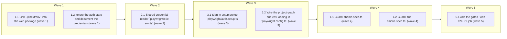

# Playwright e2e behind the Supabase auth gate, running in CI

<!-- AT-A-GLANCE:BEGIN (generated — do not edit; refreshed by render_plan.py --summarize) -->
## At a glance

**8 tasks · 5 waves · 10 files · 0/8 done**

| Wave | Task | Title | Files | Done (acceptance) |
|---|---|---|---|---|
| 1 | 1.1 | Link `@next/env` into the web package (wave 1) | apps/web/package.json, pnpm-lock.yaml | `require.resolve("@next/env")` succeeds from `apps/web`; the lockfile diff adds … |
| 1 | 1.2 | Ignore the auth state and document the credentials (wave 1) | apps/web/.gitignore, apps/web/.env.example | `git check-ignore` matches the storage-state path; `.env.example` names both var… |
| 2 | 2.1 | Shared credential reader `playwright/e2e-env.ts` (wave 2) | apps/web/playwright/e2e-env.ts | `hasCreds` is strictly `false` with both variables unset and strictly `true` wit… |
| 3 | 3.1 | Sign-in setup project `playwright/auth.setup.ts` (wave 3) | apps/web/playwright/auth.setup.ts | The file type-checks, imports `hasCreds` and `STORAGE_STATE` from `./e2e-env`, a… |
| 3 | 3.2 | Wire the project graph and env loading in `playwright.config.ts` (wave 3) | apps/web/playwright.config.ts | The grep finds the `setup` project and `--list` exits 0 listing both spec files. |
| 4 | 4.1 | Guard `theme.spec.ts` (wave 4) | apps/web/playwright/theme.spec.ts | The grep finds the file-scope guard and `--list` still reports 5 tests from this… |
| 4 | 4.2 | Guard `trip-smoke.spec.ts` (wave 4) | apps/web/playwright/trip-smoke.spec.ts | The grep finds the file-scope guard and `--list` still reports 1 test from this … |
| 5 | 5.1 | Add the gated `web-e2e` CI job (wave 5) | .github/workflows/ci.yml | The command exits 0, which also proves the workflow still parses as YAML; the sa… |

### Progress
- [ ] 1.1 — Link `@next/env` into the web package (wave 1)
- [ ] 1.2 — Ignore the auth state and document the credentials (wave 1)
- [ ] 2.1 — Shared credential reader `playwright/e2e-env.ts` (wave 2)
- [ ] 3.1 — Sign-in setup project `playwright/auth.setup.ts` (wave 3)
- [ ] 3.2 — Wire the project graph and env loading in `playwright.config.ts` (wave 3)
- [ ] 4.1 — Guard `theme.spec.ts` (wave 4)
- [ ] 4.2 — Guard `trip-smoke.spec.ts` (wave 4)
- [ ] 5.1 — Add the gated `web-e2e` CI job (wave 5)
<!-- AT-A-GLANCE:END -->

## 1. Motivation

Since `review-a-security-hardening` (PR #129) the Next middleware redirects `/trips` to
`/auth/login`, and both Playwright specs open `/trips` with no session — so the only browser-level
coverage the repo has cannot pass. Nothing in `.github/workflows/ci.yml` runs a browser, so the
breakage went unnoticed. This plan restores both specs behind a real Supabase session and runs them
on every pull request. Design: `design.md` (approved 2026-09-04). Research: `research-brief.md`
(Deep).

## 2. Non-goals

- Programmatic sign-in through `supabase-js`, a local Supabase stack, or any BE test-token path.
- New e2e coverage beyond the two existing specs.
- Running Next as `build` + `start` in CI.
- Any change to `src/lib/supabase/middleware.ts`, `src/app/auth/*`, or `apps/api/`.
- Items 11–12 of the deep review (siblings `review-c2-chat-resilience`, `review-c3-web-ssr-i18n`).

## Global Constraints

- Node 24 for every FE command: `export PATH="$HOME/.nvm/versions/node/v24.17.0/bin:$PATH"`.
- Run FE commands from `apps/web/` or through `pnpm --filter @travel/web`.
- Stage and commit as separate commands (a PreToolUse hook blocks `git add … && git commit …`).
- No production code changes: `apps/web/src/**` and `apps/api/**` stay untouched.
- Secrets and credentials never enter a tracked file. `playwright/.auth/` is gitignored.
- Follow the existing spec convention: every Playwright file starts with a header comment giving
  its exact run recipe.
- Task `Verify` commands and Success-Criteria checks run from the repo root and assume a Node-24
  shell, which is why each `pnpm` command carries the PATH export inline.
- The `MODULE_TYPELESS_PACKAGE_JSON` warning that Node prints when importing a `.ts` file from
  `apps/web` is expected: `apps/web/package.json` deliberately has no `"type": "module"`, and
  adding one would break the Next build. Do not "fix" it.

## 3. Success Criteria

| ID | Behavior (observable) | Check (re-runnable) | Expected |
|---|---|---|---|
| SC-1 | `@next/env` resolves from the web package, so the Playwright config can load `.env.local` | `export PATH="$HOME/.nvm/versions/node/v24.17.0/bin:$PATH" && pnpm --filter @travel/web exec node -e "require.resolve('@next/env')"` | exit 0 |
| SC-2 | Saved browser auth state is gitignored and the e2e credentials are documented | `grep -q E2E_USER_EMAIL apps/web/.env.example && git check-ignore -q apps/web/playwright/.auth/user.json` | exit 0 |
| SC-3 | With no credentials in the environment the shared reader reports none | `export PATH="$HOME/.nvm/versions/node/v24.17.0/bin:$PATH" && env -u E2E_USER_EMAIL -u E2E_USER_PASSWORD pnpm --filter @travel/web exec node -e "import('./playwright/e2e-env.ts').then(m => process.exit(m.hasCreds === false ? 0 : 1))"` | exit 0 |
| SC-4 | With both credentials set the shared reader reports them present | `export PATH="$HOME/.nvm/versions/node/v24.17.0/bin:$PATH" && E2E_USER_EMAIL=e2e@example.com E2E_USER_PASSWORD=pw pnpm --filter @travel/web exec node -e "import('./playwright/e2e-env.ts').then(m => process.exit(m.hasCreds === true ? 0 : 1))"` | exit 0 |
| SC-5 | Playwright collects both specs under a `chromium` project that depends on `setup` | `export PATH="$HOME/.nvm/versions/node/v24.17.0/bin:$PATH" && pnpm --filter @travel/web exec playwright test --list --project=chromium` | exit 0 — lists theme.spec.ts and trip-smoke.spec.ts |
| SC-6 | The whole web package, Playwright directory included, type-checks | `export PATH="$HOME/.nvm/versions/node/v24.17.0/bin:$PATH" && pnpm --filter @travel/web exec tsc --noEmit` | exit 0 |
| SC-7 | CI has a `web-e2e` job that needs `web`, carries the secrets flag, and gates every step but one notice | `python3 -c "import yaml; j=yaml.safe_load(open('.github/workflows/ci.yml'))['jobs']['web-e2e']; s=j['steps']; assert 'web' in j['needs'] and 'HAS_E2E_SECRETS' in j['env']; assert sum(1 for x in s if 'HAS_E2E_SECRETS' in str(x.get('if',''))) == len(s) - 1"` | exit 0 — exits 1 today, before the job exists |

Manual acceptance, outside the SC table because it exceeds the 60-second bound and needs external
state: with the Supabase e2e user created and `E2E_USER_EMAIL` / `E2E_USER_PASSWORD` in
`apps/web/.env.local`, and the BE running on `:8000`, `pnpm --filter @travel/web e2e` finishes with
6 passed and 0 failed; and the `web-e2e` job is green on this branch's pull request.

## 4. Tasks

### Task 1.1 — Link `@next/env` into the web package (wave 1)

- **Files:** apps/web/package.json, pnpm-lock.yaml
- **Action:** Add `"@next/env": "16.2.9"` to `devDependencies` in `apps/web/package.json`, pinned
  to the exact version `next` already depends on, then run `pnpm install` from the repo root to
  update the lockfile. The package is already in the pnpm store as a transitive of `next`, so no
  new download occurs; it is currently not linked into `apps/web/node_modules`, which is why the
  Playwright config cannot import it yet. Record this in `SUMMARY.md` under Deviations as a Rule-3
  dependency addition.
- **Verify:** `export PATH="$HOME/.nvm/versions/node/v24.17.0/bin:$PATH" && pnpm --filter @travel/web exec node -e "require.resolve('@next/env')"`
- **Done:** `require.resolve("@next/env")` succeeds from `apps/web`; the lockfile diff adds only
  the `@next/env` link, no version changes elsewhere.
- **Criteria:** SC-1
- **Interfaces:** Consumes the existing next 16.2.9 pin from the web manifest. Produces `apps/web/package.json` with a resolvable @next/env devDependency, consumed by Task 3.2.

### Task 1.2 — Ignore the auth state and document the credentials (wave 1)

- **Files:** apps/web/.gitignore, apps/web/.env.example
- **Action:** Add `/playwright/.auth` to `apps/web/.gitignore` next to the existing
  `/playwright/.cache` entry — the saved storage state holds session cookies that can impersonate
  the e2e user, so it must never be committed. In `apps/web/.env.example`, document
  `E2E_USER_EMAIL` and `E2E_USER_PASSWORD` in a commented block that states they are read only by
  `pnpm e2e`, that the account must exist on the Supabase project with a confirmed email, and that
  the specs skip when either is absent.
- **Verify:** `grep -q E2E_USER_EMAIL apps/web/.env.example && git check-ignore -q apps/web/playwright/.auth/user.json`
- **Done:** `git check-ignore` matches the storage-state path; `.env.example` names both variables
  and their purpose.
- **Criteria:** SC-2
- **Interfaces:** Consumes nothing. Produces `apps/web/.gitignore` and `apps/web/.env.example`, which document and protect the credentials used by Tasks 3.1 and 3.2.

### Task 2.1 — Shared credential reader `playwright/e2e-env.ts` (wave 2)

- **Files:** apps/web/playwright/e2e-env.ts, apps/web/playwright/load-env.ts, apps/web/playwright/storage-state.ts
- **Action:** Create three single-purpose modules. `e2e-env.ts` is the only file that reads
  `process.env`; `load-env.ts` is a side-effect module calling `loadEnvConfig(<apps/web>, true)`,
  which the config imports FIRST so the dotenv files are populated before any module reads them
  (imports evaluate before the importing file's statements, so a `loadEnvConfig` statement in the
  config runs too late and credentials from `.env.local` are missed); `storage-state.ts` owns the
  path. Export `E2E_USER_EMAIL` and `E2E_USER_PASSWORD` (both `string |
  undefined`), and `hasCreds` typed `boolean` and computed as `Boolean(email && password)` so it is never a
  string. `storage-state.ts` exports `STORAGE_STATE`, an **absolute**
  path anchored to this module's own directory joined with `.auth/user.json` — never from
  `process.cwd()`, because a cwd-relative storage-state path is the documented cause of the
  setup-project failing on a CI runner while passing locally (microsoft/playwright#32302).
  The module must **not** mention `import.meta`: Playwright transpiles it to CommonJS, where
  `import.meta` is a parse error and `__dirname` is defined, while Node's own type stripping loads
  the same file as ESM, where `__dirname` is undefined. Anchor on `__dirname` behind a `typeof`
  guard so both loaders work. `storage-state.ts` is Playwright-only, so it throws rather than
  falling back to a cwd-relative guess when `__dirname` is absent.
  When `hasCreds` is false, print one line to stderr naming both missing variables, so an all-skip
  run is never silent.
- **Verify:** `export PATH="$HOME/.nvm/versions/node/v24.17.0/bin:$PATH" && env -u E2E_USER_EMAIL -u E2E_USER_PASSWORD pnpm --filter @travel/web exec node -e "import('./playwright/e2e-env.ts').then(m => process.exit(m.hasCreds === false ? 0 : 1))"`
- **Done:** `hasCreds` is strictly `false` with both variables unset and strictly `true` with both
  set; `STORAGE_STATE` is absolute and ends with `playwright/.auth/user.json`.
- **Criteria:** SC-3, SC-4, SC-6
- **Interfaces:** Consumes the process environment. Produces `apps/web/playwright/e2e-env.ts` exporting hasCreds, plus `apps/web/playwright/load-env.ts` and `apps/web/playwright/storage-state.ts`, consumed by Tasks 3.1, 3.2, 4.1 and 4.2.

### Task 3.1 — Sign-in setup project `playwright/auth.setup.ts` (wave 3)

- **Files:** apps/web/playwright/auth.setup.ts
- **Action:** Create the setup spec that produces the shared session. Start with the header comment
  giving the run recipe and the prerequisite that the Supabase e2e user exists with a confirmed
  email. At file scope call `test.skip(!hasCreds, "E2E_USER_EMAIL/E2E_USER_PASSWORD not set")` —
  file scope, not inside the test body, because `storageState` is read when the context fixture is
  created, so a body-level guard would still hit a missing-file error. In one `setup` test: go to
  `/auth/login`, fill the `Email` and `Password` labels, submit, then `await
  page.waitForURL(url => !url.pathname.startsWith("/auth/login"))` wrapped so that on timeout the
  text of any `role="alert"` element is attached to the thrown error (a wrong password keeps the
  page on `/auth/login` and renders that alert). Finish with
  `await page.context().storageState({ path: STORAGE_STATE })`.
- **Verify:** `export PATH="$HOME/.nvm/versions/node/v24.17.0/bin:$PATH" && pnpm --filter @travel/web exec tsc --noEmit`
- **Done:** The file type-checks, imports `hasCreds` from `./e2e-env` and `STORAGE_STATE` from
  `./storage-state`, and contains exactly one `setup(...)` test and one file-scope skip.
- **Criteria:** SC-6
- **Interfaces:** Consumes `apps/web/playwright/e2e-env.ts` and the sign-in form labels. Produces `apps/web/playwright/auth.setup.ts`, whose run writes the shared storage state used by the chromium project.

### Task 3.2 — Wire the project graph and env loading in `playwright.config.ts` (wave 3)

- **Files:** apps/web/playwright.config.ts
- **Action:** Import `./playwright/load-env` before every other local import so a local `.env.local`
  reaches the Playwright runner process the same way it reaches `next dev`; the loader never
  overrides an already-set variable, so CI's exported secrets still win. It must be an import, not
  a `loadEnvConfig` statement: statements run after imports have already been evaluated. Replace the single `chromium` project with two: `{ name: "setup", testMatch:
  /.*\.setup\.ts/ }` and `{ name: "chromium", use: { ...devices["Desktop Chrome"], storageState:
  STORAGE_STATE }, dependencies: ["setup"] }`. Set `retries: process.env.CI ? 1 : 0` so the
  existing `trace: "on-first-retry"` actually produces a trace on a CI failure. Leave `webServer`,
  `baseURL`, `fullyParallel` and `forbidOnly` untouched. Update the file's header comment to
  describe the two projects.
- **Verify:** `export PATH="$HOME/.nvm/versions/node/v24.17.0/bin:$PATH" && grep -q 'name:.*setup' apps/web/playwright.config.ts && pnpm --filter @travel/web exec playwright test --list --project=chromium`
- **Done:** The grep finds the `setup` project and `--list` exits 0 listing both spec files.
- **Criteria:** SC-5, SC-6
- **Interfaces:** Consumes `apps/web/package.json` and `apps/web/playwright/e2e-env.ts`. Produces `apps/web/playwright.config.ts` carrying the setup-to-chromium project graph every spec runs under.

### Task 4.1 — Guard `theme.spec.ts` (wave 4)

- **Files:** apps/web/playwright/theme.spec.ts
- **Action:** Add the file-scope `test.skip(!hasCreds, …)` guard and update the header comment.
  The page stays `/trips`: there is no public URL that renders the theme toggle, because `/` is
  `redirect("/trips")` and `AppShell` renders bare children under `/auth*`, so this spec needs a
  session even though it needs no backend. Note in the header that under CI `retries: 1` a
  pass-on-retry of the no-FOUC test is still a real flash signal worth reading in the trace. Do not
  change any assertion.
- **Verify:** `export PATH="$HOME/.nvm/versions/node/v24.17.0/bin:$PATH" && grep -q 'test.skip(!hasCreds' apps/web/playwright/theme.spec.ts && pnpm --filter @travel/web exec playwright test --list --project=chromium`
- **Done:** The grep finds the file-scope guard and `--list` still reports 5 tests from this file; the only diff is the import, the
  file-scope skip, and the header comment.
- **Criteria:** SC-5, SC-6
- **Interfaces:** Consumes `apps/web/playwright/e2e-env.ts` and `apps/web/playwright.config.ts`. Produces the guarded `apps/web/playwright/theme.spec.ts`.

### Task 4.2 — Guard `trip-smoke.spec.ts` (wave 4)

- **Files:** apps/web/playwright/trip-smoke.spec.ts
- **Action:** Add the file-scope `test.skip(!hasCreds, …)` guard and rewrite the header comment:
  the spec now runs with a session from the setup project, still needs the FastAPI backend on
  `:8000`, and the recipe must name `E2E_USER_EMAIL` / `E2E_USER_PASSWORD` in `.env.local`. Leave
  the create-trip → add-item → reload flow and every assertion unchanged; the unique `Date.now()`
  stamp is what makes the shared e2e account safe under `fullyParallel`.
- **Verify:** `export PATH="$HOME/.nvm/versions/node/v24.17.0/bin:$PATH" && grep -q 'test.skip(!hasCreds' apps/web/playwright/trip-smoke.spec.ts && pnpm --filter @travel/web exec playwright test --list --project=chromium`
- **Done:** The grep finds the file-scope guard and `--list` still reports 1 test from this file; the flow body is unchanged in the diff.
- **Criteria:** SC-5, SC-6
- **Interfaces:** Consumes `apps/web/playwright/e2e-env.ts` and `apps/web/playwright.config.ts`. Produces the guarded `apps/web/playwright/trip-smoke.spec.ts`.

### Task 5.1 — Add the gated `web-e2e` CI job (wave 5)

- **Files:** .github/workflows/ci.yml
- **Action:** Add a `web-e2e` job with `needs: web` and a job-level
  `env: { HAS_E2E_SECRETS: "${{ secrets.E2E_USER_EMAIL != '' }}" }` — `secrets` is readable in a
  job-level `env` but not in a job-level `if`, which is why the flag is an env var. Every step
  carries `if: env.HAS_E2E_SECRETS == 'true'` except a final unconditional step echoing that e2e
  was skipped for want of secrets. Steps, in order: checkout; setup-python 3.12; install uv;
  `uv venv && uv pip install -r requirements.txt` in `apps/api`; one step that starts the backend
  detached with `nohup … uvicorn app.main:app --port 8000 > uvicorn.log 2>&1 &` (a plain `&` dies
  with the step shell) under `DATABASE_URL=sqlite:///./e2e.db`, `ENVIRONMENT=development`,
  `SUPABASE_URL`, and every LLM key empty, then polls `curl -sf http://localhost:8000/docs` for up
  to 60 seconds and on timeout prints `uvicorn.log` and exits 1; pnpm/action-setup; setup-node 24
  with pnpm cache; `pnpm install --frozen-lockfile`; `pnpm --filter @travel/web exec playwright
  install --with-deps chromium`; `pnpm --filter @travel/web e2e` with `E2E_USER_EMAIL`,
  `E2E_USER_PASSWORD`, `NEXT_PUBLIC_SUPABASE_URL`, `NEXT_PUBLIC_SUPABASE_PUBLISHABLE_KEY` and
  `NEXT_PUBLIC_API_URL=http://localhost:8000` from secrets; and `actions/upload-artifact` of
  `apps/web/playwright-report` with `if: failure() && env.HAS_E2E_SECRETS == 'true'`. Node must be
  24 because the pinned `pnpm@11.9.0` imports `node:sqlite`
  (`docs/solutions/ci/pnpm-node-floor-mismatch.md`). Add no helper script: every
  directory named `scripts/` is gitignored in this repo, so a checker placed there could not be
  committed and its result could not be reproduced from a fresh clone. The acceptance check is the
  inline PyYAML command in the Verify field below, which exits 1 on the current tree because the
  job does not exist yet.
- **Verify:** `python3 -c "import yaml; j=yaml.safe_load(open('.github/workflows/ci.yml'))['jobs']['web-e2e']; s=j['steps']; assert 'web' in j['needs'] and 'HAS_E2E_SECRETS' in j['env']; assert sum(1 for x in s if 'HAS_E2E_SECRETS' in str(x.get('if',''))) == len(s) - 1"`
- **Done:** The command exits 0, which also proves the workflow still parses as YAML; the same
  command exits 1 on the pre-task tree.
- **Criteria:** SC-7
- **Interfaces:** Consumes `apps/web/playwright.config.ts` and the four repository secrets. Produces `.github/workflows/ci.yml` carrying the gated web-e2e job.

## 5. Risks

- **Relative storage-state path.** The upstream failure mode in microsoft/playwright#32302 is a
  cwd-relative path that resolves differently on a runner. Task 2.1 builds it from the module URL.
- **`NODE_ENV=test` blanks `.env.local`.** Next's loader skips `.env.local` when `NODE_ENV` is
  `test`, which would silently turn a real local run into an all-skip run that still exits 0. The
  stderr notice in Task 2.1 is the mitigation; Playwright itself does not set `NODE_ENV`.
- **External dependency on Supabase.** One sign-in per run keeps rate-limit exposure small, and
  `retries: 1` under CI absorbs a single transient failure, but a Supabase outage fails the job.
- **Unconfirmed e2e user.** Password sign-in fails with `Email not confirmed`; the alert text is
  attached to the setup failure so the cause is visible in the report.
- **Human prerequisites gate the manual acceptance.** The Supabase e2e user and the four repository
  secrets must exist before the CI half can be verified at truth tier rather than by reading the
  workflow. Until then, SC-7 proves structure only: it reads the workflow, it does not run it.
- **Design deviation to record in `SUMMARY.md`.** The design wrote `storageState:
  "playwright/.auth/user.json"` (relative, as the Playwright docs show); Task 2.1 makes it absolute
  to avoid the cwd-relative failure mode in microsoft/playwright#32302.
- **Stale local `user.json`.** Running only `--project=chromium` skips the setup project and can
  start from an expired session; delete `playwright/.auth/` to recover.

## 6. Status Log

| Date | Event |
|---|---|
| 2026-09-04 | Shipped — PR opened against main. |
| 2026-09-04 | Intake (parent `review-c-web-experience`, E001-A), design approved, Deep research brief written, plan drafted. |
| 2026-09-04 | Tasks 1.1, 1.2 complete; commits a8b3bf2, 6b3e9ff. Both reviews pass/approved. |
| 2026-09-04 | Task 2.1 complete; commit de5292c; review pass/approved. Task 2.1's mandated `import.meta.url` then proved to be a parse error under Playwright's CommonJS transpile; the Action is corrected above and the module re-anchored on `__dirname`. |
| 2026-09-04 | Tasks 3.1, 3.2 complete; commit 1a3fb62. Tasks 4.1, 4.2 complete; commit 8af6981. |
| 2026-09-04 | Correctness review (6 angles) over the full branch: 6 real findings fixed in `a1e4e5a`, 1 rejected on evidence (`-g` does not filter the setup project), 1 late finding (diagnostics missed job cancellation) fixed in `0056940`. |
| 2026-09-04 | Intent review: gaps found — both are external-prerequisite blockers (no Supabase e2e user, no repo secrets), already disclosed; recorded as deferred in SUMMARY, not fixable in-session. Review chain complete. |
| 2026-09-04 | Task 5.1 complete; commit c9deca3. Tail review (4.1, 4.2, 5.1 + the fix) pass/approved, three Minor findings closed in this entry. All 8 tasks done. |
| 2026-09-04 | Ordering fix committed as 6f4a2af. |
| 2026-09-04 | Wave-3 review found a blocking ordering defect the plan itself caused: the config's `loadEnvConfig` statement ran after `e2e-env` had already read `process.env`, so credentials present only in `.env.local` were missed and every spec skipped silently. Reproduced with a temporary dotenv file, then fixed by splitting out `load-env.ts` (imported first, dev mode) and `storage-state.ts` (throws instead of a cwd fallback). Tasks 2.1 and 3.2 amended above. |
| 2026-09-04 | Plan review round 2: approved; Task 1.1 PATH export, formatting-agnostic grep in 3.2, single-quoted grep patterns. |
| 2026-09-04 | Plan review round 1: helper script moved out (every `scripts/` directory is gitignored), Node-24 PATH added to every check, discriminating greps added to Tasks 3.2/4.1/4.2, undecidable `retries` claim dropped from Task 3.2 Done. |
