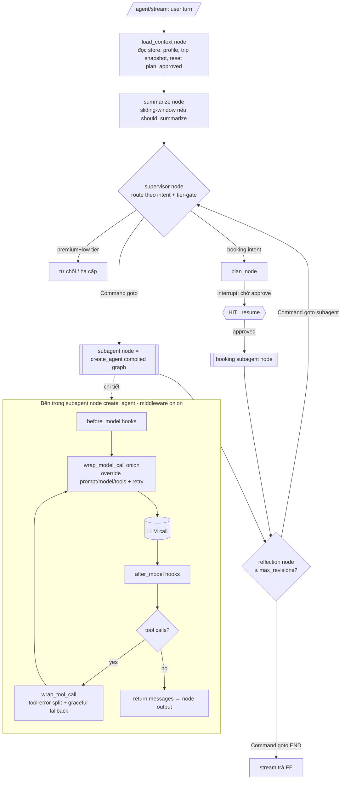

# Design — Path B Subagent Migration (full flow)

> PLAN.md = *làm gì, thứ tự nào*. Doc này = *kiến trúc chạy ra sao end-to-end*. Grounded từ
> `app/agents/` (map hiện tại) + langchain 1.3.11 installed source (`factory.py`, `middleware/`).
> Phạm vi committed: Wave A (PII decoupled) + Wave 0–3 (pilot journal). Design vẫn mô tả cả hình dạng
> cuối để mở rộng on-demand nhất quán.

---

## 1. Bức tranh lớn — cái gì đổi, cái gì KHÔNG

```
                         GIỮ NGUYÊN (custom StateGraph)                    ĐỔI (node builder)
   ┌───────────────────────────────────────────────────────────┐   ┌──────────────────────────┐
   START → load_context → summarize → supervisor ──Command(goto)──►│  subagent node            │
                                          ▲          │                │  v1: build_subagent       │
                                          │          ├──► planner     │      (hand-rolled)        │
                              reflection ◄┘          ├──► concierge   │  v2: build_subagent_v2    │
                              (Command goto          ├──► journal ◄───┼──    create_agent(...)     │
                               subagent|END)         ├──► plan        │      + middleware onion    │
                                          ▲          │    │interrupt()│  (nhúng compiled graph     │
                                          └──────────┼──► booking     │   làm 1 node)             │
                                                     └──► budget      └──────────────────────────┘
                                       (supervisor / reflection / HITL: KHÔNG đổi)
```

**Bất biến thiết kế:** ranh giới *orchestration (supervisor graph)* ↔ *single-agent ReAct loop (subagent
node)*. Mọi thứ **giữa** các node — routing tất định, reflection loop, `plan_node` `interrupt()` HITL,
`load_context`/`summarize`, tier-gate — **ở lại graph cha**. Chỉ **bên trong** một node (model+tools+prompt
của một subagent) chuyển thành `create_agent` + middleware. Đây là lý do path B ≠ path C.

## 2. Full request flow (end-to-end, một lượt user)



**Điểm chốt:** `load_context`, `summarize`, `supervisor`, `reflection`, `plan_node`+`interrupt()` **không
nằm trong bất kỳ middleware nào** — chúng là node graph cha. Middleware chỉ chạy trong hộp `SA_INNER`, mỗi
subagent node một instance onion riêng.

## 3. Middleware onion — 5 behavior đặt ở đâu

`create_agent(model, tools, middleware=[...])` compile một graph con: `before_model → model → after_model
→ (tools) → loop`. Middleware execute **theo thứ tự liệt kê**; `wrap_model_call` bọc quanh handler kiểu
onion (middleware đầu = lớp ngoài cùng). Map từ `_base.py::assistant` hiện tại:

| # | Behavior hiện tại (`_base.py`) | Hook mới | Cơ chế |
|---|---|---|---|
| 1 | Deferred model `resolve_model(None)` → `get_agent_llm` | `wrap_model_call` | `request.override(model=get_agent_llm(name))` per call; giữ `AgentConfigCache` |
| 2 | Dynamic prompt `system_with_summary(state, ground_current_date(system))` | `wrap_model_call` | `request.override(system_prompt=...)`; đọc `request.state` (summary/profile/trip_context) |
| 3 | Tool filter `allow_episodic` | `wrap_model_call` | `request.override(tools=[t for t if allow_episodic or t.name!=EPISODIC])`; đọc `request.runtime.context` |
| 4 | Node retry `LLM_RETRY` | `ModelRetryMiddleware` | `retry_on=_is_retryable_llm`, **`on_failure="error"`** (propagate, KHÔNG "continue") |
| 5 | Tool-error split (`_tool_error_to_message` / `ToolFaultPolicy`) | `wrap_tool_call` | transient(UpstreamError)→retry, logic(ToolException)→narrowed msg; **bỏ `Command(goto)`**, chỉ construct ToolMessage |

Thứ tự đề xuất (ngoài→trong): `[dynamic_model, dynamic_prompt, tool_filter, retry, tool_error]` — model/prompt/tools
phải set trước khi retry bọc quanh model call; tool_error ở lớp tool riêng.

```
       ┌─ dynamic_model.wrap_model_call ────────────────────────┐
       │  ┌─ dynamic_prompt.wrap_model_call ──────────────────┐ │
       │  │  ┌─ tool_filter.wrap_model_call ────────────────┐ │ │
       │  │  │  ┌─ ModelRetryMiddleware ──────────────────┐ │ │ │
   req ─┼──┼──┼──┼──►  handler → [LLM]  ◄── retry loop ───┼─┼─┼─┼─► ModelResponse
       │  │  │  └─────────────────────────────────────────┘ │ │ │
       │  │  └───────────────────────────────────────────────┘ │ │
       │  └─────────────────────────────────────────────────────┘ │
       └───────────────────────────────────────────────────────────┘
   (tool calls) → wrap_tool_call(tool_error) → ToolNode(Send per call)
```

## 4. State / Context / Store threading (điểm feasibility then chốt)

| Kênh | Hiện tại | Sau migration | Bằng chứng |
|---|---|---|---|
| **State** | `TravelAgentState` (MessagesState + summary/profile/trip_context/current_flow) | `create_agent(state_schema=TravelAgentState)` — subclass AgentState; reducer `add_messages` win | `factory.py:815,1148` |
| **Context** | `context_schema=AgentContext`, đọc qua `Runtime[AgentContext]` trong node | `create_agent(context_schema=AgentContext)`; middleware đọc `request.runtime.context` | `factory.py:817,1443` |
| **Store/checkpointer** | compile 1 lần ở graph cha; propagate vào nested subgraph (InjectedStore tự chạy) | Compiled create_agent nhúng làm node → parent store/checkpointer vẫn propagate | `_base.py:8-11` + PoC 0.1(3) |

**Quyết định (fork):** AgentContext đi qua **`context_schema`**, KHÔNG qua state.
- *Bác "context qua state" fallback:* state persist vào checkpointer → per-run context (tier/allow_episodic)
  sẽ dính vào lịch sử, sai ngữ nghĩa `AgentContext` (read-only per-request). Nếu `context_schema` fail ở PoC →
  **escalate**, không âm thầm nhét vào state.

## 5. Parity strategy — 3 điểm drift đã biết (từ panel review)

`create_agent` KHÔNG phải superset của hand-rolled loop; "parity" là **có kiểm chứng**, không mặc định:

| Drift | Nguyên nhân | Xử lý trong design |
|---|---|---|
| **Retry exhaustion** | Node graph có `retry_policy` propagate; `create_agent` không có node retry (`factory.py:1502`), middleware default `on_failure="continue"` trả error AIMessage | Bắt buộc `on_failure="error"`; golden test có case **cạn retry** assert exception propagate |
| **Streaming shape** | `create_agent` stamp `AIMessage.name=node_name` + inject `ToolCallTransformer` (`factory.py:1420,1795`) | Golden harness có case `.astream`; **Wave 3 verify `/agent/stream` thủ công** (surface FE thật) |
| **Parallel tool granularity** | `wrap_tool_call` retry **per-call**; `ToolFaultPolicy` hiện retry **whole ToolNode**; `Send` per call ordering | Test 2 tool-call song song + 1 transient fail; ghi rõ chênh lệch ordering ToolMessage; concierge migrate on-demand (không ở pilot) |

**Golden parity harness** (`test_subagent_parity.py`, lên **Wave 1**): cùng `TravelAgentState` + `FakeLLM`
scripted → chạy v1 vs v2 → assert cùng chuỗi messages/tool_calls/error. Phủ: tool-call, transient error,
logic error, `allow_episodic` on/off, **parallel fail**, **streaming**. Đây là verify-gate mọi wave.

## 6. Migration mechanics — v1/v2 coexistence

```
build_subagent      (v1, _base.py)      ─┐
                                          ├─ CẢ HAI tồn tại tới khi mọi subagent earn migration
build_subagent_v2   (v2, _base_v2.py)   ─┘   (mixed v1/v2 = RESTING STATE hợp lệ, không phải nợ undefined)

graph.py: journal → v2   |   planner/budget/concierge/booking → v1   (Wave 3 kết thúc trạng thái này)
```

- Đổi **một dòng builder** per subagent trong `graph.py`; supervisor/edges/reflection/HITL không chạm.
- Revert = trỏ lại v1 + `git revert`. Mỗi subagent độc lập revertible.
- Retire v1 + rename `_base_v2→_base`: **task riêng, chỉ khi cả 5 đã qua** (ngoài committed scope).

## 7. Wave A — PII flow (decoupled, KHÔNG đụng design trên)

PII ship **trên kiến trúc hiện tại**, độc lập hoàn toàn migration:

```
load_context → summarize → supervisor → subagent(v1) ...
                    │
                    └─(hoặc pre-model trong node) redact_pii(text): email→[REDACTED], card→mask,
                       custom detector name/phone (phối hợp MIN-53)
```

Sau khi journal đã v2, PII **có thể** chuyển thành `PIIMiddleware` trong onion của node đó — nhưng đó là
tối ưu sau, KHÔNG phải điều kiện để đóng lỗ hổng. Đóng lỗ hổng = Wave A, ngay.

## 8. Design decisions (forks — cái làm doc này là *design* chứ không chỉ flow)

| Fork | Chọn | Bác |
|---|---|---|
| Context channel | `context_schema` (đúng ngữ nghĩa read-only per-request) | state (persist vào checkpointer = regression) |
| Retry | `ModelRetryMiddleware(on_failure="error")` (per-model, propagate) | outer retry node bọc create_agent (retry cả tool-loop = khác parity) |
| Tool-error | `wrap_tool_call` per-call + tái dùng `retry.py` filter | create_agent tool config mặc định (mất split transient/logic + graceful fallback) |
| Migration | factory v1/v2 song song, pilot 1 → gate | big-bang cả 5 (parity không kiểm soát — panel bác) |
| PII | Wave A decoupled trước; middleware sau (optional) | PII-as-middleware gated sau full migration (lỗ hổng mở 6 wave — panel bác) |

## 9. Traceability → PLAN

| Design §| PLAN task |
|---|---|
| §4 state/context/store, §5 retry/stream/parallel | Task 0.1 (PoC 6 mục) |
| §3 middleware onion #1–4 | Task 1.1 |
| §3 #5 + §5 parallel | Task 1.2 |
| §5 golden harness | Task 1.3 |
| §6 factory v2 | Task 2.1 |
| §1–2 pilot journal + STOP | Task 3.1 |
| §7 PII | Task A.1 |
