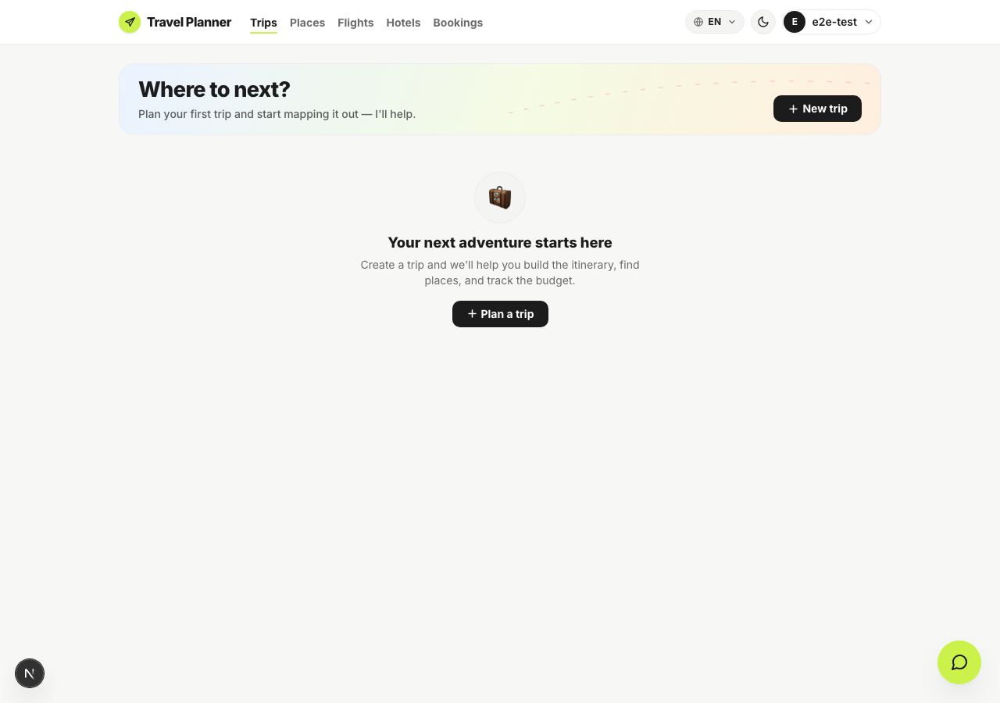
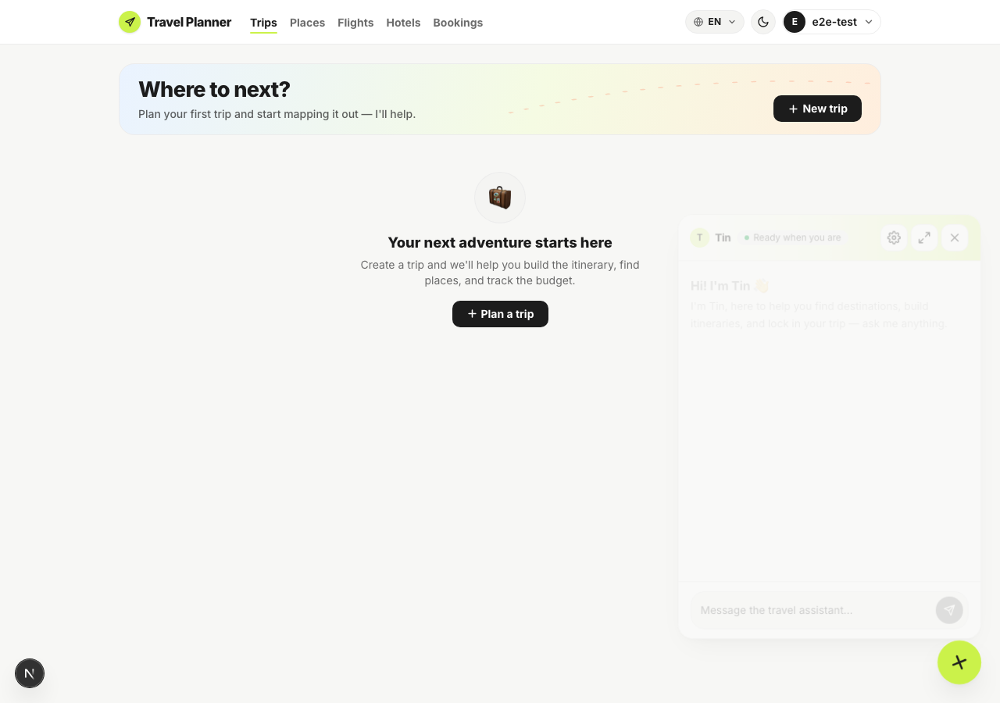
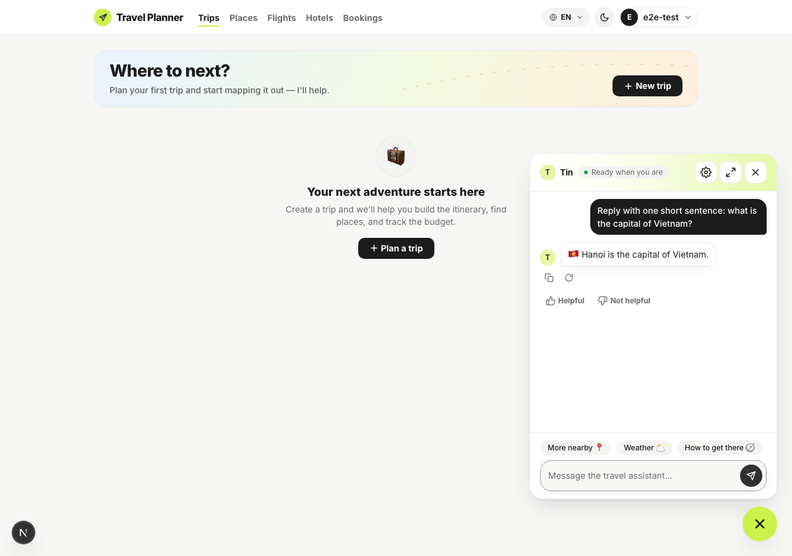
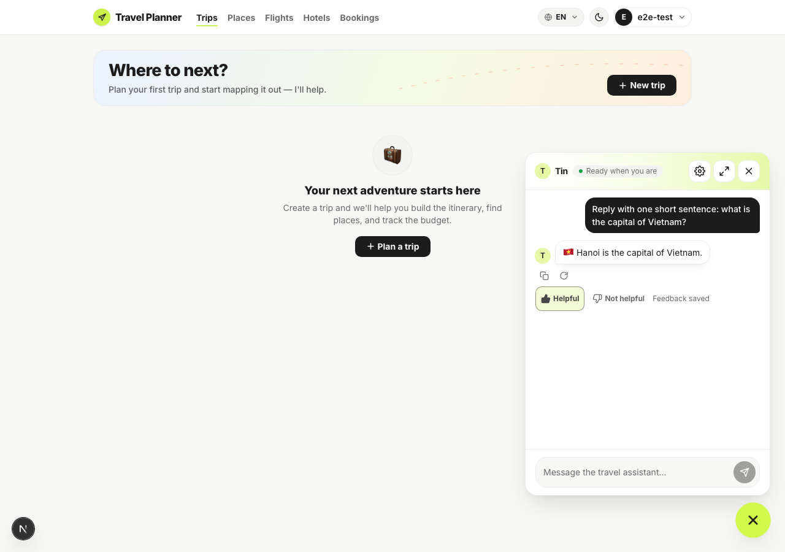
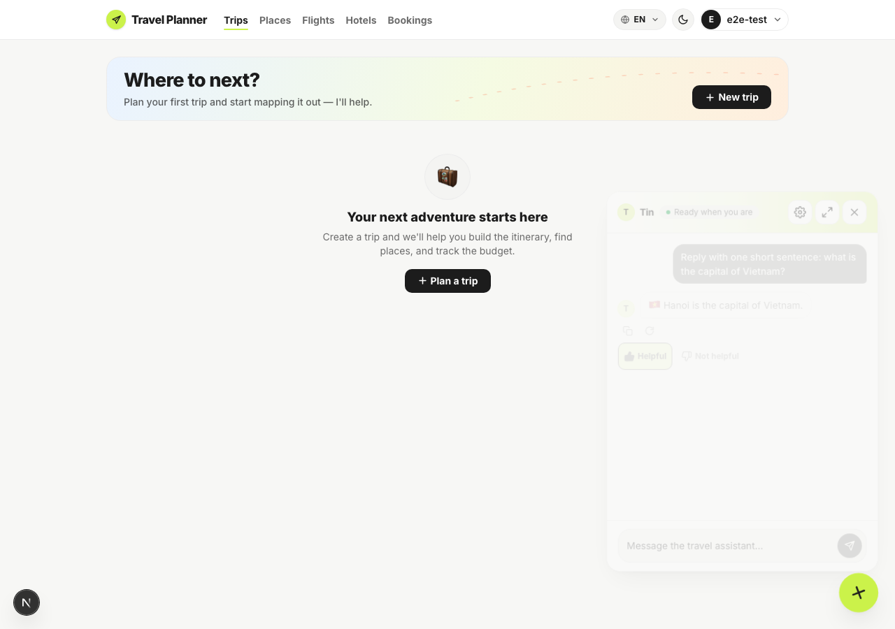
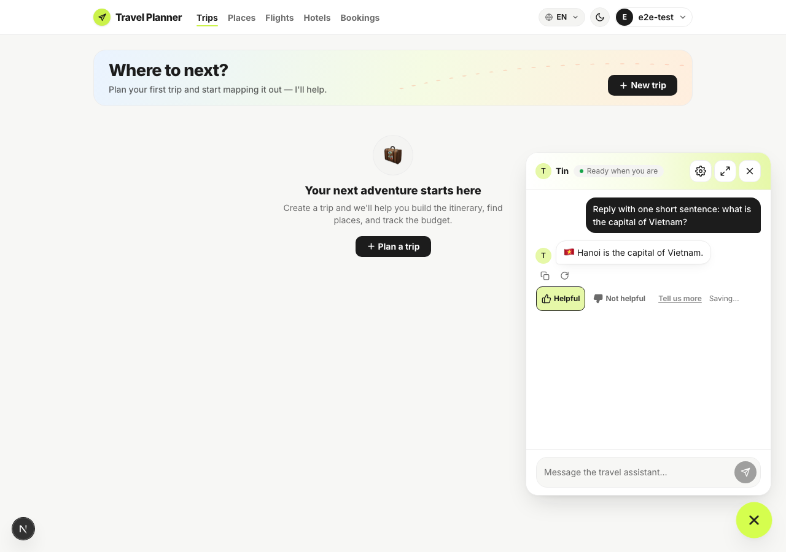
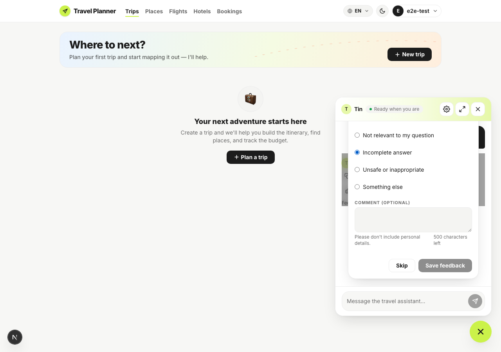
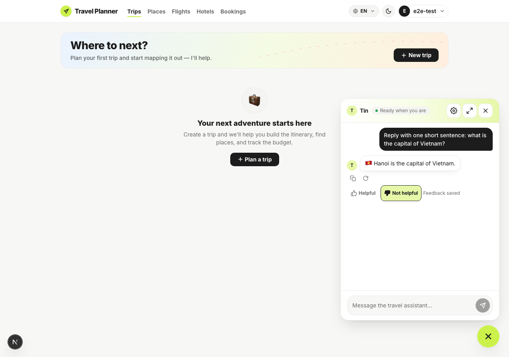
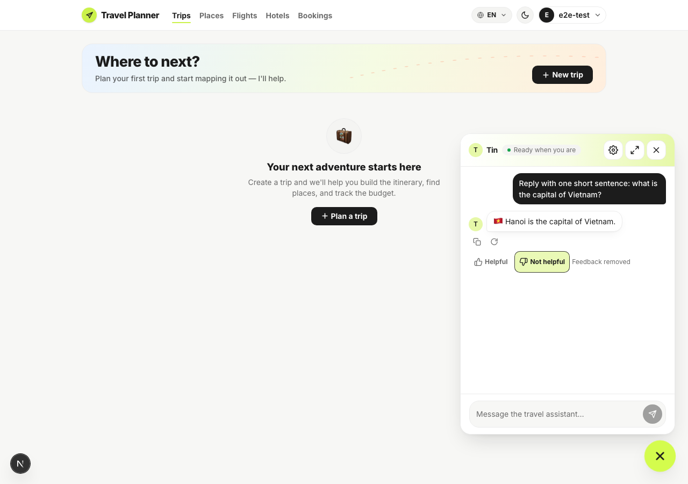
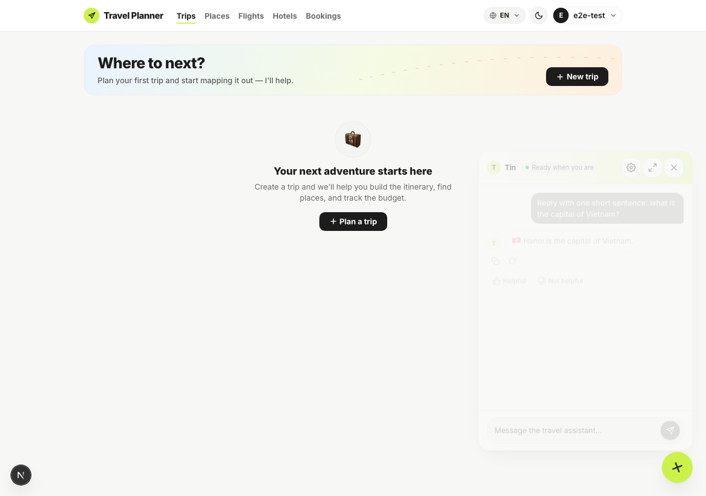

# Browser UAT — user-feedback-v1

Run 2026-09-12 against `feat/user-feedback-v1`, with the Next dev server on `:3000` and the API on
`:8000` (local uvicorn, a fresh SQLite database migrated to `d4f7a2c9e1b3`, a real OpenAI key).
Driven by [`run-uat.mjs`](run-uat.mjs) — playwright-core under Node 24, because the Playwright MCP
server is broken in this environment.

```bash
export PATH="$HOME/.nvm/versions/node/v24.17.0/bin:$PATH"
export E2E_USER_EMAIL=... E2E_USER_PASSWORD=...
cd apps/web && node ../specs/user-feedback-v1/uat/run-uat.mjs
```

This exercises the exact sequence `playwright/chat-feedback.spec.ts` asserts (DESIGN.md section 12)
in a real browser against a real signed-in account and a real chat reply, end to end:

| # | Case | Result |
|---|---|---|
| 1 | Sign in, open the assistant, send a message | Real LLM reply rendered |
| 2 | SSE `done` carries `assistant_message_id` | Captured: a UUID |
| 3 | Reload — history names the same message id | Confirmed |
| 4 | Rate Helpful | `aria-pressed=true`, "Feedback saved" announced |
| 5 | Reload — Helpful still pressed | Confirmed |
| 6 | Switch to Not helpful, open "Tell us more" | Reason dialog opens |
| 7 | Pick "Incomplete answer", save | `feedback_event_id` returned |
| 8 | Reload — state is `not_helpful` + `incomplete`, dialog trigger gone | Confirmed |
| 9 | Retract | Neither thumb selected, "Feedback removed" announced |
| 10 | Reload — still neither thumb selected | Confirmed |
| 11 | Replay the exact detail request | `200`, `replayed: true`, **same** `feedback_event_id` |
| 12 | Probe an unknown message id | `404`, same non-enumerating body |

Every check the script makes is a real assertion against the running API — it throws and captures
a failure screenshot if any of them do not hold. Both runs of this script (the second, after a
one-line URL fix, below) passed every check.

### 1 — Signed in



### 2 — Assistant open



### 3 — Reply, unrated



### 4 — Helpful saved



### 5 — Helpful persists after reload



### 6 — Switched to Not helpful



### 7 — Reason dialog



### 8 — Detail saved



### 9 — Detail persists after reload


### 10 — Retracted



### 11 — Retract persists after reload



## One bug this UAT found

The first run completed all 11 UI steps above, then failed at the final two API-only checks
(replay and the unknown-id probe) with `apiRequestContext.post: Invalid URL`. The script's own
`page.request.post(FEEDBACK_PATH, ...)` calls used the relative path only; unlike the reviewed
Playwright test (which gets a `baseURL` from `playwright.config.ts`), a bare `playwright-core`
context has none configured, so the relative path was never resolved against the running origin.
Fixed by prefixing both calls with `BASE`. This is a bug in the **UAT script**, not in the product —
the reviewed e2e spec was never affected, since it always runs through the configured `baseURL`.

## Environment notes

- The backend ran against a scratch SQLite database (`apps/api/uat.db`, gitignored, not part of
  this commit), migrated fresh to this branch's head so the run says nothing about any shared dev
  database.
- A real `OPENAI_API_KEY` is required: without one every turn takes the failure path and its reply
  is never rateable (see DESIGN.md section 3.1's rateable rule and the e2e spec's own skip guard).
- `E2E_USER_EMAIL` / `E2E_USER_PASSWORD` are read from the environment only; the script does not
  read `.env.local` itself.
